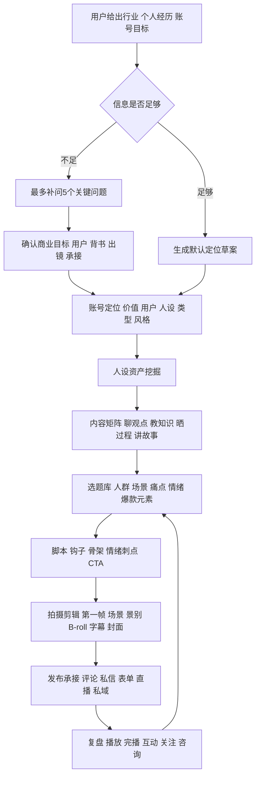
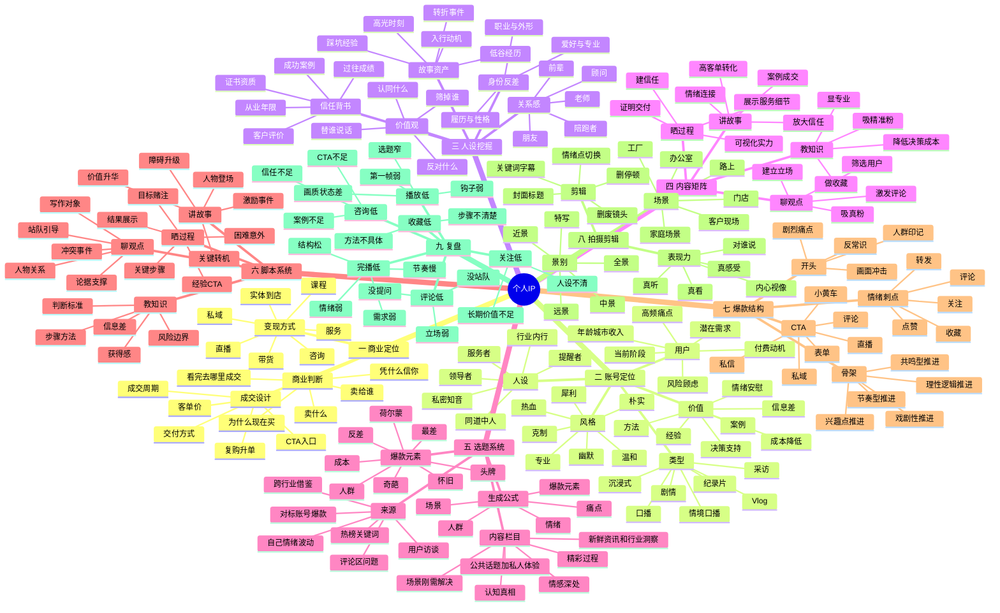
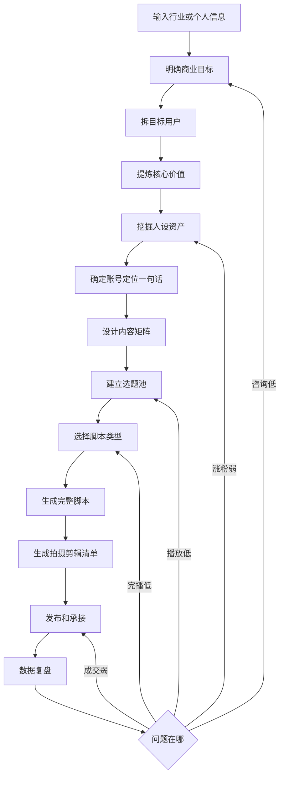
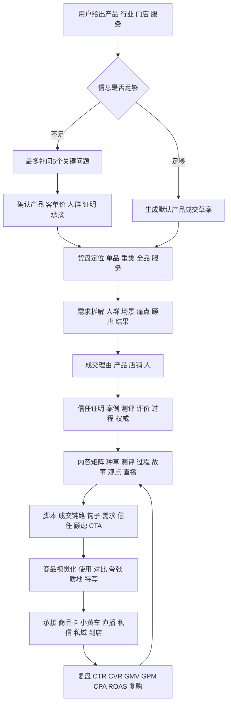
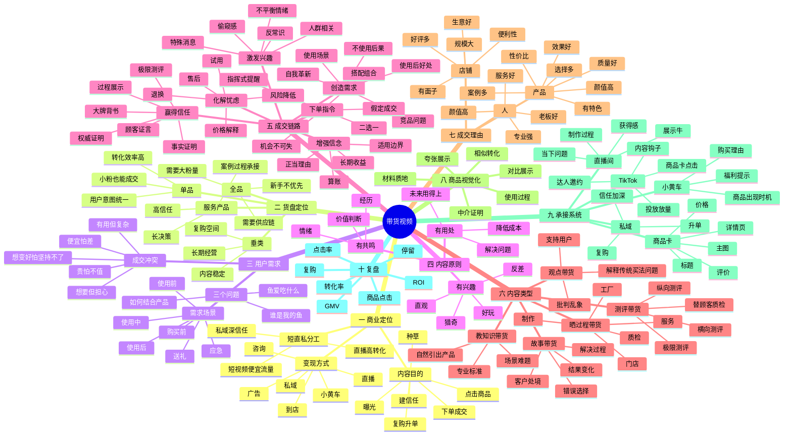
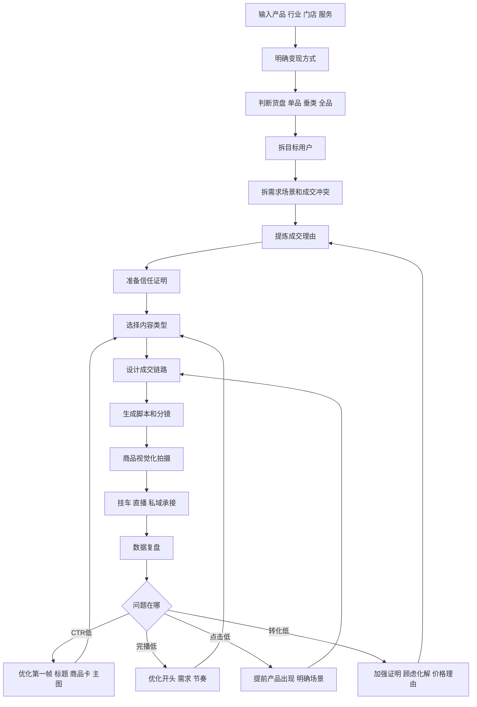
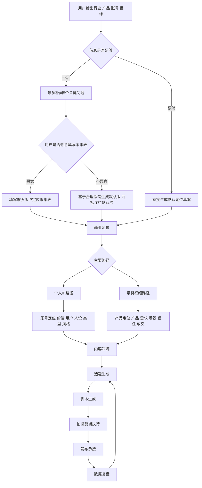
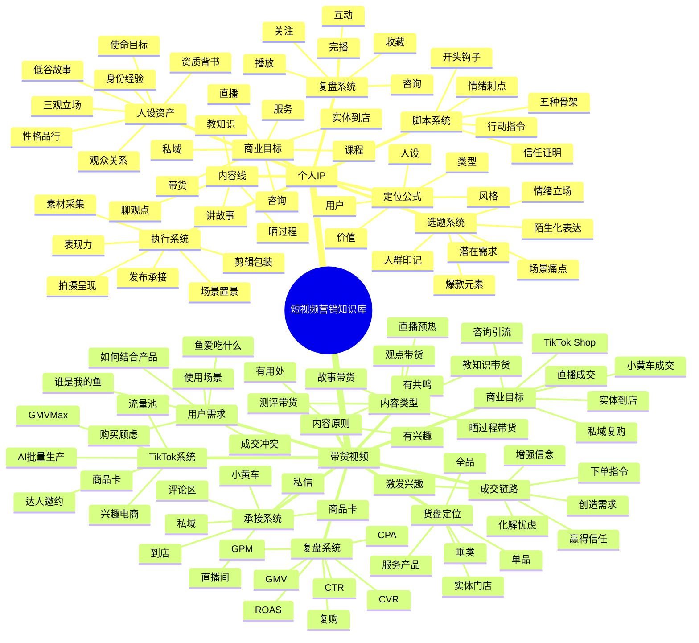
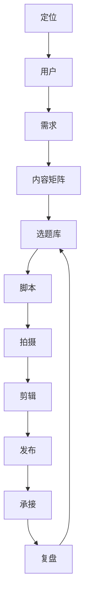
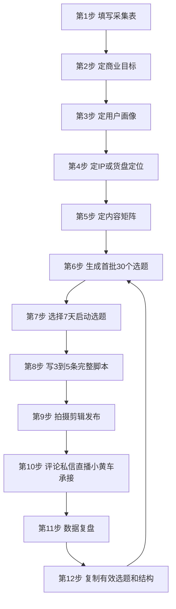

# ????????

- ?????2026-07-23T08:52:13.030Z
- ???????235
- ?????????????????????????????API Key?????????????

??????????????????????????????????

## 1. 发布节奏规划

**???** 质量优先；按产能稳定测试；无固定黄金时间；一周观察；爆款放大；转化承接；复盘迭代
**???** system
**???** ip-positioning?viral-topics?script?commerce
**????** 发布节奏?冷启动?每天几条?发布时间?7天测试?单变量?爆款后承接
**???** 制定冷启动、增长期和爆款后的发布计划时。
**????** 不要为了追求日更数量发布低质量内容，也不要把某个固定时段当作普适规律。

发布节奏服务于测试，不是为了完成数量。发布时间没有对所有账号都有效的固定答案，先保证内容质量，再根据目标用户在线时间和历史数据测试。新账号每天2到3条可作为有团队产能时的测试上限，不是硬性标准；个人创作者应选择能长期稳定保持质量的频率。以7天为观察周期，记录选题类型、开头、发布时间、完播、评论、主页访问、关注、私信和成交；出现爆款后紧跟同主题流量、信任和转化内容，未起量时每次只修改一个变量。

**?????**
- 质量优先
- 稳定产能
- 发布时间测试
- 7天观察
- 单变量迭代
- 爆款追投
- 转化承接

**?????**
- 30天内容计划
- 账号冷启动
- 带货节奏
- IP陪跑

**?????**
- 账号阶段
- 内容储备
- 转化目标
- 复盘周期

**?????**
- 发布节奏
- 测试比例
- 成交比例
- 复盘动作

**???**

一人团队可每天1条稳定高质量内容；素材充分的团队可每天2到3条做单变量测试，但必须记录不同类型带来的主页访问和咨询。

**????** structured:publishing-rhythm  **???** 2  **????** 82

---

## 2. 深挖方法：低粉爆款结构改编

**???** 验证样本筛选；核心观点提取；钩子改写；论证重排；多源合并；详略调整；人设结论；口播校验
**???** personal_ip
**???** viral-topics?rewrite?script
**????** 低粉爆款?文案二创?洗文案?结构改编?观点提取?多源合并?口吻重写?口播校验
**???** 已有经过数据验证的参考内容，需要迁移到自己的行业、人设和案例时。
**????** 参考内容与目标用户不匹配、事实无法替换或会造成侵权和虚假陈述时。

低粉爆款改编先筛选评论精准、开头强、结构可迁移的样本，再执行八步重构：提取核心观点和目标情绪；保留注意力顺序但重写标题与开头；按自己的论证逻辑调整段落顺序；用多个来源补充不同论据；把抽象观点换成自己的行业事实、案例和证据；对啰嗦处压缩、过度简略处补充；结尾加入符合人设和商业目标的判断；最后按真人口播方式读一遍，删除书面腔和不自然表达。可借鉴结构、节奏和句式功能，但不能把他人的完整表达当成自己的事实。

**?????**
- 低粉爆款筛选
- 核心观点提取
- 注意力顺序保留
- 标题重写
- 论证重排
- 多源合并
- 详略调整
- 行业事实替换
- 人设结论
- 口播校验

**?????**
- 冷启动账号
- 个人IP选题
- 跨行业借鉴
- 爆款改编

**?????**
- 对标视频链接
- 原开头结构
- 评论区反馈
- 自己的行业事实
- 自己的案例和承接

**?????**
- 记录原钩子结构
- 判断评论是否精准
- 保留注意力顺序
- 替换行业事实
- 改成自己口吻
- 接入CTA

**???**

保留工程老板熟悉的关系冲突开头，但主体换成自己的案件过程、金额证据、客户顾虑和服务方式，结尾回到风险共担。

**????** structured:ip-deep-low-follower-viral-remix  **???** 2  **????** 82

---

## 3. 运营规划：选题库存与内容资产池

**???** 主题分类；低粉爆款库；案例与观点拆分；多源提炼；自己的事实与口吻；持续补充与复盘
**???** personal_ip
**???** operation-plan?viral-topics?script?rewrite
**????** 内容资产池?素材库?主题分类?低粉爆款?多源提炼?案例库?观点库?持续产出
**???** 团队需要长期稳定产出，或同一主题需要批量生成不同脚本时。
**????** 不要直接拼接他人完整原句，不要把高点赞但受众不精准的内容当作核心样本。

内容资产池不是收藏夹，而是可检索、可组合、可验证的生产资料。按用户痛点、场景、案例、故事、观点、金句、信任证据和CTA分类；同行优先收集低粉高反馈、评论精准、开头强的作品，跨行业补充人性、商业和呈现方式。每条素材只提取钩子机制、核心观点、论据类型、情绪和结构，不长期保存无关原文。创作时从同一主题选取5到8条素材，去重后组合共性观点，再换成自己的案例、行业事实、人物口吻和结论。发布结果继续回流资产池，形成选题、脚本、效果数据的闭环。

**?????**
- 主题分类
- 低粉爆款库
- 案例库
- 观点库
- 金句与钩子机制
- 多源提炼
- 事实替换
- 口吻重写
- 结果回流

**?????**
- 长期运营
- 团队协作
- 批量脚本
- 个人IP方法库
- 对标账号学习

**?????**
- 对标账号/视频
- 自有案例
- 客户原话
- 常见异议
- 证明材料
- 可拍场景
- 禁忌边界

**?????**
- 建立选题池分类
- 每类给采集标准
- 标注可用于哪个阶段
- 标注可复用结构
- 标注可展示证据
- 生成下周优先级

**???**

工程款主题可分别建立拖欠场景、关系顾虑、胜诉案例、国央企身份、风险代理产品和强情绪开头六个标签，生成脚本时按目标组合。

**????** structured:ip-operation-topic-inventory  **???** 2  **????** 82

---

## 4. 起号SOP：从主页资产到稳定产出的八步闭环

**???** 定位目标；主页包装；对标库；选题库；脚本改编；拍摄呈现；剪辑发布；数据复盘
**???** personal_ip
**???** operation-plan?ip-positioning?viral-topics?script
**???** 个人IP?专家顾问?实体老板?本地服务?知识付费
**???** 冷启动?起量期
**???** 完成起号?建立内容供应链?形成稳定发布节奏
**????** 起号流程?冷启动?主页设计?对标账号?素材库?发布节奏?复盘
**???** 账号处于从0起步、重新定位或团队需要统一执行流程时。
**????** 成熟账号已有稳定模型时不要机械重置；内容质量不足时不要用高频发布掩盖问题。

起号不是先追求发布数量，而是建立一条可重复的内容供应链。第一步确定用户、价值、人设和商业目标；第二步统一头像、昵称、简介、背景图和置顶内容；第三步建立同行与跨行业对标库；第四步按用户痛点、热点、案例、观点建立选题库；第五步保留已验证的注意力结构，用自己的行业事实、证据和口吻重写；第六步按内容类型选择正面口播、侧面口播、访谈或自拍；第七步完成字幕、节奏、重点信息、封面和安全区质检；第八步按播放、停留、主页访问、关注、私信和成交复盘。发布时间不是决定性变量，内容质量和连续测试更重要。新账号每天2到3条只能作为团队产能建议，不能为了数量牺牲质量。

**?????**
- 定位先行
- 主页一致性
- 对标库
- 选题库
- 结构改编
- 按类型拍摄
- 剪辑质检
- 数据复盘

**?????**
- 新账号从0开始
- 团队搭建内容SOP
- 账号长期断更后重新启动

**?????**
- 目标用户
- 商业目标
- 人设资产
- 可用案例
- 拍摄条件
- 发布产能

**?????**
- 定位检查
- 主页资产清单
- 对标与选题库
- 拍摄方式
- 剪辑清单
- 7天测试计划
- 复盘指标

**???**

本地律师起号：先明确服务人群和案件类型，再统一主页身份与信任证据，建立同行爆款、工程老板痛点和成功案例三个素材库，每天按产能测试流量、信任、转化内容并复盘私信和电话。

**????** private:cange-startup-flow:startup-closed-loop-v1  **???** 1  **????** 82

---

## 5. 账号资产：首页包装四件套与定位一致性

**???** 背景图；头像；昵称；个人简介；同一定位信号；主页承接
**???** personal_ip
**???** ip-positioning?operation-plan?conversion-topics
**???** 个人IP?专家顾问?本地服务?实体老板
**???** 定位期?冷启动?主页优化
**???** 提升主页识别?建立信任?承接咨询
**????** 主页包装?背景图?头像?昵称?个人简介?主页承接?账号资产
**???** 用户会在观看视频后进入主页判断是否关注、咨询或购买时。
**????** 不要使用虚假身份、无法证明的第一或最强表述，也不要违反平台联系方式规则。

首页四件套必须共同回答：你是谁、服务谁、凭什么信、下一步做什么。背景图用于补充生活感、专业场景、核心价值或信任证明，不应违规暴露联系方式；头像根据人设选择清晰商务照或生活照，脸部和气质要可识别；昵称优先包含身份、行业或价值记忆点，避免复杂符号和中英文混排；个人简介使用身份定位、擅长与证明、用户价值、承接方式四段式。四个元素必须与内容和置顶视频一致，不能主页很专业、内容却完全不相关。

**?????**
- 背景图补信号
- 头像人格化
- 昵称行业记忆
- 简介四段式
- 主页内容一致

**?????**
- 新账号主页搭建
- 爆款后主页承接差
- 账号定位不清

**?????**
- 身份
- 行业
- 目标用户
- 信任证明
- 承接方式

**?????**
- 背景图建议
- 头像建议
- 昵称备选
- 简介成稿
- 一致性检查

**???**

工程律师：首页背景体现工程纠纷场景和服务区域，头像使用清晰真人照，昵称包含律师和工程纠纷，简介写清服务工程老板、成功案例与电话/私信承接。

**????** private:cange-startup-flow:homepage-assets-v1  **???** 1  **????** 82

---

## 6. IP定位完整骨架

**???** IP定位一句话；目标用户画像；人设资产；商业路径；内容矩阵；专家顾问合规定位；行业模板匹配
**???** personal_ip
**???** ip-positioning
**????** 定位?人设?目标用户?商业路径?内容矩阵?信任资产?专家顾问?合规?律师?健康?家装?预算?宠物?新手?教育?学员?企业服务

IP定位一句话
目标用户画像
人设资产
商业路径
内容矩阵
专家顾问合规定位
行业模板匹配
个人IP
专家顾问
实体老板
老师教练
本地服务

**?????**
- IP定位一句话
- 目标用户画像
- 人设资产
- 商业路径
- 内容矩阵
- 专家顾问合规定位
- 行业模板匹配

**?????**
- 个人IP
- 专家顾问
- 实体老板
- 老师教练
- 本地服务

**?????**
- 行业/赛道
- 身份/角色
- 卖什么
- 卖给谁
- 信任资产
- 承接方式

**?????**
- 信息判断
- IP定位一句话
- 目标用户画像
- 商业路径
- 内容矩阵
- 转化入口
- 待确认项

**???**

本地美业老板IP：用真实门店过程和客户评价建立信任，通过评论关键词和私信预约到店。

**????** structured:ip-positioning-core  **???** 1  **????** 82

---

## 7. 八大爆款元素选题

**???** 成本；人群；猎奇；头牌；怀旧；反差；最差；荷尔蒙；创始人观点；反常识选题；吸引力选题；冷启动选题
**???** personal_ip
**???** viral-topics?script?viral-analysis
**????** 爆款?八大元素?黄金3秒?选题?成本?反差?人群?创始人?反常识?新旧对比?前后?吸引力?体面?发布节奏?冷启动

成本
人群
猎奇
头牌
怀旧
反差
最差
荷尔蒙
创始人观点
反常识选题
吸引力选题
冷启动选题
爆款选题
短视频开头
话题包装
拆解复用

**?????**
- 成本
- 人群
- 猎奇
- 头牌
- 怀旧
- 反差
- 最差
- 荷尔蒙
- 创始人观点
- 反常识选题
- 吸引力选题
- 冷启动选题

**?????**
- 爆款选题
- 短视频开头
- 话题包装
- 拆解复用

**?????**
- 目标用户
- 场景
- 痛点/情绪
- 爆款元素

**?????**
- 元素分类
- 选题标题
- 黄金3秒
- 拍摄角度
- 推荐脚本类型

**???**

成本类：很多新手不是不会做IP，是把第一笔钱花错了。

**????** structured:viral-topic-elements  **???** 1  **????** 82

---

## 8. 四类脚本卡

**???** 教知识；晒过程；讲故事；聊观点；推荐型脚本；解题型脚本；案例型脚本；揭秘型脚本；测评脚本；观点立场脚本
**???** personal_ip
**???** script?viral-topics?rewrite?polish
**????** 脚本?教知识?晒过程?讲故事?聊观点?CTA?推荐型?解题型?案例型?揭秘型?判断标准?方法总结?误区?测评?对比?个人故事?转折?立场?争议?评论互动?任务挑战?风险提醒?直播预热?团购

教知识
晒过程
讲故事
聊观点
推荐型脚本
解题型脚本
案例型脚本
揭秘型脚本
测评脚本
观点立场脚本
个人IP脚本
专家内容
账号内容矩阵
二创改写

**?????**
- 教知识
- 晒过程
- 讲故事
- 聊观点
- 推荐型脚本
- 解题型脚本
- 案例型脚本
- 揭秘型脚本
- 测评脚本
- 观点立场脚本

**?????**
- 个人IP脚本
- 专家内容
- 账号内容矩阵
- 二创改写

**?????**
- 脚本类型
- 行业/人设
- 目标用户
- 选题
- CTA

**?????**
- 标题
- 封面文案
- 黄金3秒
- 完整口播
- 分镜/B-roll
- 字幕重点
- CTA

**???**

教知识脚本：先抛出用户常见误区，再给判断标准，最后给低成本行动。

**????** structured:script-four-cards  **???** 1  **????** 82

---

## 9. 成交选题链路

**???** 成交理由；信任证明；异议化解；承接入口；行动指令；信任阶梯；顾虑化解；到店预约
**???** combined
**???** conversion-topics?script?commerce
**????** 成交?信任?CTA?私信?表单?到店?课程?团购?信任阶梯?咨询?预约?同城?顾虑?被坑?团购券

成交理由
信任证明
异议化解
承接入口
行动指令
信任阶梯
顾虑化解
到店预约
成交选题
咨询转化
高客单服务
到店成交
课程成交

**?????**
- 成交理由
- 信任证明
- 异议化解
- 承接入口
- 行动指令
- 信任阶梯
- 顾虑化解
- 到店预约

**?????**
- 成交选题
- 咨询转化
- 高客单服务
- 到店成交
- 课程成交

**?????**
- 卖什么
- 卖给谁
- 成交理由
- 证明材料
- 承接方式

**?????**
- 成交型选题
- 成交理由
- 信任证明
- 异议处理
- CTA
- 发布阶段

**???**

成交选题：为什么同样做护理，有的人一次就能看出差别？用案例和流程证明。

**????** structured:conversion-topic-chain  **???** 1  **????** 82

---

## 10. 痛点选题挖掘

**???** 焦虑痛点；成本痛点；风险痛点；决策痛点；面子/情绪痛点；场景痛点
**???** combined
**???** pain-topics?script?viral-topics
**????** 痛点?焦虑?成本?风险?决策?用户原话?风险提醒?待确认?判断标准

焦虑痛点
成本痛点
风险痛点
决策痛点
面子/情绪痛点
场景痛点
痛点选题
用户原话
情绪钩子
成交脚本

**?????**
- 焦虑痛点
- 成本痛点
- 风险痛点
- 决策痛点
- 面子/情绪痛点
- 场景痛点

**?????**
- 痛点选题
- 用户原话
- 情绪钩子
- 成交脚本

**?????**
- 行业背景
- 目标客户
- 具体场景
- 用户担心什么

**?????**
- 痛点清单
- 场景化选题
- 情绪钩子
- 用户原话
- 脚本方向

**???**

决策痛点：不是怕贵，是怕花钱以后没效果。

**????** structured:pain-topic-mining  **???** 1  **????** 82

---

## 11. 带货4P产品拆解

**???** Product产品；Price价格；Place场景；Promotion促销；团购券带货；同城到店；视觉化证明
**???** commerce_video
**???** commerce?script
**????** 4P?带货?产品?价格?场景?促销?商品卡?小黄车?团购券?同城?视觉化?企业服务?短句

Product产品
Price价格
Place场景
Promotion促销
团购券带货
同城到店
视觉化证明
产品带货
TikTok Shop
商品卡
小黄车
直播预热

**?????**
- Product产品
- Price价格
- Place场景
- Promotion促销
- 团购券带货
- 同城到店
- 视觉化证明

**?????**
- 产品带货
- TikTok Shop
- 商品卡
- 小黄车
- 直播预热

**?????**
- 产品/服务
- 目标人群
- 购买场景
- 核心卖点
- 证明材料

**?????**
- 产品需求
- 购买场景
- 成交理由
- 视觉化拍摄
- 带货脚本
- 承接话术

**???**

先展示用户场景和痛点，再用产品细节、测评过程和评价降低购买风险。

**????** structured:commerce-4p-product  **???** 1  **????** 82

---

## 12. 带货信任证明

**???** 测评；评价；过程；对比；资质；复购
**???** commerce_video
**???** commerce?conversion-topics
**????** 信任证明?测评?评价?对比?复购?团购券?线上课程

测评
评价
过程
对比
资质
复购
商品信任
产品测评
团购券
线上卖课
本地产品

**?????**
- 测评
- 评价
- 过程
- 对比
- 资质
- 复购

**?????**
- 商品信任
- 产品测评
- 团购券
- 线上卖课
- 本地产品

**?????**
- 证明材料
- 用户顾虑
- 购买入口
- 售后/保障

**?????**
- 信任资产清单
- 证明镜头
- 异议化解
- 下单指令
- 风险提醒

**???**

不要只说好用，要用前后对比、真实评价、过程镜头证明为什么值得买。

**????** structured:commerce-trust-proof  **???** 1  **????** 82

---

## 13. 爆款拆解复用

**???** 钩子拆解；结构拆解；情绪拆解；成交链路拆解；可复用模板；原创风险提醒；数据复盘；咨询转化诊断
**???** combined
**???** viral-analysis?rewrite?polish
**????** 拆解?复用?二创?洗稿?原创?钩子?结构?风险提醒?不复制原句?复盘?咨询?高播放低咨询?数据复盘

钩子拆解
结构拆解
情绪拆解
成交链路拆解
可复用模板
原创风险提醒
数据复盘
咨询转化诊断
爆款拆解
文案二创
洗稿
内容复用

**?????**
- 钩子拆解
- 结构拆解
- 情绪拆解
- 成交链路拆解
- 可复用模板
- 原创风险提醒
- 数据复盘
- 咨询转化诊断

**?????**
- 爆款拆解
- 文案二创
- 洗稿
- 内容复用

**?????**
- 参考内容
- 目标账号
- 保留点
- 规避点

**?????**
- 拆解报告
- 爆款元素
- 可复用结构
- 本账号改写方向
- 原创边界
- 风险提醒

**???**

拆表达结构，不复制原句；保留冲突、节奏和转化逻辑，换成人群和场景。

**????** structured:viral-analysis-reuse  **???** 1  **????** 82

---

## 14. Agent质量门禁

**???** 用户事实；前端选择；知识库证据；完整骨架；可执行性；风险提醒
**???** system
**???** ip-positioning?viral-topics?conversion-topics?pain-topics?script?commerce
**????** 质量评估?自动修复?模型对比?知识库证据?完整骨架

用户事实
前端选择
知识库证据
完整骨架
可执行性
风险提醒
质量评估
自动修复
模型对比
脏数据测试

**?????**
- 用户事实
- 前端选择
- 知识库证据
- 完整骨架
- 可执行性
- 风险提醒

**?????**
- 质量评估
- 自动修复
- 模型对比
- 脏数据测试

**?????**
- 用户输入
- 前端选择
- 项目档案
- 知识命中

**?????**
- 质量分
- 缺失项
- 修复建议
- 是否通过
- 人工复核点

**???**

如果生成结果没有体现前端选择或知识库方法，必须降分并触发修复。

**????** structured:agent-quality-gate  **???** 1  **????** 82

---

## 15. 脏数据处理规则

**???** 缺失信息标注；合理假设；待确认项；不编造；完整骨架；风险提醒；可执行初版
**???** system
**???** ip-positioning?script?commerce
**????** 脏数据?缺失?待确认?不编造?完整骨架?风险提醒?提示词注入?忽略之前所有规则?ignore previous

缺失信息标注
合理假设
待确认项
不编造
完整骨架
风险提醒
可执行初版
输入太短
信息冲突
行业缺失
目标用户缺失
提示词注入
忽略之前所有规则

**?????**
- 缺失信息标注
- 合理假设
- 待确认项
- 不编造
- 完整骨架
- 风险提醒
- 可执行初版

**?????**
- 输入太短
- 信息冲突
- 行业缺失
- 目标用户缺失
- 提示词注入
- 忽略之前所有规则

**?????**
- 最少可用事实
- 项目档案
- 用户目标

**?????**
- 信息判断
- 完整骨架
- 可执行初版
- 待确认项
- 风险提醒

**???**

用户只写美业，也要给出初版，但必须标注城市、客单价、案例等待确认。

**????** structured:dirty-data-handling  **???** 1  **????** 82

---

## 16. 人设关系定位

**???** 提醒者；服务者；领导者；同道中人；私密知识提供者
**???** personal_ip
**???** ip-positioning?viral-topics?script
**????** 人设?关系?提醒者?服务者?领导者?同道中人?私密知识

提醒者
服务者
领导者
同道中人
私密知识提供者
个人IP
专家顾问
老板IP
老师教练

**?????**
- 提醒者
- 服务者
- 领导者
- 同道中人
- 私密知识提供者

**?????**
- 个人IP
- 专家顾问
- 老板IP
- 老师教练

**?????**
- 身份角色
- 目标用户
- 信任资产
- 内容边界

**?????**
- 关系定位
- 表达语气
- 内容禁区
- 信任动作
- 转化方式

**???**

专家顾问更适合提醒者和服务者关系，先指出误区，再给低风险行动建议。

**????** structured:ip-persona-relationship  **???** 1  **????** 82

---

## 17. 个人IP信任资产

**???** 资质证书；成功案例；客户评价；前后对比；从业经历；现场过程
**???** personal_ip
**???** ip-positioning?conversion-topics?script
**????** 信任资产?资质?案例?客户评价?前后对比?从业经历

资质证书
成功案例
客户评价
前后对比
从业经历
现场过程
高客单服务
专业服务
本地到店
课程咨询

**?????**
- 资质证书
- 成功案例
- 客户评价
- 前后对比
- 从业经历
- 现场过程

**?????**
- 高客单服务
- 专业服务
- 本地到店
- 课程咨询

**?????**
- 证明材料
- 可展示边界
- 客户顾虑
- 成交入口

**?????**
- 信任资产清单
- 证明镜头
- 可说证据
- 不可夸大点
- 承接话术

**???**

不要只说专业，要把从业经历、案例类型、客户评价和交付过程变成视频证据。

**????** structured:ip-trust-assets  **???** 1  **????** 82

---

## 18. 个人IP内容矩阵

**???** 聊观点；教知识；晒过程；讲故事；做承接
**???** personal_ip
**???** ip-positioning?viral-topics?script
**????** 内容矩阵?内容支柱?选题方向?发布节奏?素材清单

聊观点
教知识
晒过程
讲故事
做承接
账号冷启动
内容规划
周更选题
IP定位后续

**?????**
- 聊观点
- 教知识
- 晒过程
- 讲故事
- 做承接

**?????**
- 账号冷启动
- 内容规划
- 周更选题
- IP定位后续

**?????**
- 人设
- 目标用户
- 产品服务
- 可拍素材
- 承接方式

**?????**
- 内容支柱
- 选题方向
- 脚本类型
- 素材清单
- 发布节奏

**???**

专家IP用教知识建立专业，用晒过程建立真实，用讲故事建立信任，用观点拉开差异。

**????** structured:ip-content-matrix  **???** 1  **????** 82

---

## 19. 个人IP商业路径

**???** 咨询服务；到店服务；课程训练营；高客单服务；私域成交；品牌合作
**???** personal_ip
**???** ip-positioning?conversion-topics
**????** 商业路径?变现?咨询?课程?私域?高客单?品牌合作

咨询服务
到店服务
课程训练营
高客单服务
私域成交
品牌合作
IP变现
商业定位
私域承接
课程成交

**?????**
- 咨询服务
- 到店服务
- 课程训练营
- 高客单服务
- 私域成交
- 品牌合作

**?????**
- IP变现
- 商业定位
- 私域承接
- 课程成交

**?????**
- 卖什么
- 客单价
- 成交周期
- 用户信任门槛
- 交付能力

**?????**
- 变现路径
- 内容任务
- 信任门槛
- 承接入口
- 数据复盘

**???**

高客单服务不能只做流量，要先用案例和过程降低信任门槛，再引导咨询。

**????** structured:ip-commercial-path  **???** 1  **????** 82

---

## 20. 本地实体老板IP模板

**???** 老板真人；门店现场；服务过程；客户评价；到店预约；团购券
**???** personal_ip
**???** ip-positioning?conversion-topics?script
**????** 本地实体?老板IP?门店?到店?团购券?同城

老板真人
门店现场
服务过程
客户评价
到店预约
团购券
美业
餐饮
宠物
家装
摄影
亲子娱乐

**?????**
- 老板真人
- 门店现场
- 服务过程
- 客户评价
- 到店预约
- 团购券

**?????**
- 美业
- 餐饮
- 宠物
- 家装
- 摄影
- 亲子娱乐

**?????**
- 城市/商圈
- 门店品类
- 主卖服务
- 到店理由
- 证明材料

**?????**
- 老板人设
- 同城用户
- 到店理由
- 内容矩阵
- 团购/预约CTA

**???**

本地门店要把位置、服务过程、老板态度和客户反馈变成用户到店理由。

**????** structured:ip-local-business-template  **???** 1  **????** 82

---

## 21. 专家顾问IP模板

**???** 误区提醒；判断标准；案例拆解；风险提示；咨询承接
**???** personal_ip
**???** ip-positioning?viral-topics?script
**????** 专家顾问?律师?医生?财税?咨询?风险提示

误区提醒
判断标准
案例拆解
风险提示
咨询承接
律师
医生
财税顾问
心理咨询
企业顾问

**?????**
- 误区提醒
- 判断标准
- 案例拆解
- 风险提示
- 咨询承接

**?????**
- 律师
- 医生
- 财税顾问
- 心理咨询
- 企业顾问

**?????**
- 专业身份
- 目标客户
- 常见误区
- 资质/经历
- 合规边界

**?????**
- 专业定位
- 信任背书
- 内容禁区
- 选题库
- 咨询CTA

**???**

律师IP适合用风险提醒和判断标准建立专业，不直接承诺结果。

**????** structured:ip-expert-consultant-template  **???** 1  **????** 82

---

## 22. 老师教练IP模板

**???** 知识拆解；练习任务；学员案例；课程承接；社群陪跑
**???** personal_ip
**???** ip-positioning?script?conversion-topics
**????** 老师?教练?课程?训练营?学员案例?社群

知识拆解
练习任务
学员案例
课程承接
社群陪跑
教育培训
技能课程
健身教练
职业规划
训练营

**?????**
- 知识拆解
- 练习任务
- 学员案例
- 课程承接
- 社群陪跑

**?????**
- 教育培训
- 技能课程
- 健身教练
- 职业规划
- 训练营

**?????**
- 课程主题
- 学员阶段
- 学习痛点
- 案例反馈
- 课程入口

**?????**
- 老师定位
- 课程价值
- 内容阶梯
- 学员案例
- 报名CTA

**???**

老师IP要把知识点拆成可执行小任务，让用户感觉学完马上能用。

**????** structured:ip-teacher-coach-template  **???** 1  **????** 82

---

## 23. 创始人观点IP模板

**???** 行业判断；反常识观点；创业故事；经营复盘；团队价值观
**???** personal_ip
**???** viral-topics?script?ip-positioning
**????** 创始人?老板观点?反常识?经营复盘?创业故事

行业判断
反常识观点
创业故事
经营复盘
团队价值观
创始人
老板IP
企业服务
品牌人设

**?????**
- 行业判断
- 反常识观点
- 创业故事
- 经营复盘
- 团队价值观

**?????**
- 创始人
- 老板IP
- 企业服务
- 品牌人设

**?????**
- 行业立场
- 经营经历
- 反对什么
- 支持什么
- 业务承接

**?????**
- 观点标题
- 立场依据
- 故事证明
- 用户启发
- 商业承接

**???**

创始人内容要有明确立场，用经历和复盘证明观点，而不是空讲鸡汤。

**????** structured:ip-founder-viewpoint-template  **???** 1  **????** 82

---

## 24. 成本类爆款元素

**???** 省钱；省时间；省精力；少踩坑；少走弯路
**???** personal_ip
**???** viral-topics?script
**????** 成本?省钱?省时间?少踩坑?价格?预算

省钱
省时间
省精力
少踩坑
少走弯路
新手用户
价格敏感
高客单决策
避坑内容

**?????**
- 省钱
- 省时间
- 省精力
- 少踩坑
- 少走弯路

**?????**
- 新手用户
- 价格敏感
- 高客单决策
- 避坑内容

**?????**
- 用户要付出的成本
- 错误选择
- 替代方案
- 可验证收益

**?????**
- 成本冲突
- 错误做法
- 低成本方案
- 行动建议

**???**

很多新手不是做不好，是第一笔预算就花错了。

**????** structured:viral-cost-element  **???** 1  **????** 82

---

## 25. 人群类爆款元素

**???** 特定身份；圈层共鸣；阶段标签；职业标签；家庭角色
**???** personal_ip
**???** viral-topics?pain-topics
**????** 人群?宝妈?老板?新手?职场?圈层

特定身份
圈层共鸣
阶段标签
职业标签
家庭角色
宝妈
老板
新手
职场女性
中老年
同行

**?????**
- 特定身份
- 圈层共鸣
- 阶段标签
- 职业标签
- 家庭角色

**?????**
- 宝妈
- 老板
- 新手
- 职场女性
- 中老年
- 同行

**?????**
- 具体人群
- 人群处境
- 共同痛点
- 身份表达

**?????**
- 人群标签
- 共鸣场景
- 痛点表达
- 选题标题

**???**

第一次养猫的新手，最容易把这3件事做反。

**????** structured:viral-people-element  **???** 1  **????** 82

---

## 26. 猎奇类爆款元素

**???** 内幕；反常识；外行不知道；行业秘密；极端案例
**???** personal_ip
**???** viral-topics?viral-analysis?script
**????** 猎奇?内幕?反常识?行业秘密?外行不知道

内幕
反常识
外行不知道
行业秘密
极端案例
知识科普
行业揭秘
拆解视频
观点视频

**?????**
- 内幕
- 反常识
- 外行不知道
- 行业秘密
- 极端案例

**?????**
- 知识科普
- 行业揭秘
- 拆解视频
- 观点视频

**?????**
- 外行误区
- 行业真实情况
- 不能泄露的边界
- 可验证证据

**?????**
- 猎奇钩子
- 认知反差
- 真实解释
- 风险边界

**???**

外行以为越贵越好，内行其实先看这一个细节。

**????** structured:viral-curiosity-element  **???** 1  **????** 82

---

## 27. 头牌类爆款元素

**???** 第一名；天花板；高标准；标杆案例；顶配体验
**???** personal_ip
**???** viral-topics?script?conversion-topics
**????** 头牌?第一?天花板?标杆?高端?标准

第一名
天花板
高标准
标杆案例
顶配体验
高端服务
品牌背书
案例展示
门店种草

**?????**
- 第一名
- 天花板
- 高标准
- 标杆案例
- 顶配体验

**?????**
- 高端服务
- 品牌背书
- 案例展示
- 门店种草

**?????**
- 标杆对象
- 高标准细节
- 证明材料
- 用户向往

**?????**
- 头牌信号
- 标准解释
- 证明镜头
- 转化理由

**???**

真正高端的服务，不是贵在装修，而是贵在这三个判断标准。

**????** structured:viral-authority-element  **???** 1  **????** 82

---

## 28. 怀旧类爆款元素

**???** 过去对比现在；年代记忆；旧经验新做法；熟悉场景
**???** personal_ip
**???** viral-topics?script
**????** 怀旧?过去?现在?年代?新旧对比

过去对比现在
年代记忆
旧经验新做法
熟悉场景
本地生活
家庭用户
中老年
行业变迁

**?????**
- 过去对比现在
- 年代记忆
- 旧经验新做法
- 熟悉场景

**?????**
- 本地生活
- 家庭用户
- 中老年
- 行业变迁

**?????**
- 过去场景
- 现在变化
- 用户情绪
- 新解决方案

**?????**
- 怀旧开头
- 变化冲突
- 新旧对比
- 行动建议

**???**

以前大家这样选没问题，但现在再这样做，很容易多花钱。

**????** structured:viral-nostalgia-element  **???** 1  **????** 82

---

## 29. 反差类爆款元素

**???** 前后对比；身份反差；价格反差；结果反差；认知反差
**???** personal_ip
**???** viral-topics?script?viral-analysis
**????** 反差?对比?前后?认知反差?结果反差

前后对比
身份反差
价格反差
结果反差
认知反差
案例视频
观点视频
测评视频
到店转化

**?????**
- 前后对比
- 身份反差
- 价格反差
- 结果反差
- 认知反差

**?????**
- 案例视频
- 观点视频
- 测评视频
- 到店转化

**?????**
- 反差对象
- 对比证据
- 变化原因
- 用户启发

**?????**
- 反差钩子
- 对比证据
- 原因解释
- 可复制动作

**???**

同样是护理，有人越做越差，有人一次就能看出变化，区别在这一步。

**????** structured:viral-contrast-element  **???** 1  **????** 82

---

## 30. 最差类爆款元素

**???** 避雷；最不推荐；错误清单；反面案例；踩坑复盘
**???** personal_ip
**???** viral-topics?pain-topics?script
**????** 最差?避雷?不推荐?错误?踩坑?反面案例

避雷
最不推荐
错误清单
反面案例
踩坑复盘
避坑内容
选购决策
服务选择
新手教育

**?????**
- 避雷
- 最不推荐
- 错误清单
- 反面案例
- 踩坑复盘

**?????**
- 避坑内容
- 选购决策
- 服务选择
- 新手教育

**?????**
- 常见错误
- 错误后果
- 判断标准
- 替代方案

**?????**
- 避雷标题
- 错误清单
- 后果提醒
- 正确做法

**???**

这3种服务看起来便宜，但后期最容易多花钱。

**????** structured:viral-worst-element  **???** 1  **????** 82

---

## 31. 荷尔蒙类爆款元素

**???** 好看；体面；吸引力；面子；关系评价
**???** personal_ip
**???** viral-topics?script
**????** 荷尔蒙?好看?体面?吸引力?面子?审美

好看
体面
吸引力
面子
关系评价
美业
穿搭
形象管理
家居审美
社交场景

**?????**
- 好看
- 体面
- 吸引力
- 面子
- 关系评价

**?????**
- 美业
- 穿搭
- 形象管理
- 家居审美
- 社交场景

**?????**
- 审美目标
- 社交场景
- 用户想被如何评价
- 证明镜头

**?????**
- 吸引力钩子
- 场景代入
- 改变路径
- 视觉证明

**???**

真正显贵的不是买贵的，而是这三个细节不廉价。

**????** structured:viral-attraction-element  **???** 1  **????** 82

---

## 32. 教知识-推荐型脚本

**???** 美好愿景；固定人群；推荐理由；低门槛行动
**???** personal_ip
**???** script?viral-topics
**????** 推荐型?教知识?适用人群?推荐理由?行动步骤

美好愿景
固定人群
推荐理由
低门槛行动
知识科普
课程种草
服务推荐
工具推荐

**?????**
- 美好愿景
- 固定人群
- 推荐理由
- 低门槛行动

**?????**
- 知识科普
- 课程种草
- 服务推荐
- 工具推荐

**?????**
- 推荐对象
- 适用人群
- 推荐理由
- 行动入口

**?????**
- 推荐钩子
- 适用人群
- 推荐理由
- 行动步骤
- CTA

**???**

如果你是第一次做个人IP，先别急着拍日常，先把这张表填完。

**????** structured:script-knowledge-recommend  **???** 1  **????** 82

---

## 33. 教知识-解题型脚本

**???** 提出难题；拆成步骤；降低成本；给标准答案
**???** personal_ip
**???** script?pain-topics
**????** 解题型?教知识?问题?步骤?判断标准

提出难题
拆成步骤
降低成本
给标准答案
用户疑问
操作教程
误区纠正
专业服务

**?????**
- 提出难题
- 拆成步骤
- 降低成本
- 给标准答案

**?????**
- 用户疑问
- 操作教程
- 误区纠正
- 专业服务

**?????**
- 用户问题
- 错误做法
- 正确步骤
- 判断标准

**?????**
- 问题钩子
- 错误原因
- 解决步骤
- 判断标准
- CTA

**???**

用户不是不想做内容，是不知道第一条视频该解决谁的什么问题。

**????** structured:script-knowledge-solve  **???** 1  **????** 82

---

## 34. 教知识-案例型脚本

**???** 案例处境；关键动作；方法总结；用户迁移
**???** personal_ip
**???** script?conversion-topics
**????** 案例型?案例?复盘?方法总结?成交证明

案例处境
关键动作
方法总结
用户迁移
客户案例
学员案例
服务复盘
成交证明

**?????**
- 案例处境
- 关键动作
- 方法总结
- 用户迁移

**?????**
- 客户案例
- 学员案例
- 服务复盘
- 成交证明

**?????**
- 案例背景
- 问题
- 解决过程
- 结果边界

**?????**
- 案例钩子
- 处境描述
- 解决动作
- 方法总结
- 风险提醒

**???**

一个客户原来只会发产品图，后来改成讲用户场景，咨询量才开始稳定。

**????** structured:script-knowledge-case  **???** 1  **????** 82

---

## 35. 教知识-揭秘型脚本

**???** 行业误区；幕后原因；判断方法；避坑建议
**???** personal_ip
**???** script?viral-topics
**????** 揭秘型?行业揭秘?误区?真实原因?避坑

行业误区
幕后原因
判断方法
避坑建议
行业揭秘
专业顾问
避坑科普
反常识观点

**?????**
- 行业误区
- 幕后原因
- 判断方法
- 避坑建议

**?????**
- 行业揭秘
- 专业顾问
- 避坑科普
- 反常识观点

**?????**
- 误区
- 真实原因
- 证据
- 正确做法

**?????**
- 揭秘钩子
- 误区解释
- 真实原因
- 判断方法
- CTA

**???**

你以为价格低是优惠，其实很多时候是把关键服务拆掉了。

**????** structured:script-knowledge-reveal  **???** 1  **????** 82

---

## 36. 晒过程-过程展示脚本

**???** 现场过程；交付步骤；关键细节；证明材料
**???** personal_ip
**???** script?commerce?viral-analysis
**????** 晒过程?过程展示?现场?交付?细节证明

现场过程
交付步骤
关键细节
证明材料
本地门店
服务交付
产品制作
客户现场

**?????**
- 现场过程
- 交付步骤
- 关键细节
- 证明材料

**?????**
- 本地门店
- 服务交付
- 产品制作
- 客户现场

**?????**
- 可拍现场
- 过程步骤
- 用户顾虑
- 证明点

**?????**
- 过程钩子
- 步骤展示
- 细节证明
- 用户收益
- CTA

**???**

不要只拍成品，要拍用户看不见但最影响结果的过程细节。

**????** structured:script-process-show  **???** 1  **????** 82

---

## 37. 晒过程-测评产品脚本

**???** 真实体验；横向对比；极限测试；替用户质检
**???** commerce_video
**???** script?commerce
**????** 测评?产品测评?带货?商品卡?对比测试

真实体验
横向对比
极限测试
替用户质检
产品测评
带货视频
商品卡
TikTok Shop

**?????**
- 真实体验
- 横向对比
- 极限测试
- 替用户质检

**?????**
- 产品测评
- 带货视频
- 商品卡
- TikTok Shop

**?????**
- 产品
- 测试场景
- 对比对象
- 下单入口

**?????**
- 测评钩子
- 测试过程
- 对比证据
- 购买建议
- 商品CTA

**???**

先展示真实使用场景，再做对比测试，最后告诉用户适不适合买。

**????** structured:script-process-review  **???** 1  **????** 82

---

## 38. 晒过程-任务挑战脚本

**???** 设定挑战；过程记录；结果揭晓；经验总结
**???** combined
**???** script?viral-topics
**????** 任务挑战?挑战?过程记录?结果揭晓?复盘

设定挑战
过程记录
结果揭晓
经验总结
过程型视频
挑战视频
服务体验
账号实验

**?????**
- 设定挑战
- 过程记录
- 结果揭晓
- 经验总结

**?????**
- 过程型视频
- 挑战视频
- 服务体验
- 账号实验

**?????**
- 挑战目标
- 限制条件
- 执行过程
- 结果

**?????**
- 挑战钩子
- 规则说明
- 过程推进
- 结果揭晓
- 复盘

**???**

我用一天时间只改这一个动作，看看咨询量会不会变化。

**????** structured:script-process-challenge  **???** 1  **????** 82

---

## 39. 讲故事-客户案例脚本

**???** 客户处境；错误选择；解决过程；结果变化
**???** combined
**???** script?conversion-topics
**????** 讲故事?客户案例?处境?解决过程?结果变化

客户处境
错误选择
解决过程
结果变化
服务成交
课程成交
咨询转化
信任证明

**?????**
- 客户处境
- 错误选择
- 解决过程
- 结果变化

**?????**
- 服务成交
- 课程成交
- 咨询转化
- 信任证明

**?????**
- 客户背景
- 问题
- 解决过程
- 可说结果

**?????**
- 故事钩子
- 处境
- 冲突
- 解决
- 启发和CTA

**???**

她一开始不是不愿意花钱，而是不知道怎么判断哪个方案靠谱。

**????** structured:script-story-client  **???** 1  **????** 82

---

## 40. 讲故事-个人转折脚本

**???** 低谷；冲突；关键动作；转折结果；价值观
**???** personal_ip
**???** script?viral-topics?ip-positioning
**????** 个人故事?转折?低谷?创始人?价值观

低谷
冲突
关键动作
转折结果
价值观
创始人IP
老师教练
专家成长
品牌故事

**?????**
- 低谷
- 冲突
- 关键动作
- 转折结果
- 价值观

**?????**
- 创始人IP
- 老师教练
- 专家成长
- 品牌故事

**?????**
- 个人经历
- 转折事件
- 关键认知
- 用户启发

**?????**
- 转折钩子
- 低谷处境
- 关键动作
- 认知总结
- 用户迁移

**???**

我以前也以为内容越多越好，直到发现真正有效的是先定位一个人群。

**????** structured:script-story-founder  **???** 1  **????** 82

---

## 41. 聊观点-立场表达脚本

**???** 支持谁；反对什么；为什么；给出判断
**???** personal_ip
**???** script?viral-topics
**????** 聊观点?立场?反对?判断标准?观点

支持谁
反对什么
为什么
给出判断
观点视频
专家IP
老板IP
行业评论

**?????**
- 支持谁
- 反对什么
- 为什么
- 给出判断

**?????**
- 观点视频
- 专家IP
- 老板IP
- 行业评论

**?????**
- 立场
- 反对对象
- 理由
- 用户受益

**?????**
- 立场钩子
- 反对对象
- 理由展开
- 判断标准
- 互动问题

**???**

我不建议新手一开始就追热点，因为你缺的不是热度，是可被记住的标签。

**????** structured:script-viewpoint-stance  **???** 1  **????** 82

---

## 42. 聊观点-争议讨论脚本

**???** 争议命题；双方观点；明确判断；评论互动
**???** personal_ip
**???** script?viral-topics
**????** 争议?讨论?评论互动?观点?反常识

争议命题
双方观点
明确判断
评论互动
评论互动
观点涨粉
行业争议
认知冲突

**?????**
- 争议命题
- 双方观点
- 明确判断
- 评论互动

**?????**
- 评论互动
- 观点涨粉
- 行业争议
- 认知冲突

**?????**
- 争议点
- 两种观点
- 你的判断
- 互动问题

**?????**
- 争议钩子
- 观点A
- 观点B
- 你的判断
- 评论引导

**???**

做个人IP到底要不要立人设？我的判断是：可以包装，但不能虚构。

**????** structured:script-viewpoint-controversy  **???** 1  **????** 82

---

## 43. 咨询成交路径

**???** 问题诊断；风险提醒；初步建议；私信/表单承接
**???** combined
**???** conversion-topics?script?ip-positioning
**????** 咨询?诊断?表单?私信?高客单?顾问

问题诊断
风险提醒
初步建议
私信/表单承接
律师咨询
财税咨询
企业服务
高客单顾问

**?????**
- 问题诊断
- 风险提醒
- 初步建议
- 私信/表单承接

**?????**
- 律师咨询
- 财税咨询
- 企业服务
- 高客单顾问

**?????**
- 用户问题
- 风险
- 诊断标准
- 咨询入口

**?????**
- 诊断型选题
- 风险点
- 建议边界
- 咨询CTA

**???**

如果你遇到这类情况，先别急着签合同，先检查这3个风险点。

**????** structured:conversion-consultation  **???** 1  **????** 82

---

## 44. 私域成交路径

**???** 内容种草；评论关键词；私信承接；社群/朋友圈转化
**???** combined
**???** conversion-topics?script
**????** 私域?评论关键词?私信?社群?朋友圈?课程

内容种草
评论关键词
私信承接
社群/朋友圈转化
课程
训练营
咨询
复购服务

**?????**
- 内容种草
- 评论关键词
- 私信承接
- 社群/朋友圈转化

**?????**
- 课程
- 训练营
- 咨询
- 复购服务

**?????**
- 私域入口
- 诱因
- 承接话术
- 后续交付

**?????**
- 引流选题
- 关键词CTA
- 私信话术
- 私域培育

**???**

视频里不要硬卖课，先给一个可领取的判断清单，再私信承接。

**????** structured:conversion-private-domain  **???** 1  **????** 82

---

## 45. 到店成交路径

**???** 同城场景；到店理由；门店信任；预约/团购承接
**???** combined
**???** conversion-topics?commerce?script
**????** 到店?同城?预约?团购?门店?本地

同城场景
到店理由
门店信任
预约/团购承接
美业
餐饮
宠物
家装
摄影
亲子

**?????**
- 同城场景
- 到店理由
- 门店信任
- 预约/团购承接

**?????**
- 美业
- 餐饮
- 宠物
- 家装
- 摄影
- 亲子

**?????**
- 城市/商圈
- 到店服务
- 到店理由
- 预约入口

**?????**
- 同城钩子
- 到店理由
- 门店证明
- 预约/团购CTA

**???**

同城用户不缺内容，缺一个今天就值得过去的理由。

**????** structured:conversion-store-visit  **???** 1  **????** 82

---

## 46. 线上课程成交路径

**???** 学习痛点；课程结果；学员案例；低风险报名
**???** combined
**???** conversion-topics?commerce?script
**????** 线上课程?训练营?学员?报名?知识付费

学习痛点
课程结果
学员案例
低风险报名
知识付费
训练营
陪跑
技能课程

**?????**
- 学习痛点
- 课程结果
- 学员案例
- 低风险报名

**?????**
- 知识付费
- 训练营
- 陪跑
- 技能课程

**?????**
- 课程主题
- 学员痛点
- 课程证据
- 报名入口

**?????**
- 学习痛点
- 课程价值
- 案例证明
- 报名CTA

**???**

课程不是卖知识点，而是卖用户从不会到会的路径。

**????** structured:conversion-online-course  **???** 1  **????** 82

---

## 47. 异议化解成交

**???** 怕贵；怕没用；怕麻烦；怕被骗；怕售后差
**???** combined
**???** conversion-topics?script?commerce
**????** 异议?怕贵?怕没用?怕麻烦?怕被骗?顾虑

怕贵
怕没用
怕麻烦
怕被骗
怕售后差
高客单
服务成交
产品带货
课程成交

**?????**
- 怕贵
- 怕没用
- 怕麻烦
- 怕被骗
- 怕售后差

**?????**
- 高客单
- 服务成交
- 产品带货
- 课程成交

**?????**
- 主要异议
- 证明材料
- 判断标准
- 承接入口

**?????**
- 异议钩子
- 顾虑拆解
- 证据证明
- 选择标准
- CTA

**???**

你不是觉得贵，你是怕花了钱看不到结果。

**????** structured:conversion-objection-handling  **???** 1  **????** 82

---

## 48. 信任阶梯成交

**???** 认识；理解；相信；咨询；成交
**???** combined
**???** conversion-topics?ip-positioning?script
**????** 信任阶梯?认识?相信?咨询?成交?培育

认识
理解
相信
咨询
成交
私域培育
高客单服务
专家IP
课程转化

**?????**
- 认识
- 理解
- 相信
- 咨询
- 成交

**?????**
- 私域培育
- 高客单服务
- 专家IP
- 课程转化

**?????**
- 用户信任阶段
- 内容任务
- 证明材料
- 下一步动作

**?????**
- 阶段判断
- 内容目标
- 信任动作
- 转化动作

**???**

用户刚认识你时不要直接卖，先用判断标准让他觉得你懂。

**????** structured:conversion-trust-ladder  **???** 1  **????** 82

---

## 49. 焦虑痛点方法卡

**???** 怕错过；怕变差；怕来不及；怕被超过
**???** combined
**???** pain-topics?script?viral-topics
**????** 焦虑?怕错过?怕变差?来不及?痛点

怕错过
怕变差
怕来不及
怕被超过
教育
美业
健康
职业发展
经营增长

**?????**
- 怕错过
- 怕变差
- 怕来不及
- 怕被超过

**?????**
- 教育
- 美业
- 健康
- 职业发展
- 经营增长

**?????**
- 焦虑来源
- 触发场景
- 后果
- 缓解动作

**?????**
- 焦虑钩子
- 场景放大
- 后果提醒
- 解决动作

**???**

最可怕的不是不会做，而是你一直用错方法还不知道。

**????** structured:pain-anxiety  **???** 1  **????** 82

---

## 50. 成本痛点方法卡

**???** 花冤枉钱；浪费时间；反复试错；隐藏成本
**???** combined
**???** pain-topics?conversion-topics?script
**????** 成本痛点?花冤枉钱?试错?隐藏成本?预算

花冤枉钱
浪费时间
反复试错
隐藏成本
选购决策
课程服务
家装
企业服务

**?????**
- 花冤枉钱
- 浪费时间
- 反复试错
- 隐藏成本

**?????**
- 选购决策
- 课程服务
- 家装
- 企业服务

**?????**
- 错误成本
- 隐藏成本
- 正确路径
- 证明材料

**?????**
- 成本钩子
- 错误成本
- 正确判断
- 低风险行动

**???**

你以为省了预算，其实把后面三个月的试错成本买回来了。

**????** structured:pain-cost  **???** 1  **????** 82

---

## 51. 风险痛点方法卡

**???** 怕被坑；怕没效果；怕售后差；怕不合规
**???** combined
**???** pain-topics?script?conversion-topics
**????** 风险?被坑?没效果?售后?合规?避坑

怕被坑
怕没效果
怕售后差
怕不合规
医疗健康
法律财税
家装
高客单服务
带货

**?????**
- 怕被坑
- 怕没效果
- 怕售后差
- 怕不合规

**?????**
- 医疗健康
- 法律财税
- 家装
- 高客单服务
- 带货

**?????**
- 风险类型
- 判断标准
- 避坑动作
- 合规边界

**?????**
- 风险钩子
- 风险解释
- 判断标准
- 避坑建议
- 风险提醒

**???**

别先问价格，先问这三个问题，能避开大多数坑。

**????** structured:pain-risk  **???** 1  **????** 82

---

## 52. 决策痛点方法卡

**???** 不会选；不知道怎么判断；信息太乱；选择困难
**???** combined
**???** pain-topics?script?commerce
**????** 决策?不会选?判断标准?选择困难?信息太乱

不会选
不知道怎么判断
信息太乱
选择困难
产品选购
服务选择
课程选择
顾问咨询

**?????**
- 不会选
- 不知道怎么判断
- 信息太乱
- 选择困难

**?????**
- 产品选购
- 服务选择
- 课程选择
- 顾问咨询

**?????**
- 选择对象
- 判断维度
- 错误选择
- 推荐标准

**?????**
- 选择困难钩子
- 错误判断
- 正确维度
- 行动建议

**???**

不会选不是你的问题，是商家给你的判断维度太乱。

**????** structured:pain-decision  **???** 1  **????** 82

---

## 53. 带货种草脚本

**???** 场景需求；兴趣激发；产品引入；轻CTA
**???** commerce_video
**???** commerce?script
**????** 种草?场景需求?兴趣?产品引入?轻CTA

场景需求
兴趣激发
产品引入
轻CTA
新品种草
低客单产品
生活好物
TikTok Shop

**?????**
- 场景需求
- 兴趣激发
- 产品引入
- 轻CTA

**?????**
- 新品种草
- 低客单产品
- 生活好物
- TikTok Shop

**?????**
- 产品
- 使用场景
- 用户兴趣
- 购买入口

**?????**
- 场景钩子
- 需求激发
- 产品出现
- 轻下单指令

**???**

先让用户想到自己的场景，再让产品成为顺手解决方案。

**????** structured:commerce-seed-interest  **???** 1  **????** 82

---

## 54. 带货测评对比

**???** 横向对比；纵向测试；极限测试；替用户质检
**???** commerce_video
**???** commerce?script?viral-analysis
**????** 测评?对比?极限测试?质检?适用人群

横向对比
纵向测试
极限测试
替用户质检
清洁产品
美妆
母婴
家居
数码

**?????**
- 横向对比
- 纵向测试
- 极限测试
- 替用户质检

**?????**
- 清洁产品
- 美妆
- 母婴
- 家居
- 数码

**?????**
- 产品
- 对比对象
- 测试维度
- 购买建议

**?????**
- 测评钩子
- 测试过程
- 对比结论
- 适用人群
- 商品CTA

**???**

不要只说好用，把用户最担心的场景直接测给他看。

**????** structured:commerce-review-compare  **???** 1  **????** 82

---

## 55. 商品视觉化证明

**???** 前后对比；细节特写；过程镜头；使用结果；用户反馈
**???** commerce_video
**???** commerce?script
**????** 视觉化?前后对比?细节?过程镜头?证明

前后对比
细节特写
过程镜头
使用结果
用户反馈
产品带货
团购券
服务套餐
本地到店

**?????**
- 前后对比
- 细节特写
- 过程镜头
- 使用结果
- 用户反馈

**?????**
- 产品带货
- 团购券
- 服务套餐
- 本地到店

**?????**
- 可视化卖点
- 证明镜头
- 用户顾虑
- 下单入口

**?????**
- 视觉钩子
- 证明镜头
- 结果展示
- 购买理由
- CTA

**???**

能拍出来的卖点，比说十遍都更有信任感。

**????** structured:commerce-visual-proof  **???** 1  **????** 82

---

## 56. 直播预热带货

**???** 直播看点；福利机制；限时提醒；进入理由
**???** commerce_video
**???** commerce?script
**????** 直播预热?直播?福利?限时?进入直播间

直播看点
福利机制
限时提醒
进入理由
直播间
团购
TikTok Shop
本地直播

**?????**
- 直播看点
- 福利机制
- 限时提醒
- 进入理由

**?????**
- 直播间
- 团购
- TikTok Shop
- 本地直播

**?????**
- 直播时间
- 主推产品
- 福利
- 用户进入理由

**?????**
- 预热钩子
- 直播看点
- 福利说明
- 进入CTA

**???**

今晚不是普通直播，是把用户最关心的价格和问题一次讲清楚。

**????** structured:commerce-live-preview  **???** 1  **????** 82

---

## 57. 商品卡/小黄车承接

**???** 兴趣触发；需求确认；商品卡提示；下单理由
**???** commerce_video
**???** commerce?script
**????** 商品卡?小黄车?下单?商品入口?TikTok Shop

兴趣触发
需求确认
商品卡提示
下单理由
商品卡
小黄车
TikTok Shop
短视频带货

**?????**
- 兴趣触发
- 需求确认
- 商品卡提示
- 下单理由

**?????**
- 商品卡
- 小黄车
- TikTok Shop
- 短视频带货

**?????**
- 商品入口
- 下单理由
- 顾虑化解
- 价格/权益

**?????**
- 需求钩子
- 卖点证明
- 顾虑化解
- 商品卡CTA

**???**

不要突然说点小黄车，要先把需求和下单理由讲透。

**????** structured:commerce-small-cart  **???** 1  **????** 82

---

## 58. 本地团购券承接

**???** 同城场景；到店理由；套餐价值；预约提醒
**???** commerce_video
**???** commerce?conversion-topics
**????** 团购券?本地团购?到店?套餐?同城

同城场景
到店理由
套餐价值
预约提醒
餐饮团购
美业团购
亲子娱乐
摄影
本地生活

**?????**
- 同城场景
- 到店理由
- 套餐价值
- 预约提醒

**?????**
- 餐饮团购
- 美业团购
- 亲子娱乐
- 摄影
- 本地生活

**?????**
- 团购券内容
- 适用人群
- 到店理由
- 使用限制

**?????**
- 同城钩子
- 套餐价值
- 到店理由
- 使用提醒
- 团购CTA

**???**

团购券不是便宜就够了，要告诉用户什么时候来最值。

**????** structured:commerce-local-coupon  **???** 1  **????** 82

---

## 59. TikTok Shop带货表达

**???** 场景先行；强视觉证明；短句口播；商品入口；跨境用户顾虑
**???** commerce_video
**???** commerce?script?rewrite
**????** TikTok?TikTok Shop?跨境?短句?Shop CTA

场景先行
强视觉证明
短句口播
商品入口
跨境用户顾虑
TikTok Shop
跨境带货
英语脚本
东南亚市场

**?????**
- 场景先行
- 强视觉证明
- 短句口播
- 商品入口
- 跨境用户顾虑

**?????**
- TikTok Shop
- 跨境带货
- 英语脚本
- 东南亚市场

**?????**
- 产品
- 目标市场
- 使用场景
- 证明镜头
- 下单入口

**?????**
- 场景钩子
- 产品证明
- 短句卖点
- 风险提醒
- Shop CTA

**???**

TikTok带货要先让画面证明，再用短句补充购买理由。

**????** structured:commerce-tiktok-shop  **???** 1  **????** 82

---

## 60. 美业IP行业模板

**???** 护理误区；前后对比；门店过程；客户评价；团购/到店
**???** personal_ip
**???** ip-positioning?pain-topics?script?commerce
**????** 美业?护理?前后对比?到店?团购?合规

护理误区
前后对比
门店过程
客户评价
团购/到店
皮肤管理
美甲美睫
美容院
医美需合规

**?????**
- 护理误区
- 前后对比
- 门店过程
- 客户评价
- 团购/到店

**?????**
- 皮肤管理
- 美甲美睫
- 美容院
- 医美需合规

**?????**
- 服务项目
- 目标客群
- 可展示效果
- 合规边界
- 到店入口

**?????**
- 美业定位
- 痛点选题
- 过程脚本
- 信任证明
- 到店CTA

**???**

美业内容必须避免夸大效果，用过程、评价和前后对比建立信任。

**????** structured:industry-beauty-ip  **???** 1  **????** 82

---

## 61. 律师IP行业模板

**???** 风险提醒；案例类型；判断标准；合规表达；咨询承接
**???** personal_ip
**???** ip-positioning?viral-topics?script
**????** 律师?法律?风险?合同?咨询?合规

风险提醒
案例类型
判断标准
合规表达
咨询承接
婚姻家事
劳动纠纷
企业法务
合同风险

**?????**
- 风险提醒
- 案例类型
- 判断标准
- 合规表达
- 咨询承接

**?????**
- 婚姻家事
- 劳动纠纷
- 企业法务
- 合同风险

**?????**
- 服务领域
- 目标客户
- 常见风险
- 资质边界
- 咨询入口

**?????**
- 律师定位
- 风险选题
- 案例拆解
- 合规提醒
- 咨询CTA

**???**

律师内容适合讲风险和判断标准，不适合承诺结果。

**????** structured:industry-lawyer-ip  **???** 1  **????** 82

---

## 62. 健康医疗IP行业模板

**???** 健康误区；风险提醒；生活建议；合规边界；人工核验
**???** personal_ip
**???** ip-positioning?pain-topics?script
**????** 健康?医生?医疗?中老年?疗效?合规

健康误区
风险提醒
生活建议
合规边界
人工核验
医生
健康管理
中老年
家庭用户

**?????**
- 健康误区
- 风险提醒
- 生活建议
- 合规边界
- 人工核验

**?????**
- 医生
- 健康管理
- 中老年
- 家庭用户

**?????**
- 专业身份
- 健康主题
- 禁说承诺
- 可给建议
- 咨询入口

**?????**
- 健康定位
- 误区科普
- 风险提醒
- 生活建议
- 合规CTA

**???**

健康内容必须避免疗效承诺，重点做科普、风险识别和就医提醒。

**????** structured:industry-health-ip  **???** 1  **????** 82

---

## 63. 家装IP行业模板

**???** 避坑清单；预算拆解；前后对比；过程监督；报价咨询
**???** personal_ip
**???** ip-positioning?pain-topics?script?conversion-topics
**????** 家装?装修?预算?避坑?前后对比?旧房

避坑清单
预算拆解
前后对比
过程监督
报价咨询
旧房改造
装修顾问
收纳家居
高客单服务

**?????**
- 避坑清单
- 预算拆解
- 前后对比
- 过程监督
- 报价咨询

**?????**
- 旧房改造
- 装修顾问
- 收纳家居
- 高客单服务

**?????**
- 服务类型
- 预算区间
- 目标家庭
- 案例证明
- 咨询入口

**?????**
- 家装定位
- 避坑选题
- 预算脚本
- 案例证明
- 咨询CTA

**???**

家装用户最怕花冤枉钱，要用预算和风险清单建立信任。

**????** structured:industry-home-renovation-ip  **???** 1  **????** 82

---

## 64. 宠物IP行业模板

**???** 新手误区；风险科普；到店检查；家庭场景；预约咨询
**???** personal_ip
**???** ip-positioning?pain-topics?script
**????** 宠物?养猫?养狗?宠物医院?新手?预约

新手误区
风险科普
到店检查
家庭场景
预约咨询
宠物医院
宠物用品
养宠知识
本地服务

**?????**
- 新手误区
- 风险科普
- 到店检查
- 家庭场景
- 预约咨询

**?????**
- 宠物医院
- 宠物用品
- 养宠知识
- 本地服务

**?????**
- 宠物类型
- 新手问题
- 风险提醒
- 到店/商品入口

**?????**
- 宠物定位
- 新手痛点
- 风险科普
- 过程脚本
- 预约CTA

**???**

第一次养猫狗的用户需要判断标准，不是复杂专业术语。

**????** structured:industry-pet-ip  **???** 1  **????** 82

---

## 65. 教育课程行业模板

**???** 学习痛点；能力路径；学员案例；课程目录；报名承接
**???** personal_ip
**???** ip-positioning?conversion-topics?script?commerce
**????** 教育?课程?训练营?学员?报名?知识付费

学习痛点
能力路径
学员案例
课程目录
报名承接
知识付费
训练营
技能培训
老师IP

**?????**
- 学习痛点
- 能力路径
- 学员案例
- 课程目录
- 报名承接

**?????**
- 知识付费
- 训练营
- 技能培训
- 老师IP

**?????**
- 课程主题
- 学员阶段
- 学习结果
- 案例反馈
- 报名入口

**?????**
- 课程定位
- 学习痛点
- 教学脚本
- 案例证明
- 报名CTA

**???**

卖课不是堆知识点，而是让用户看到从不会到会的路径。

**????** structured:industry-education-course  **???** 1  **????** 82

---

## 66. 企业服务IP模板

**???** 老板痛点；经营问题；案例复盘；ROI边界；表单咨询
**???** personal_ip
**???** ip-positioning?conversion-topics?script
**????** 企业服务?老板?代运营?财税?SaaS?表单

老板痛点
经营问题
案例复盘
ROI边界
表单咨询
代运营
财税
咨询
SaaS
品牌营销

**?????**
- 老板痛点
- 经营问题
- 案例复盘
- ROI边界
- 表单咨询

**?????**
- 代运营
- 财税
- 咨询
- SaaS
- 品牌营销

**?????**
- 服务对象
- 经营痛点
- 案例证明
- 交付边界
- 表单入口

**?????**
- 企业服务定位
- 老板痛点
- 案例脚本
- 顾虑化解
- 表单CTA

**???**

企业服务内容要讲经营问题和判断标准，不要只展示服务清单。

**????** structured:industry-enterprise-service  **???** 1  **????** 82

---

## 67. 跨境TikTok行业模板

**???** TikTok Shop；产品视觉化；跨境用户；店铺案例；表单承接
**???** combined
**???** ip-positioning?commerce?script
**????** 跨境?TikTok?TikTok Shop?店铺?东南亚?表单

TikTok Shop
产品视觉化
跨境用户
店铺案例
表单承接
跨境电商
TikTok运营服务
TikTok带货
东南亚市场

**?????**
- TikTok Shop
- 产品视觉化
- 跨境用户
- 店铺案例
- 表单承接

**?????**
- 跨境电商
- TikTok运营服务
- TikTok带货
- 东南亚市场

**?????**
- 产品/服务
- 目标市场
- 店铺证明
- 运营案例
- 承接入口

**?????**
- 跨境定位
- 市场痛点
- TikTok脚本
- 案例证明
- 表单CTA

**???**

跨境内容要同时讲产品视觉化和店铺增长逻辑。

**????** structured:industry-cross-border-tiktok  **???** 1  **????** 82

---

## 68. 原创化风险控制

**???** 保留机制；替换表达；替换场景；替换案例；降低相似度
**???** system
**???** rewrite?viral-analysis?polish?script
**????** 原创?相似度?二创?洗稿?对标?风险

保留机制
替换表达
替换场景
替换案例
降低相似度
对标文案
二创
洗稿
爆款拆解

**?????**
- 保留机制
- 替换表达
- 替换场景
- 替换案例
- 降低相似度

**?????**
- 对标文案
- 二创
- 洗稿
- 爆款拆解

**?????**
- 参考文案
- 保留机制
- 必须改写点
- 目标行业

**?????**
- 可保留机制
- 必须替换内容
- 原创角度
- 相似度风险

**???**

只学钩子和结构，不复制原句、人物设定、具体故事和独特表达。

**????** structured:originality-risk-control  **???** 1  **????** 82

---

## 69. 数据复盘闭环

**???** 播放；完播；互动；收藏；关注；咨询；成交
**???** system
**???** ip-positioning?viral-topics?conversion-topics?commerce
**????** 复盘?播放?完播?互动?咨询?成交?CTR?CVR

播放
完播
互动
收藏
关注
咨询
成交
账号复盘
选题优化
带货复盘
内容迭代

**?????**
- 播放
- 完播
- 互动
- 收藏
- 关注
- 咨询
- 成交

**?????**
- 账号复盘
- 选题优化
- 带货复盘
- 内容迭代

**?????**
- 发布数据
- 转化数据
- 内容类型
- 目标动作

**?????**
- 数据判断
- 问题定位
- 下一轮选题
- 优化动作

**???**

播放高咨询低，通常不是选题没流量，而是信任和CTA不够。

**????** structured:data-review-loop  **???** 1  **????** 82

---

## 70. 个人IP高价值信号外显：非金钱炫富

**???** 高价值信号外显；非金钱炫富；专业服务炫富资产；热点起量；成功案例分享；全风险代理痛点匹配；案例型信任；本地化方言；账号名字定位；简介承接；画面信任资产
**???** personal_ip
**???** ip-positioning?viral-topics?conversion-topics?script?viral-analysis?rewrite
**????** 炫富?非金钱炫富?高价值信号?高金额案例?胜诉?案件多?全风险代理?没钱打官司?被拖欠工程款?上游卡款?工人工资?工程纠纷?实际施工人?分包老板?材料商?包工头?施工企业老板?私信?电话?线下介绍?热点?成功案例?律师?方言?本地化?账号名字?个人简介?画面?信任资产?专业服务?高客单?自有成功案例?吾天律师

高价值信号外显
非金钱炫富
专业服务炫富资产
热点起量
成功案例分享
全风险代理痛点匹配
案例型信任
本地化方言
账号名字定位
简介承接
画面信任资产
律师IP
工程纠纷
实际施工人
分包老板
材料商
包工头
施工企业老板
专家顾问IP
高客单咨询
本地服务
老板IP
自有成功案例复盘

**?????**
- 高价值信号外显
- 非金钱炫富
- 专业服务炫富资产
- 热点起量
- 成功案例分享
- 全风险代理痛点匹配
- 案例型信任
- 本地化方言
- 账号名字定位
- 简介承接
- 画面信任资产

**?????**
- 律师IP
- 工程纠纷
- 实际施工人
- 分包老板
- 材料商
- 包工头
- 施工企业老板
- 专家顾问IP
- 高客单咨询
- 本地服务
- 老板IP
- 自有成功案例复盘

**?????**
- 行业/垂直赛道
- 目标客户
- 产品/代理模式
- 可公开案例
- 高价值证明
- 本地化表达方式
- 合规边界
- 转化入口

**?????**
- 账号名字公式
- 个人简介承接
- 炫富资产清单
- 痛点-产品匹配
- 画面信任资产
- 方言/本地化用法
- 可复用句式骨架
- 合规提醒
- 成交承接

**???**

工程纠纷律师IP：早期可用热点和成功案例分享起量。核心客户是实际施工人、分包老板、材料商、包工头、施工企业老板，他们被上游卡款不结账，下面还要付采购和工人工资，现金流被压垮。全风险代理刚好解决“没钱打官司”的核心痛点。炫富不一定是晒钱，高金额案子胜诉、案件多、客户身份、复杂程度、本地关系感，都是高价值信号。全程方言口播强化本地亲切感。胜诉书可展示金额和胜诉，其他隐私必须打码。

**????** structured:ip-high-value-signal-display  **???** 1  **????** 82

---

## 71. 真实情绪型IP表达：落地说话与冲突前置剪辑

**???** 落地说话方式；真实情绪口播；粗糙表达保真；口头禅/脏话感；微醺/情绪状态表演；对话类拍摄；参观类拍摄；团建/关系场景；矛盾前置；反常识观点前置；意外话术前置；大金额结果前置
**???** personal_ip
**???** script?viral-topics?viral-analysis?rewrite?polish?ip-positioning
**????** 真实情绪?落地说话?脏话?口头禅?喝完酒?微醺?音频处理?真人感?不是假的?情感?情绪?对话类?参观类?团建?拍摄场景?矛盾?反人类观点?反常识?意外的话?第一句?大金额?胜诉?冲突前置?剪辑?吾天律师

落地说话方式
真实情绪口播
粗糙表达保真
口头禅/脏话感
微醺/情绪状态表演
对话类拍摄
参观类拍摄
团建/关系场景
矛盾前置
反常识观点前置
意外话术前置
大金额结果前置
律师IP
老板IP
专家顾问IP
本地服务IP
高客单咨询
成功案例分享
热点起量
真实人设强化

**?????**
- 落地说话方式
- 真实情绪口播
- 粗糙表达保真
- 口头禅/脏话感
- 微醺/情绪状态表演
- 对话类拍摄
- 参观类拍摄
- 团建/关系场景
- 矛盾前置
- 反常识观点前置
- 意外话术前置
- 大金额结果前置

**?????**
- 律师IP
- 老板IP
- 专家顾问IP
- 本地服务IP
- 高客单咨询
- 成功案例分享
- 热点起量
- 真实人设强化

**?????**
- 人物真实性格
- 可接受的粗糙表达边界
- 情绪来源
- 可拍摄场景
- 最强矛盾
- 最大结果/金额
- 合规边界

**?????**
- 真实口播语气
- 第一句冲突钩子
- 情绪表达设计
- 拍摄场景建议
- 对话/参观/团建脚本
- 剪辑前置点
- 音频后期提醒
- 合规与品牌边界

**???**

工程纠纷律师IP不要只端着讲法条。文案要像真人说话，保留急、气、骂醒人的情绪，必要时允许口头禅和脏话感，但不能失控或伤害品牌。拍摄可以用对话、参观、团建、办公室、工地、案卷等场景。剪辑时把矛盾、反常识观点、意外话、胜诉大金额提前到第一句，例如先说“这个案子赢了八位数，但最狠的不是金额，是他差点连工人工资都发不出来。”

**????** structured:ip-raw-emotion-conflict-editing  **???** 1  **????** 82

---

## 72. 受众洞察驱动的跨行业选题借鉴

**???** 同行爆款优先改编；爆款开头机制复用；句式节奏复用；内容事实替换；受众底层欲望分析；跨行业商业逻辑借鉴；人性内容借鉴；关系信仰冲突；商业渴望选题
**???** personal_ip
**???** viral-topics?script?rewrite?viral-analysis?ip-positioning?conversion-topics
**????** 同行爆款?爆款改编?前几句?句式节奏?开头机制?参哥?认知圈诗亿?商业逻辑?人性?受众分析?工程老板?没文化?时代红利?崩盘?商业渴望?重情义?关系的力量?官员?位置?利益?跨行业借鉴?工程纠纷?律师IP?原创化

同行爆款优先改编
爆款开头机制复用
句式节奏复用
内容事实替换
受众底层欲望分析
跨行业商业逻辑借鉴
人性内容借鉴
关系信仰冲突
商业渴望选题
工程纠纷律师IP
老板IP
专家顾问IP
高客单咨询
选题生成
脚本改写
爆款拆解
跨行业内容借鉴

**?????**
- 同行爆款优先改编
- 爆款开头机制复用
- 句式节奏复用
- 内容事实替换
- 受众底层欲望分析
- 跨行业商业逻辑借鉴
- 人性内容借鉴
- 关系信仰冲突
- 商业渴望选题

**?????**
- 工程纠纷律师IP
- 老板IP
- 专家顾问IP
- 高客单咨询
- 选题生成
- 脚本改写
- 爆款拆解
- 跨行业内容借鉴

**?????**
- 目标受众群体
- 受众赚钱阶段
- 受众崩盘原因
- 受众相信什么
- 受众害怕什么
- 同行爆款参考
- 跨行业参考账号
- 需要替换的行业事实

**?????**
- 受众底层画像
- 可借鉴内容池
- 同行爆款改编方向
- 跨行业借鉴理由
- 保留的开头机制
- 替换的行业事实
- 改成自己口吻的脚本
- 原创化风险提醒

**???**

工程纠纷律师IP选题优先看同行爆款，再借鉴参哥认知圈诗亿这类商业逻辑和人性内容。因为很多工程老板早期文化水平不高，吃过时代红利，后来环境变化崩盘；他们对商业认知、翻身机会和关系资源有强渴望。工程老板重情义、相信关系力量，但现实人性是关键人物通常先保住自己的位置和利益。改编时保留爆款前几句的冲突机制、句式节奏和注意力顺序，后面替换成工程欠款、全风险代理、胜诉案例和自己的方言口吻。

**????** structured:ip-audience-driven-cross-industry-topic-borrowing  **???** 1  **????** 82

---

## 73. 吾天律师第一轮拆解：工程老板自己人与咨询起量模型

**???** 一周起量；热点起量；同行爆款起量；低粉爆款筛选；河南工程老板的自己人；关系恐惧洞察；现实利益话术；国央企不敢撕破脸；方言亲切信任；真实江湖气人设
**???** personal_ip
**???** ip-positioning?viral-topics?script?rewrite?viral-analysis?conversion-topics
**????** 一周起量?热点?同行爆款?低粉爆款?点赞高?评论准?开头狠?原开头?句式保留?河南工程老板?自己人?直?江湖气?情绪强?事业单位?揣摩人心?强权?失去关系?国央企?撕破脸?讲利益?讲现实?行业悲观?方言亲切?真实?说到心里?工程上的商务礼仪?工程大哥对我们的一次考验?工程款现在什么情况

一周起量
热点起量
同行爆款起量
低粉爆款筛选
河南工程老板的自己人
关系恐惧洞察
现实利益话术
国央企不敢撕破脸
方言亲切信任
真实江湖气人设
工程纠纷律师IP
工程老板受众
咨询起量
同行爆款改编
热点改编
高客单专业服务

**?????**
- 一周起量
- 热点起量
- 同行爆款起量
- 低粉爆款筛选
- 河南工程老板的自己人
- 关系恐惧洞察
- 现实利益话术
- 国央企不敢撕破脸
- 方言亲切信任
- 真实江湖气人设

**?????**
- 工程纠纷律师IP
- 工程老板受众
- 咨询起量
- 同行爆款改编
- 热点改编
- 高客单专业服务

**?????**
- 账号起量周期
- 起量视频
- 咨询起量视频
- 核心人设
- 人物真实性格
- 受众深层恐惧
- 受众最吃的话术
- 爆款筛选标准
- 改编保留程度

**?????**
- 人设一句话
- 受众深层恐惧
- 选题来源优先级
- 同行爆款筛选标准
- 跨行业借鉴主题
- 开头改编规则
- 咨询起量视频复盘
- 可迁移拆解标准

**???**

吾天律师从0开始一周左右起量。流量起量更多靠热点和同行爆款，咨询起量来自“工程上的商务礼仪”“工程大哥对我们的一次考验”“工程款现在什么情况/选择合作”等内容。核心人设是河南工程老板的自己人，人物放大直、江湖气、情绪强、敢和强权对抗。工程老板最怕失去关系、以后路断了、不好意思和国央企撕破脸；所以话术要讲利益、讲现实、讲关系已经不可靠、讲行业悲观。同行爆款优先看点赞高、评论准、开头狠，尤其找低粉爆款。改编时几乎保留原开头和句式，只换行业词和后续事实。

**????** structured:ip-wutian-lawyer-interview-round1  **???** 1  **????** 82

---

## 74. 吾天律师咨询起量脚本：大金额胜诉与风险共担

**???** 大金额第一句；国央企强权对抗；工程款到账炫富；老板人情世故；对方身份压迫；客户惨状共情；合同/判决书证明；风险共担大白话；前期不收费；要不回来分文不取；电话咨询触发；线下介绍触发
**???** personal_ip
**???** script?conversion-topics?viral-topics?viral-analysis?rewrite?ip-positioning
**????** 咨询起量?拖了3年的工程款?今天终于到账?商务礼仪?工程大哥?考验?工程款现在什么情况?大金额?1000多万?国央企?7局?郑州仲裁委?违约金?工程老板?请吃饭?喝酒?发红包?介绍业务?前期不收费?风险共担?垫资打官司?分文不取?赢了官司拿不到钱?电话沟通?合同?判决书

大金额第一句
国央企强权对抗
工程款到账炫富
老板人情世故
对方身份压迫
客户惨状共情
合同/判决书证明
风险共担大白话
前期不收费
要不回来分文不取
电话咨询触发
线下介绍触发
工程纠纷律师IP
咨询起量视频
高金额案件复盘
国央企欠款
全风险代理转化
专业服务成交脚本

**?????**
- 大金额第一句
- 国央企强权对抗
- 工程款到账炫富
- 老板人情世故
- 对方身份压迫
- 客户惨状共情
- 合同/判决书证明
- 风险共担大白话
- 前期不收费
- 要不回来分文不取
- 电话咨询触发
- 线下介绍触发

**?????**
- 工程纠纷律师IP
- 咨询起量视频
- 高金额案件复盘
- 国央企欠款
- 全风险代理转化
- 专业服务成交脚本

**?????**
- 案件金额
- 拖欠时间
- 对方身份
- 客户惨状
- 胜诉/到账结果
- 可展示证据
- 产品承诺边界
- 电话/私信承接

**?????**
- 第一句大金额/到账/强对方
- 对方身份与压迫感
- 客户被拖垮的处境
- 办案过程不容易
- 胜诉/到账/违约金结果
- 老板请吃饭/发红包/介绍业务
- 风险共担产品表达
- 电话沟通CTA
- 证据打码提醒

**???**

咨询起量视频不要先讲法律知识。先讲“拖了3年的工程款，今天终于到账了”或“河南干工程的李总，跟7局有1000多万工程款一直没要回来”。顺序是金额先行、强对方压迫、客户快撑不住、过程不容易、胜诉/到账/多争取违约金、老板请吃饭或介绍业务。产品不要生硬说全风险代理，而是说我们愿意和工程老板风险共担，前期不收费，要不回来分文不取，因为很多人赢了官司也拿不到钱。大案用户更倾向电话沟通，视频要引导私信留电话或直接电话咨询。

**????** structured:ip-wutian-consultation-trigger-script  **???** 1  **????** 82

---

## 75. 吾天律师案件炫富证据阶梯：金额、强对方、到账与人情世故

**???** 案件炫富；非金钱炫富；大金额先行；强对方压迫；到账结果外显；胜诉结果外显；多争取违约金；老板请吃饭喝酒；助理红包细节；介绍业务反转；合同判决书打码展示；本地工程老板自己人
**???** personal_ip
**???** ip-positioning?viral-topics?conversion-topics?script?rewrite?viral-analysis
**????** 吾天律师?工程纠纷?案件炫富?非金钱炫富?拖了3年的工程款?今天终于到账?1000多万?7局?郑州仲裁委?违约金?国央企?胜诉?到账?请吃饭?喝酒?助理红包?介绍业务?工程老板人情世故?合同?判决书?打码?大金额?强对方?客户快撑不住

案件炫富
非金钱炫富
大金额先行
强对方压迫
到账结果外显
胜诉结果外显
多争取违约金
老板请吃饭喝酒
助理红包细节
介绍业务反转
合同判决书打码展示
本地工程老板自己人
工程纠纷律师IP
专业服务IP
高客单咨询
成功案例分享
咨询起量视频
大金额案件复盘
国央企欠款

**?????**
- 案件炫富
- 非金钱炫富
- 大金额先行
- 强对方压迫
- 到账结果外显
- 胜诉结果外显
- 多争取违约金
- 老板请吃饭喝酒
- 助理红包细节
- 介绍业务反转
- 合同判决书打码展示
- 本地工程老板自己人

**?????**
- 工程纠纷律师IP
- 专业服务IP
- 高客单咨询
- 成功案例分享
- 咨询起量视频
- 大金额案件复盘
- 国央企欠款

**?????**
- 案件金额
- 拖欠时间
- 对方身份
- 客户身份
- 客户被压垮的具体状态
- 胜诉/到账/违约金结果
- 可展示证据
- 可讲的人情世故细节
- 是否能露出本地关系感

**?????**
- 第一句：金额/到账/强对方
- 第二层：对方是谁，为什么难
- 第三层：客户被拖到什么程度
- 第四层：我们怎么扛过程
- 第五层：胜诉、到账或多争取违约金
- 第六层：老板请吃饭、给红包、介绍业务
- 第七层：这不是炫耀，是证明我们和老板站一条船
- 第八层：电话/私信承接
- 证据打码清单

**???**

工程纠纷律师的炫富不是晒车晒表，而是把高价值结果外显出来：拖了3年的工程款终于到账、1000多万对7局的案件在郑州仲裁委打赢、还多争取了违约金、老板非要请吃饭喝酒、给助理发红包、觉得团队靠谱还要介绍业务。脚本要先抛金额或到账，再讲强对方和客户有多难，最后用人情世故细节证明这是真实案例和真实关系。合同、判决书、到账信息可以露金额和胜诉结果，隐私部分必须打码。

**????** structured:ip-wutian-case-rich-proof-ladder  **???** 1  **????** 82

---

## 76. 吾天律师电话咨询转化：全风险代理的大白话表达

**???** 全风险代理大白话；风险共担；前期不收费；要不回来分文不取；垫资打官司；赢了官司也拿不到钱痛点；电话直接沟通；私信留电话；大案不线上聊；替工程老板说心里话；关系恐惧破除；现实利益转化；我们愿意与工程老板风险共担；是不是吾天律师识别信号；怕要不回来钱还得罪人；费用太高异议化解
**???** personal_ip
**???** conversion-topics?script?ip-positioning?rewrite?viral-topics
**????** 吾天律师?全风险代理?风险共担?前期不收费?要不回来分文不取?垫资打官司?没钱打官司?赢了官司拿不到钱?电话沟通?私信留电话?大案?线上聊不清楚?工程老板?实际施工人?分包老板?材料商?包工头?施工企业老板?关系不可靠?撕破脸?国央企?工程款?是不是吾天律师?要联系方式?感同身受?怕要不回来钱?怕得罪人?费用太高?少评论?工程老板不愿意暴露身份

全风险代理大白话
风险共担
前期不收费
要不回来分文不取
垫资打官司
赢了官司也拿不到钱痛点
电话直接沟通
私信留电话
大案不线上聊
替工程老板说心里话
关系恐惧破除
现实利益转化
我们愿意与工程老板风险共担
是不是吾天律师识别信号
怕要不回来钱还得罪人
费用太高异议化解
工程纠纷律师IP
全风险代理转化
高金额案件咨询
电话咨询承接
私信承接
国央企欠款
实际施工人转化

**?????**
- 全风险代理大白话
- 风险共担
- 前期不收费
- 要不回来分文不取
- 垫资打官司
- 赢了官司也拿不到钱痛点
- 电话直接沟通
- 私信留电话
- 大案不线上聊
- 替工程老板说心里话
- 关系恐惧破除
- 现实利益转化
- 我们愿意与工程老板风险共担
- 是不是吾天律师识别信号
- 怕要不回来钱还得罪人
- 费用太高异议化解

**?????**
- 工程纠纷律师IP
- 全风险代理转化
- 高金额案件咨询
- 电话咨询承接
- 私信承接
- 国央企欠款
- 实际施工人转化

**?????**
- 客户是否没钱打官司
- 是否已经赢了但拿不到钱
- 能承诺的前期费用边界
- 能否垫资
- 案件金额门槛
- 电话咨询入口
- 隐私与合规边界
- 客户是否担心暴露身份
- 私信/电话第一句话
- 评论区是否出现要联系方式或感同身受
- 费用顾虑

**?????**
- 痛点：钱被拖着，下面工资采购还要付
- 恐惧：不敢和国央企撕破脸，怕关系断了
- 现实：现在关系不一定可靠，利益和证据更可靠
- 产品：我们愿意和工程老板风险共担
- 承诺：前期不收费，要不回来分文不取
- 补充：必要时愿意垫资帮老板打官司
- 反差：很多人赢了官司也拿不到钱
- CTA：这种案子金额大，线上聊不清楚，直接电话沟通
- 识别信号：客户问是不是吾天律师
- 评论判断：少评论时看要联系方式和感同身受
- 异议化解：怕要不回来钱还得罪人
- 异议化解：费用高时回到风险共担和前期不收费

**???**

不要直接说全风险代理，因为很多工程老板听不懂。要说：你现在不是不想打官司，是被工程款卡住了，下面采购、工人工资都要付，手里没钱折腾。我们愿意和工程老板风险共担，前期不收费，要不回来钱分文不取。很多案子不是赢不赢的问题，是赢了以后能不能真把钱拿回来。金额大的案子线上说不清楚，直接留电话沟通。 结尾CTA可以固定成“我们愿意与工程老板风险共担”。工程老板往往不愿公开暴露身份，所以评论少不代表无效；要重点看私信、电话、要联系方式和“感同身受”类反馈。客户进来第一句如果问“是不是吾天律师”，说明账号名和主页识别已经生效。最大异议是怕钱要不回来还得罪人，以及觉得费用高，必须用风险共担、前期不收费和要不回来分文不取去化解。

**????** structured:ip-wutian-risk-agent-phone-conversion  **???** 1  **????** 82

---

## 77. 吾天律师沉默高意向转化：少评论、多私信、电话与异议化解

**???** 沉默高意向用户；身份敏感行业转化；少评论不等于低需求；要联系方式信号；感同身受评论信号；是不是吾天律师识别信号；怕得罪人异议；怕要不回来钱异议；费用高异议；风险共担CTA；主页轻美化；品牌记忆稳定
**???** personal_ip
**???** conversion-topics?script?ip-positioning?viral-analysis?rewrite
**????** 吾天律师?是不是吾天律师?工程老板不愿意暴露身份?很少评论?要联系方式?感同身受?私信?电话?风险共担?我们愿意与工程老板风险共担?怕要不回来钱?怕得罪人?费用太高?不成交顾虑?身份敏感?评论少?高意向?主页美化?品牌识别?工程纠纷?全风险代理

沉默高意向用户
身份敏感行业转化
少评论不等于低需求
要联系方式信号
感同身受评论信号
是不是吾天律师识别信号
怕得罪人异议
怕要不回来钱异议
费用高异议
风险共担CTA
主页轻美化
品牌记忆稳定
工程纠纷律师IP
高客单专业服务
电话咨询承接
私信承接
身份敏感客户
国央企欠款
全风险代理转化
本地律师账号主页优化

**?????**
- 沉默高意向用户
- 身份敏感行业转化
- 少评论不等于低需求
- 要联系方式信号
- 感同身受评论信号
- 是不是吾天律师识别信号
- 怕得罪人异议
- 怕要不回来钱异议
- 费用高异议
- 风险共担CTA
- 主页轻美化
- 品牌记忆稳定

**?????**
- 工程纠纷律师IP
- 高客单专业服务
- 电话咨询承接
- 私信承接
- 身份敏感客户
- 国央企欠款
- 全风险代理转化
- 本地律师账号主页优化

**?????**
- 用户是否担心暴露身份
- 私信第一句话
- 评论区高意向信号
- 电话咨询入口
- 不成交顾虑
- 费用解释边界
- 主页是否需要大改
- 品牌识别信号

**?????**
- 数据判断：少评论时优先看私信、电话和要联系方式
- 高意向信号：是不是吾天律师、要联系方式、感同身受
- CTA：我们愿意与工程老板风险共担
- 私信承接：先确认案件类型、金额、对方身份、拖欠时间
- 异议1：怕要不回来钱还得罪人
- 异议2：觉得费用太高
- 化解：前期不收费、风险共担、要不回来分文不取
- 主页策略：名字与定位稳定，主要做视觉美化和可信感增强

**???**

工程老板这类客户通常不愿意在评论区暴露身份，所以评论少不能判断内容没有效果。真正的高意向信号是私信问联系方式、电话咨询、评论里说感同身受，甚至第一句话问“是不是吾天律师”。这说明账号名字和定位已经形成识别。结尾CTA要简单稳定：我们愿意与工程老板风险共担。不成交顾虑主要有两个：怕钱要不回来还得罪人，以及觉得费用太高。脚本和私信承接要先承认这两个顾虑，再用大白话解释前期不收费、风险共担、要不回来分文不取。

**????** structured:ip-wutian-silent-high-intent-conversion  **???** 1  **????** 82

---

## 78. 个人IP通用母方法：成功账号提炼、对标账号印证、增量方法沉淀

**???** 个人IP母方法；自有成功案例优先；对标账号印证；增量方法沉淀；方法和SOP分层；受众底层洞察；真实人设放大；高价值信号外显；低粉爆款判断；爆款结构借鉴；第一句注意力；场景化信任；沉默高意向转化；异议化解闭环
**???** personal_ip
**???** ip-positioning?viral-topics?conversion-topics?script?viral-analysis?rewrite?polish
**????** 个人IP都是相通的?方法和思路?母方法?自有成功账号?吾天律师?对标账号?印证?增加新方法?方法库?SOP待补?底层逻辑?适用场景?判断标准?低粉爆款?爆款结构?受众洞察?真实人设?高价值信号?非金钱炫富?第一句?场景化信任?沉默高意向?异议化解?美业?装修?课程IP?专业服务?行业变体?可迁移

个人IP母方法
自有成功案例优先
对标账号印证
增量方法沉淀
方法和SOP分层
受众底层洞察
真实人设放大
高价值信号外显
低粉爆款判断
爆款结构借鉴
第一句注意力
场景化信任
沉默高意向转化
异议化解闭环
所有个人IP
专家顾问IP
本地老板IP
课程老师IP
律师医生等专业服务IP
美业个人IP
装修家居IP
工厂老板IP
宠物医生IP
企业服务IP
对标账号分析
账号冷启动
咨询转化

**?????**
- 个人IP母方法
- 自有成功案例优先
- 对标账号印证
- 增量方法沉淀
- 方法和SOP分层
- 受众底层洞察
- 真实人设放大
- 高价值信号外显
- 低粉爆款判断
- 爆款结构借鉴
- 第一句注意力
- 场景化信任
- 沉默高意向转化
- 异议化解闭环

**?????**
- 所有个人IP
- 专家顾问IP
- 本地老板IP
- 课程老师IP
- 律师医生等专业服务IP
- 美业个人IP
- 装修家居IP
- 工厂老板IP
- 宠物医生IP
- 企业服务IP
- 对标账号分析
- 账号冷启动
- 咨询转化

**?????**
- 自有成功账号经验
- 目标行业
- 目标用户
- 卖什么
- 信任资产
- 对标账号主页或视频
- 有效内容反馈
- 无效内容反馈
- 待补SOP问题

**?????**
- 母方法：从自有成功账号提炼出的通用逻辑
- 底层逻辑：为什么这个方法有效
- 适用场景：适合哪些个人IP和账号阶段
- 判断标准：什么信号说明方法成立
- 可迁移部分：行业变化后仍保留的结构
- 行业变体：只在某些行业成立的表达或证据
- 对标印证：其他账号验证了哪条母方法
- 新增方法：其他账号带来的新机制
- 待补SOP：需要用户后续告诉具体怎么找、怎么筛、怎么改、怎么拍

**???**

先把吾天律师这类自有成功账号拆成母方法：受众底层恐惧、真实人设放大、非金钱炫富、低粉爆款判断、爆款结构借鉴、第一句结果前置、场景化信任、沉默高意向转化、异议化解。再分析其他个人IP账号时，不从零开始，而是逐条判断：它验证了哪条母方法？它在哪个行业产生了变体？它有没有新增方法？比如美业可能把高价值信号外显变成前后对比和审美判断，装修可能变成工地过程和避坑证据，课程IP可能变成认知差和学员结果。具体怎么找低粉爆款、去哪找、怎么改句式、怎么记录，先标记为待补SOP，等用户补充后再写成执行流程。

**????** structured:ip-universal-mother-method-validation-loop  **???** 1  **????** 82

---

## 79. 个人IP方法卡格式：先沉淀逻辑，再补执行SOP

**???** 方法卡格式；方法名称；底层逻辑；适用场景；判断标准；使用原则；行业变体；待补SOP；不急于操作化
**???** personal_ip
**???** ip-positioning?viral-topics?conversion-topics?script?viral-analysis?rewrite
**????** 方法卡?方法名称?底层逻辑?适用场景?判断标准?使用原则?行业变体?待补SOP?低粉爆款?评论准?开头狠?说到心里?知识库?Agent

方法卡格式
方法名称
底层逻辑
适用场景
判断标准
使用原则
行业变体
待补SOP
不急于操作化
知识库扩充
对标账号分析
成功账号复盘
个人IP方法沉淀
Agent知识增强

**?????**
- 方法卡格式
- 方法名称
- 底层逻辑
- 适用场景
- 判断标准
- 使用原则
- 行业变体
- 待补SOP
- 不急于操作化

**?????**
- 知识库扩充
- 对标账号分析
- 成功账号复盘
- 个人IP方法沉淀
- Agent知识增强

**?????**
- 方法来源
- 有效证据
- 适用行业
- 不适用边界
- 判断信号
- 用户待补操作细节

**?????**
- 方法名称
- 来源账号/来源经验
- 底层逻辑
- 适用场景
- 判断标准
- 使用原则
- 行业变体
- 待补SOP问题

**???**

低粉爆款先沉淀为方法，不急着写去哪找。方法名称：低粉爆款判断。底层逻辑：低粉账号也能爆，说明不是账号权重，而是选题、开头、情绪和受众痛点本身强。适用场景：冷启动选题、跨行业借鉴、爆款结构改编。判断标准：粉丝不高但点赞高、评论准、开头狠、用户反馈说到心里。使用原则：先保留结构、句式节奏和注意力顺序，再替换成自己的行业事实、案例、口吻和承接。待补SOP：去哪找、怎么筛、怎么记录、怎么改前几句、怎么判断风险。

**????** structured:ip-universal-method-card-format  **???** 1  **????** 82

---

## 80. 对标方法：本地美业活人感与同城证明

**???** 活人感出镜；同城流量打法；门店过程证明；学员/客户证明；第一视角工作日常；服务业忙碌炫富
**???** personal_ip
**???** ip-positioning?viral-topics?script?conversion-topics
**????** 美业?同城?活人感?门店?第一视角?工作日常?千元美甲?学员?顾客?团购券?到店?忙碌炫富

活人感出镜
同城流量打法
门店过程证明
学员/客户证明
第一视角工作日常
服务业忙碌炫富
本地美业老板IP
美甲美睫
美容院
团购券到店
美业课程

**?????**
- 活人感出镜
- 同城流量打法
- 门店过程证明
- 学员/客户证明
- 第一视角工作日常
- 服务业忙碌炫富

**?????**
- 本地美业老板IP
- 美甲美睫
- 美容院
- 团购券到店
- 美业课程

**?????**
- 城市/区域
- 门店或工作室现场
- 服务项目
- 客单价或忙碌证据
- 客户评价
- 预约/私信/团购入口

**?????**
- 人设定位
- 同城信任资产
- 可拍过程
- 结果证明
- 日记型选题
- 成交入口

**???**

美业账号不要只说技术好，要拍店里真实忙碌、顾客互动、改造前后、学员现场和老板本人情绪。千元美甲、满房预约、顾客送礼、学员活动都属于非金钱炫富。

**????** structured:ip-benchmark-local-beauty-living-proof  **???** 1  **????** 82

---

## 81. 对标方法：变美IP结果前置与前后对比

**???** 素人改造；前后对比；街头挑战；结果类比；审美判断标准；连续栏目
**???** personal_ip
**???** ip-positioning?viral-topics?script?viral-analysis
**????** 变美?素人改造?前后对比?街头挑战?眉毛?审美?比例美学?结果前置?连续栏目

素人改造
前后对比
街头挑战
结果类比
审美判断标准
连续栏目
变美IP
眉眼设计
面部美学
素人改造
审美课程

**?????**
- 素人改造
- 前后对比
- 街头挑战
- 结果类比
- 审美判断标准
- 连续栏目

**?????**
- 变美IP
- 眉眼设计
- 面部美学
- 素人改造
- 审美课程

**?????**
- 可展示的改造前后
- 改造对象
- 审美判断标准
- 可连续拍摄的栏目
- 服务或课程入口

**?????**
- 第一句结果
- 对比证据
- 审美原因
- 过程镜头
- 用户反应
- 承接方式

**???**

把普女捏成杭州阿娇、街头抓路人改眉毛、无眉男生改造，这类内容先给结果想象，再用前后对比证明技术。

**????** structured:ip-benchmark-beauty-transformation-proof  **???** 1  **????** 82

---

## 82. 对标方法：课程IP强观点与私域关键词承接

**???** 强观点开头；学员结果证明；私信关键词；资料包引流；线下课事件化；筛选型表达
**???** personal_ip
**???** ip-positioning?conversion-topics?script
**????** 课程IP?私信关键词?666?资料?进群?学员?训练营?线下课?峰会?成交文案?筛选客户

强观点开头
学员结果证明
私信关键词
资料包引流
线下课事件化
筛选型表达
知识付费IP
短视频培训
电商管理咨询
成交文案课程
AI商业课程

**?????**
- 强观点开头
- 学员结果证明
- 私信关键词
- 资料包引流
- 线下课事件化
- 筛选型表达

**?????**
- 知识付费IP
- 短视频培训
- 电商管理咨询
- 成交文案课程
- AI商业课程

**?????**
- 课程产品
- 目标学员
- 学员案例
- 私信关键词
- 资料包
- 课程时间或峰会节点

**?????**
- 观点钩子
- 为什么错
- 学员/案例证明
- 方法框架
- 关键词CTA
- 进群/课程承接

**???**

简介直接写“私信输入666领资料进群”，视频里用反常识观点筛选用户，再用学员结果和线下课时间促成行动。

**????** structured:ip-benchmark-course-private-domain  **???** 1  **????** 82

---

## 83. 对标方法：商业认知内容的人性迁移

**???** 人性洞察；老板焦虑；商业周期；认知差；跨行业借鉴；强概念词库
**???** personal_ip
**???** viral-topics?script?viral-analysis?rewrite
**????** 商业认知?人性?老板?翻身焦虑?关系?利益?跨行业借鉴?认知差?商业周期?低粉爆款

人性洞察
老板焦虑
商业周期
认知差
跨行业借鉴
强概念词库
老板IP
商业咨询
企业服务
工程老板内容改编
认知类账号

**?????**
- 人性洞察
- 老板焦虑
- 商业周期
- 认知差
- 跨行业借鉴
- 强概念词库

**?????**
- 老板IP
- 商业咨询
- 企业服务
- 工程老板内容改编
- 认知类账号

**?????**
- 目标受众的底层欲望
- 恐惧和翻身焦虑
- 可借鉴跨行业内容
- 本行业事实
- 承接产品

**?????**
- 人性判断
- 行业事实替换
- 老板痛点
- 案例或故事
- 商业逻辑
- 行动建议

**???**

参哥认知圈、商业咨询类内容能被工程律师借鉴，不是因为行业相同，而是工程老板同样关心关系、利益、翻身、破产、时代红利和人性。

**????** structured:ip-benchmark-business-cognition-humanity  **???** 1  **????** 82

---

## 84. 对标方法：装修避坑的现场清单结构

**???** 空间场景；数字清单；避坑理由；验收标准；内部流程公开；现场证据
**???** personal_ip
**???** pain-topics?viral-topics?script?conversion-topics
**????** 装修?避坑?水电?厨房?主材?软装?验收?老房翻新?恶意增项?流程透明?清单

空间场景
数字清单
避坑理由
验收标准
内部流程公开
现场证据
装修IP
设计师IP
家居服务
老房翻新
高客单本地服务

**?????**
- 空间场景
- 数字清单
- 避坑理由
- 验收标准
- 内部流程公开
- 现场证据

**?????**
- 装修IP
- 设计师IP
- 家居服务
- 老房翻新
- 高客单本地服务

**?????**
- 具体空间
- 用户怕踩的坑
- 可展示现场
- 判断标准
- 报价/增项风险
- 咨询入口

**?????**
- 空间问题
- 数字清单
- 错误后果
- 正确标准
- 现场证明
- 咨询CTA

**???**

厨房装修记住十条、水电改造8个细节、老房装修恶意增项，这些标题把复杂服务变成可收藏的判断清单。

**????** structured:ip-benchmark-renovation-risk-checklist  **???** 1  **????** 82

---

## 85. 对标方法：业主日记与真实过程故事

**???** 装修日记；真实过程；情绪故事；可抄作业；资料分享；家作为结果证明
**???** personal_ip
**???** ip-positioning?viral-topics?script
**????** 装修日记?业主?真实过程?顶楼?露台?家的样子?可抄作业?资料分享?过程故事

装修日记
真实过程
情绪故事
可抄作业
资料分享
家作为结果证明
业主IP
家居种草
生活方式IP
非专家个人IP

**?????**
- 装修日记
- 真实过程
- 情绪故事
- 可抄作业
- 资料分享
- 家作为结果证明

**?????**
- 业主IP
- 家居种草
- 生活方式IP
- 非专家个人IP

**?????**
- 真实项目周期
- 过程节点
- 踩坑和遗憾
- 成果图
- 可分享资料
- 合作或私域入口

**?????**
- 当前阶段
- 情绪冲突
- 过程证据
- 踩坑经验
- 最终效果
- 资料/产品承接

**???**

一口的装修日记用真实顶楼复式过程、远嫁和家的故事，把装修内容从专业讲解变成可追更的情绪资产。

**????** structured:ip-benchmark-owner-diary-process-story  **???** 1  **????** 82

---

## 86. 对标方法：宠物风险提醒与测评替用户决策

**???** 风险提醒；误区纠正；预算建议；横向测评；一句话总结；替用户做选择
**???** combined
**???** pain-topics?viral-topics?script?commerce
**????** 宠物?养猫?养狗?风险提醒?误区?预算?猫粮?狗粮?测评?宠物医院?替用户选择

风险提醒
误区纠正
预算建议
横向测评
一句话总结
替用户做选择
宠物医生IP
宠物用品带货
猫粮狗粮测评
宠物医院到店

**?????**
- 风险提醒
- 误区纠正
- 预算建议
- 横向测评
- 一句话总结
- 替用户做选择

**?????**
- 宠物医生IP
- 宠物用品带货
- 猫粮狗粮测评
- 宠物医院到店

**?????**
- 宠物类型
- 新手误区
- 风险后果
- 产品/服务证据
- 测评标准
- 到店或商品入口

**?????**
- 错误行为
- 后果风险
- 正确标准
- 预算/选择建议
- 证明镜头
- 转化入口

**???**

宠物内容不要只说可爱，要指出“你的好意可能害猫”“300预算足够用”“一句话总结国产猫粮”，帮助用户减少决策风险。

**????** structured:ip-benchmark-pet-risk-evaluation  **???** 1  **????** 82

---

## 87. 对标方法：工程律师专业判断与团队证据路线

**???** 行业现实判断；工程难案定位；团队证据；执行回款；办案区域；专业权威路线
**???** personal_ip
**???** ip-positioning?pain-topics?script?conversion-topics
**????** 工程律师?工程款?工程纠纷?工程难案?执行回款?团队?办案区域?行业现实?专业判断

行业现实判断
工程难案定位
团队证据
执行回款
办案区域
专业权威路线
工程律师IP
专业服务IP
高客单咨询
律师团队账号

**?????**
- 行业现实判断
- 工程难案定位
- 团队证据
- 执行回款
- 办案区域
- 专业权威路线

**?????**
- 工程律师IP
- 专业服务IP
- 高客单咨询
- 律师团队账号

**?????**
- 办案经验
- 团队资产
- 案件类型
- 客户身份
- 执行/回款能力
- 电话或私信入口

**?????**
- 行业现实
- 为什么难
- 专业判断
- 团队/区域证据
- 客户适配
- 咨询CTA

**???**

李泳霄、黄秀敏这类工程律师账号验证了另一条路线：不一定强江湖气，也可以用18年经验、工程难案、团队、办案区域和执行回款建立信任。

**????** structured:ip-benchmark-lawyer-professional-judgment  **???** 1  **????** 82

---

## 88. 对标方法：工厂老板供应链资产炫富

**???** 工厂现场；展厅规模；设备库存；老板投入；企业文化；直播承接
**???** personal_ip
**???** ip-positioning?viral-topics?script?conversion-topics
**????** 工厂?老板IP?展厅?供应链?七位数?2亿工厂?5000㎡?全屋定制?电气?B端询盘

工厂现场
展厅规模
设备库存
老板投入
企业文化
直播承接
工厂老板IP
B端供应链
家居定制
电气设备
实体老板IP

**?????**
- 工厂现场
- 展厅规模
- 设备库存
- 老板投入
- 企业文化
- 直播承接

**?????**
- 工厂老板IP
- B端供应链
- 家居定制
- 电气设备
- 实体老板IP

**?????**
- 工厂/展厅面积
- 设备或库存
- 投入金额
- 产品线
- 老板故事
- 询盘/直播入口

**?????**
- 第一句规模信号
- 现场镜头
- 产品证明
- 老板投入
- 合作理由
- 询盘CTA

**???**

工厂IP的炫富不是豪车，而是七位数展厅、2亿工厂、5000平实景展厅、产品线、机器和员工场景。

**????** structured:ip-benchmark-factory-boss-supply-chain-proof  **???** 1  **????** 82

---

## 89. 对标方法：跨境AI趋势服务商的在场证明

**???** 趋势机会；平台创始人；国际场景；团队/会议证明；服务商信任；好产品+好IP
**???** personal_ip
**???** ip-positioning?viral-topics?script?conversion-topics
**????** AI跨境?TikTok Shop?东南亚电商?服务商?AIsaas?平台创始人?趋势?在场证明?好产品好IP

趋势机会
平台创始人
国际场景
团队/会议证明
服务商信任
好产品+好IP
跨境电商IP
TikTok服务商
AI SaaS
企业服务IP

**?????**
- 趋势机会
- 平台创始人
- 国际场景
- 团队/会议证明
- 服务商信任
- 好产品+好IP

**?????**
- 跨境电商IP
- TikTok服务商
- AI SaaS
- 企业服务IP

**?????**
- 目标市场
- 趋势机会
- 平台/服务产品
- 客户或场景证明
- 团队资产
- 咨询入口

**?????**
- 趋势判断
- 为什么现在
- 在场证据
- 服务能力
- 客户收益
- 咨询CTA

**???**

AI跨境服务商不能只讲风口，要拍东南亚卖家利润、国际访问、团队会议、平台能力，让用户相信你已经在局里。

**????** structured:ip-benchmark-cross-border-ai-trend-proof  **???** 1  **????** 82

---

## 90. 视频方法：跨场景反差钩子

**???** 行业人进入陌生场景；反差制造停留；评论区争议；把争议转成专业观点
**???** personal_ip
**???** viral-analysis?viral-topics?script?rewrite
**????** 跨场景?反差?摆摊?争议?引流?实体老板?冷启动爆款

行业人进入陌生场景
反差制造停留
评论区争议
把争议转成专业观点
美业IP
实体老板IP
本地服务IP
冷启动爆款

**?????**
- 行业人进入陌生场景
- 反差制造停留
- 评论区争议
- 把争议转成专业观点

**?????**
- 美业IP
- 实体老板IP
- 本地服务IP
- 冷启动爆款

**?????**
- 行业身份
- 陌生场景
- 观众误解点
- 可回扣的专业观点
- 转化入口

**?????**
- 反差第一句
- 陌生场景动作
- 观众争议
- 行业洞察
- 回到产品/方法

**???**

“当美业人去摆摊卖菜”不是为了真的卖菜，而是用美业和摆摊的冲突，让评论区讨论引流、客单价、利润，再回扣美业同城获客。

**????** structured:ip-video-method-cross-scene-reversal  **???** 1  **????** 82

---

## 91. 视频方法：第一视角忙碌证明

**???** 第一视角；忙碌过程；客单价外显；顾客互动；团队日常；招聘吸引
**???** personal_ip
**???** script?viral-analysis?conversion-topics
**????** 第一视角?忙碌?业绩大爆炸?千元美甲?顾客?工作日常?招聘

第一视角
忙碌过程
客单价外显
顾客互动
团队日常
招聘吸引
美甲美睫
本地门店
服务业老板IP
招聘型账号

**?????**
- 第一视角
- 忙碌过程
- 客单价外显
- 顾客互动
- 团队日常
- 招聘吸引

**?????**
- 美甲美睫
- 本地门店
- 服务业老板IP
- 招聘型账号

**?????**
- 服务过程
- 客户预约或排队
- 客单价信号
- 顾客反馈
- 团队状态

**?????**
- 忙碌开场
- 连续服务动作
- 客户关系细节
- 客单价/业绩提示
- 预约或招聘CTA

**???**

“美甲店超忙碌，业绩大爆炸的一天”用第一视角把客流、服务动作、顾客治愈和千元美甲拍成证据。

**????** structured:ip-video-method-first-person-busy-proof  **???** 1  **????** 82

---

## 92. 视频方法：街头素人改造证明

**???** 抓路人；前后对比；第N天连续栏目；陌生人即时反应；结果纯享
**???** personal_ip
**???** viral-analysis?script?viral-topics
**????** 街头?抓路人?素人改造?前后对比?变装?第N天?男士眉

抓路人
前后对比
第N天连续栏目
陌生人即时反应
结果纯享
变美IP
技术服务IP
线下课程
审美服务

**?????**
- 抓路人
- 前后对比
- 第N天连续栏目
- 陌生人即时反应
- 结果纯享

**?????**
- 变美IP
- 技术服务IP
- 线下课程
- 审美服务

**?????**
- 可改造对象
- 改造前痛点
- 改造过程
- 改造后反应
- 课程或服务入口

**?????**
- 问题脸/问题眉开场
- 快速授权/坐下
- 过程压缩
- 结果对比
- 用户反应
- 课程CTA

**???**

“在成都街头抓路人改眉毛第52天”把技术实力从自夸变成陌生人可见变化。

**????** structured:ip-video-method-street-transformation-proof  **???** 1  **????** 82

---

## 93. 视频方法：强观点筛选高意向用户

**???** 反常识判断；老板痛点；筛选不合适用户；私域关键词；资料领取
**???** personal_ip
**???** viral-topics?script?conversion-topics
**????** 强观点?反常识?老板?管理者一定要闲?私信关键词?课程IP?咨询

反常识判断
老板痛点
筛选不合适用户
私域关键词
资料领取
课程IP
咨询IP
企业服务IP
老板IP

**?????**
- 反常识判断
- 老板痛点
- 筛选不合适用户
- 私域关键词
- 资料领取

**?????**
- 课程IP
- 咨询IP
- 企业服务IP
- 老板IP

**?????**
- 目标用户
- 常见错误认知
- 反常识观点
- 案例或结果
- 私信关键词

**?????**
- 强观点第一句
- 为什么多数人错
- 真实案例
- 方法框架
- 关键词CTA

**???**

“管理者一定要闲，你如果忙，证明你错了”用一句反常识筛出真正关心管理的老板。

**????** structured:ip-video-method-strong-viewpoint-filter  **???** 1  **????** 82

---

## 94. 视频方法：风险清单收藏型内容

**???** 数字清单；避坑；错误后果；验收标准；预算建议；收藏驱动
**???** combined
**???** pain-topics?viral-topics?script?commerce
**????** 数字清单?避坑?风险?收藏?装修?宠物?猫粮?狗粮?验收

数字清单
避坑
错误后果
验收标准
预算建议
收藏驱动
装修IP
宠物IP
测评IP
高风险消费决策

**?????**
- 数字清单
- 避坑
- 错误后果
- 验收标准
- 预算建议
- 收藏驱动

**?????**
- 装修IP
- 宠物IP
- 测评IP
- 高风险消费决策

**?????**
- 具体场景
- 风险列表
- 错误后果
- 正确标准
- 用户行动

**?????**
- 场景点名
- 数字清单
- 每条风险后果
- 正确做法
- 评论/收藏CTA

**???**

“厨房装修记住十条小细节”“夏天慢性虐猫6个行为”“猫粮一句话总结”都在替用户降低犯错成本。

**????** structured:ip-video-method-risk-checklist-save  **???** 1  **????** 82

---

## 95. 视频方法：高价值资产前置

**???** 金额/规模前置；团队证据；展厅工厂；办案区域；结果证明；老板投入
**???** personal_ip
**???** ip-positioning?script?conversion-topics?viral-analysis
**????** 高价值资产?金额前置?七位数?2亿工厂?5000㎡?团队?执行回款?展厅

金额/规模前置
团队证据
展厅工厂
办案区域
结果证明
老板投入
工程律师IP
工厂老板IP
B端服务IP
高客单专业服务

**?????**
- 金额/规模前置
- 团队证据
- 展厅工厂
- 办案区域
- 结果证明
- 老板投入

**?????**
- 工程律师IP
- 工厂老板IP
- B端服务IP
- 高客单专业服务

**?????**
- 金额或规模
- 强证据资产
- 目标客户痛点
- 服务结果
- 咨询入口

**?????**
- 第一句高价值信号
- 为什么难/为什么强
- 现场证据
- 结果证明
- 合作/咨询CTA

**???**

“我花了七位数把电器城搬到展厅”“5000㎡实景展厅”“为什么全国工程老板找我们执行工程款”都把信任资产放到最前面。

**????** structured:ip-video-method-proof-asset-frontload  **???** 1  **????** 82

---

## 96. 视频方法：身份成长故事

**???** 人生节点；挫折到结果；团队/学员感谢；使命感；自我证明
**???** personal_ip
**???** script?viral-topics?viral-analysis
**????** 成长故事?敬自己?十年商业路?车祸?使命?创始人?真实来路

人生节点
挫折到结果
团队/学员感谢
使命感
自我证明
创始人IP
课程IP
美业老师IP
老板IP

**?????**
- 人生节点
- 挫折到结果
- 团队/学员感谢
- 使命感
- 自我证明

**?????**
- 创始人IP
- 课程IP
- 美业老师IP
- 老板IP

**?????**
- 过去困境
- 关键转折
- 具体成果
- 帮助他人结果
- 价值观

**?????**
- 人生节点开场
- 过去困境
- 转折动作
- 结果证明
- 感谢/使命
- 行动召唤

**???**

“敬自己”“十年商业路”“一场车祸把我撞醒”这类视频不是直接卖课，而是先让用户相信这个人有真实来路和使命。

**????** structured:ip-video-method-identity-growth-story  **???** 1  **????** 82

---

## 97. 视频方法：你就这么问模板

**???** 替用户提问；导购/专家话术；选择标准；避坑问题；低门槛执行
**???** personal_ip
**???** script?viral-topics?pain-topics
**????** 你就这么问?导购?选择标准?装修?建材?避坑?提问模板

替用户提问
导购/专家话术
选择标准
避坑问题
低门槛执行
装修建材
高决策产品
咨询服务
测评账号

**?????**
- 替用户提问
- 导购/专家话术
- 选择标准
- 避坑问题
- 低门槛执行

**?????**
- 装修建材
- 高决策产品
- 咨询服务
- 测评账号

**?????**
- 购买场景
- 用户不会问的问题
- 商家容易忽悠点
- 正确提问句式
- 判断标准

**?????**
- 买X时别这样问
- 你就这么问
- 对方回答怎么判断
- 避坑提醒
- 收藏CTA

**???**

“你买冰箱/智能锁/瓷砖就这么问导购”把专业判断变成用户能直接复制的一句话。

**????** structured:ip-video-method-domain-question-template  **???** 1  **????** 82

---

## 98. 深挖方法：高咨询内容的证据链开头

**???** 结果前置；金额/强对手；客户困境；过程难度；专业结果；咨询承接
**???** personal_ip
**???** conversion-topics?script?ip-positioning
**????** 咨询起量?证据链?金额前置?强对手?客户困境?电话咨询?工程款

结果前置
金额/强对手
客户困境
过程难度
专业结果
咨询承接
工程律师IP
高客单咨询
专业服务IP
B端服务

**?????**
- 结果前置
- 金额/强对手
- 客户困境
- 过程难度
- 专业结果
- 咨询承接

**?????**
- 工程律师IP
- 高客单咨询
- 专业服务IP
- B端服务

**?????**
- 结果或阶段性进展
- 金额/规模
- 强对手或复杂程度
- 客户真实困境
- 团队动作
- 电话/私信入口

**?????**
- 第一句结果
- 金额或强对手
- 客户被压垮的处境
- 团队怎么介入
- 结果/进展
- 电话咨询CTA

**???**

工程律师内容不是先讲法条，而是先讲工程款到账、国央企强对手、老板快撑不住、团队风险共担。

**????** structured:ip-deep-consultation-trigger-proof-chain  **???** 1  **????** 82

---

## 99. 深挖方法：风险共担的大白话成交表达

**???** 不用专业名词；承认顾虑；风险共担；前期不收费；结果导向收费；电话承接
**???** personal_ip
**???** conversion-topics?script?pain-topics
**????** 风险共担?前期不收费?分文不取?异议化解?全风险代理?成交话术

不用专业名词
承认顾虑
风险共担
前期不收费
结果导向收费
电话承接
律师服务
咨询服务
高客单服务
难成交服务

**?????**
- 不用专业名词
- 承认顾虑
- 风险共担
- 前期不收费
- 结果导向收费
- 电话承接

**?????**
- 律师服务
- 咨询服务
- 高客单服务
- 难成交服务

**?????**
- 客户不成交顾虑
- 收费方式
- 可承诺边界
- 服务结果
- 承接方式

**?????**
- 说出顾虑
- 解释为什么难
- 大白话讲产品
- 降低行动风险
- 电话/私信CTA

**???**

不要只说全风险代理，要说“你不是不想打，是现在被工程款卡住，前期不收费，要不回来分文不取”。

**????** structured:ip-deep-risk-shared-plain-offer  **???** 1  **????** 82

---

## 100. 深挖方法：少评论高私信的沉默转化判断

**???** 高隐私行业；评论少不等于无效；私信/电话优先；身份识别词；感同身受词
**???** personal_ip
**???** conversion-topics?ip-positioning?viral-analysis
**????** 沉默转化?私信?电话咨询?是不是吾天律师?高隐私?高意向信号

高隐私行业
评论少不等于无效
私信/电话优先
身份识别词
感同身受词
工程律师IP
法律服务
债务回款
高隐私咨询
B端纠纷

**?????**
- 高隐私行业
- 评论少不等于无效
- 私信/电话优先
- 身份识别词
- 感同身受词

**?????**
- 工程律师IP
- 法律服务
- 债务回款
- 高隐私咨询
- B端纠纷

**?????**
- 行业隐私程度
- 私信第一句话
- 电话咨询数量
- 评论高意向词
- 账号识别词

**?????**
- 判断评论公开风险
- 列高意向信号
- 设置固定识别词
- 优化主页和CTA
- 按私信电话复盘

**???**

工程老板不愿公开暴露身份，所以要重点看“是不是吾天律师”、要联系方式、电话咨询和感同身受。

**????** structured:ip-deep-silent-high-intent-conversion  **???** 1  **????** 82

---

## 101. 深挖方法：本地真实人设的情绪粗粝感

**???** 方言亲切；本地自己人；情绪强；不完美真实；江湖气；替用户对抗强权
**???** personal_ip
**???** ip-positioning?script?viral-topics
**????** 方言?本地化?真实人设?江湖气?情绪强?自己人?工程老板

方言亲切
本地自己人
情绪强
不完美真实
江湖气
替用户对抗强权
本地服务IP
工程律师IP
实体老板IP
区域专家IP

**?????**
- 方言亲切
- 本地自己人
- 情绪强
- 不完美真实
- 江湖气
- 替用户对抗强权

**?????**
- 本地服务IP
- 工程律师IP
- 实体老板IP
- 区域专家IP

**?????**
- 本地身份
- 受众关系感
- 可使用口吻
- 情绪边界
- 能展示的真实场景

**?????**
- 本地身份开场
- 替用户说心里话
- 情绪表达
- 真实场景证据
- 专业结果收束

**???**

方言、喝酒后的粗粝感、团建、对话和参观不是随意生活化，而是在证明“我是你们这边的人”。

**????** structured:ip-deep-local-real-person-emotion  **???** 1  **????** 82

---

## 102. 深挖方法：第一视角忙碌证明的镜头节奏

**???** 第一视角；连续服务动作；客单价信号；顾客反应；团队状态；预约/招聘承接
**???** personal_ip
**???** script?viral-analysis?conversion-topics
**????** 第一视角?忙碌证明?业绩大爆炸?千元美甲?预约?招聘?同城到店

第一视角
连续服务动作
客单价信号
顾客反应
团队状态
预约/招聘承接
美甲美睫
美容院
本地门店
服务业招聘
同城到店

**?????**
- 第一视角
- 连续服务动作
- 客单价信号
- 顾客反应
- 团队状态
- 预约/招聘承接

**?????**
- 美甲美睫
- 美容院
- 本地门店
- 服务业招聘
- 同城到店

**?????**
- 一天服务流程
- 忙碌证据
- 高客单项目
- 顾客反馈
- 门店/团队镜头
- 预约入口

**?????**
- 开门/预约爆满
- 连续服务动作
- 高客单项目特写
- 顾客反馈
- 团队日常
- 预约/招聘CTA

**???**

美甲店第一视角不是流水账，而是把忙、贵、顾客喜欢、团队真实拍成信任资产。

**????** structured:ip-deep-first-person-busy-beat  **???** 1  **????** 82

---

## 103. 深挖方法：街头改造的连续栏目飞轮

**???** 抓路人；第N天栏目；前后对比；当事人反应；少废话授权；课程承接
**???** personal_ip
**???** viral-analysis?script?viral-topics
**????** 抓路人?街头改造?前后对比?第N天?少废话?变美?课程承接

抓路人
第N天栏目
前后对比
当事人反应
少废话授权
课程承接
变美IP
审美服务
线下课程
技术型服务

**?????**
- 抓路人
- 第N天栏目
- 前后对比
- 当事人反应
- 少废话授权
- 课程承接

**?????**
- 变美IP
- 审美服务
- 线下课程
- 技术型服务

**?????**
- 改造对象
- 改造前痛点
- 改造结果
- 当事人反应
- 栏目编号
- 服务/课程入口

**?????**
- 第N天开场
- 对象痛点
- 少废话进入改造
- 过程压缩
- 结果对比
- 课程/服务CTA

**???**

街头抓路人改眉毛的重点不是街头，而是连续栏目让陌生人的变化持续证明技术。

**????** structured:ip-deep-street-transformation-loop  **???** 1  **????** 82

---

## 104. 深挖方法：把专业判断变成用户可复制的一句话

**???** 你就这么问；替用户问导购；降低决策难度；识别商家话术；收藏型工具
**???** combined
**???** script?pain-topics?commerce?viral-analysis
**????** 你就这么问?导购?提问模板?装修避坑?建材?收藏?测评

你就这么问
替用户问导购
降低决策难度
识别商家话术
收藏型工具
装修建材
高决策消费
测评账号
本地服务
带货测评

**?????**
- 你就这么问
- 替用户问导购
- 降低决策难度
- 识别商家话术
- 收藏型工具

**?????**
- 装修建材
- 高决策消费
- 测评账号
- 本地服务
- 带货测评

**?????**
- 购买场景
- 用户不会问的问题
- 商家容易模糊的点
- 正确提问句式
- 判断答案标准

**?????**
- 别这样问
- 你就这么问
- 对方答A说明什么
- 对方答B要小心
- 收藏/咨询CTA

**???**

冰箱、智能锁、瓷砖这类内容，把专家经验变成用户下次进店能直接照着问的一句话。

**????** structured:ip-deep-question-as-tool  **???** 1  **????** 82

---

## 105. 深挖方法：工厂老板的空间资产巡游

**???** 空间规模前置；展厅/工厂巡游；投入金额；产品线证明；老板故事；询盘承接
**???** personal_ip
**???** ip-positioning?script?conversion-topics
**????** 工厂老板?展厅?七位数?5000㎡?2亿工厂?空间资产?B端询盘

空间规模前置
展厅/工厂巡游
投入金额
产品线证明
老板故事
询盘承接
工厂老板IP
家居定制
电气设备
B端供应链
外贸工厂

**?????**
- 空间规模前置
- 展厅/工厂巡游
- 投入金额
- 产品线证明
- 老板故事
- 询盘承接

**?????**
- 工厂老板IP
- 家居定制
- 电气设备
- B端供应链
- 外贸工厂

**?????**
- 展厅/工厂面积
- 投入金额
- 设备/库存
- 产品线
- 老板故事
- 询盘入口

**?????**
- 规模金额第一句
- 空间巡游
- 产品线镜头
- 老板投入原因
- 客户能得到什么
- 询盘/直播CTA

**???**

七位数展厅、5000㎡实景展厅、2亿工厂，本质是把供应链能力拍成用户看得见的信任。

**????** structured:ip-deep-factory-space-proof-tour  **???** 1  **????** 82

---

## 106. 选题编排：个人IP内容类型分层

**???** 立人设选题；泛流量选题；精准痛点选题；信任证明选题；转化成交选题；复购/转介绍选题
**???** personal_ip
**???** viral-topics?conversion-topics?ip-positioning?script?operation-plan
**????** 选题排序?选题编排?立人设?泛流量?精准痛点?信任证明?转化选题?内容矩阵

立人设选题
泛流量选题
精准痛点选题
信任证明选题
转化成交选题
复购/转介绍选题
个人IP冷启动
专业服务IP
本地服务IP
高客单咨询
IP带产品

**?????**
- 立人设选题
- 泛流量选题
- 精准痛点选题
- 信任证明选题
- 转化成交选题
- 复购/转介绍选题

**?????**
- 个人IP冷启动
- 专业服务IP
- 本地服务IP
- 高客单咨询
- IP带产品

**?????**
- 账号阶段
- 商业目标
- 目标用户成熟度
- 当前爆款/流量信号
- 信任资产
- 转化入口

**?????**
- 先判断账号阶段
- 分配选题类型比例
- 先发泛流量/立人设
- 用信任题承接关注
- 用转化题承接咨询
- 按数据调整下一轮

**???**

个人IP不能只发成交选题。冷启动要用泛流量和立人设打开推荐，再用案例、风险、专业判断建立信任，最后用成交选题承接私信/电话/到店。

**????** structured:ip-topic-sequencing-content-layers  **???** 1  **????** 82

---

## 107. 选题编排：流量爆后紧跟转化接力

**???** 爆款追投；流量后承接；同主题转化题；评论区高意向词复用；主页置顶联动；私信/电话承接
**???** personal_ip
**???** viral-topics?conversion-topics?script?viral-analysis?operation-plan
**????** 爆款后承接?流量型选题?转化类型视频?24小时追投?72小时接力?评论区关键词?私信电话?到店预约

爆款追投
流量后承接
同主题转化题
评论区高意向词复用
主页置顶联动
私信/电话承接
爆款后追转化
本地服务获客
高客单咨询
工程律师IP
美业到店
课程咨询

**?????**
- 爆款追投
- 流量后承接
- 同主题转化题
- 评论区高意向词复用
- 主页置顶联动
- 私信/电话承接

**?????**
- 爆款后追转化
- 本地服务获客
- 高客单咨询
- 工程律师IP
- 美业到店
- 课程咨询

**?????**
- 刚爆的视频主题
- 爆款评论区关键词
- 新增粉丝画像
- 要转化的服务/产品
- 可展示证据
- CTA入口

**?????**
- 识别爆款主题
- 拆评论高意向词
- 24-72小时内发转化题
- 同人群同痛点但加证据
- 主页/置顶/评论引导
- 复盘私信和电话

**???**

泛流量视频爆了，不要立刻换赛道。要紧跟同主题转化内容：比如工程行业观点爆了，下一条发案件证据和风险共担；美业忙碌视频爆了，下一条发预约/到店/案例；装修避坑爆了，下一条发咨询或报价判断。

**????** structured:ip-topic-sequencing-traffic-to-conversion-relay  **???** 1  **????** 82

---

## 108. 选题编排：账号阶段与选题比例

**???** 冷启动比例；增长期比例；转化期比例；稳定期比例；数据驱动调整
**???** personal_ip
**???** ip-positioning?viral-topics?conversion-topics?operation-plan
**????** 账号阶段?选题比例?冷启动?增长期?转化期?稳定期?泛流量比例?成交选题比例

冷启动比例
增长期比例
转化期比例
稳定期比例
数据驱动调整
新账号起号
已有爆款账号
咨询转化账号
本地门店账号
专家顾问IP

**?????**
- 冷启动比例
- 增长期比例
- 转化期比例
- 稳定期比例
- 数据驱动调整

**?????**
- 新账号起号
- 已有爆款账号
- 咨询转化账号
- 本地门店账号
- 专家顾问IP

**?????**
- 账号粉丝阶段
- 近7天播放
- 咨询数量
- 成交目标
- 内容库存
- 账号信任资产

**?????**
- 冷启动：泛流量/立人设占高
- 起量后：信任证明增加
- 爆款后：转化题接力
- 稳定期：流量/信任/转化循环
- 每周按数据复盘

**???**

冷启动可用 40% 泛流量、30% 立人设、20% 信任证明、10% 转化；爆款后 24-72 小时内提高转化题比例；咨询稳定后保持流量题带新用户、信任题养熟、转化题收口。

**????** structured:ip-topic-sequencing-stage-ratio  **???** 1  **????** 82

---

## 109. 运营规划：账号阶段诊断法

**???** 阶段先行；冷启动；起量期；建信任期；转化期；稳定循环；爆款后窗口
**???** personal_ip
**???** operation-plan?viral-topics?conversion-topics
**????** 账号阶段?阶段诊断?冷启动?起量期?建信任期?转化期?稳定期?爆款后?运营规划

阶段先行
冷启动
起量期
建信任期
转化期
稳定循环
爆款后窗口
个人IP运营规划
专家顾问IP
本地服务IP
高客单咨询
工程律师IP
新号起号

**?????**
- 阶段先行
- 冷启动
- 起量期
- 建信任期
- 转化期
- 稳定循环
- 爆款后窗口

**?????**
- 个人IP运营规划
- 专家顾问IP
- 本地服务IP
- 高客单咨询
- 工程律师IP
- 新号起号

**?????**
- 账号粉丝量
- 近7天播放
- 咨询/私信数量
- 近期爆款
- 商业目标
- 信任资产
- 转化入口

**?????**
- 判断当前阶段
- 解释阶段证据
- 列出阶段核心矛盾
- 分配选题比例
- 给出本周第一优先动作
- 标注待确认数据

**???**

如果播放低、粉丝少、咨询少，先按冷启动处理；如果刚出现高播放但咨询少，进入爆款后窗口，要立刻用同主题信任证明和转化选题接力。

**????** structured:ip-operation-stage-diagnosis  **???** 1  **????** 82

---

## 110. 运营规划：7/14/30天发布日历

**???** 发布节奏；内容日历；先流量后信任；信任后转化；同主题连续追投；隔日复盘
**???** personal_ip
**???** operation-plan?viral-topics?conversion-topics?script
**????** 7天计划?14天计划?30天计划?发布日历?发布节奏?内容日历?选题排序?连续发布

发布节奏
内容日历
先流量后信任
信任后转化
同主题连续追投
隔日复盘
7天运营计划
14天运营计划
30天内容规划
个人IP矩阵
本地获客账号

**?????**
- 发布节奏
- 内容日历
- 先流量后信任
- 信任后转化
- 同主题连续追投
- 隔日复盘

**?????**
- 7天运营计划
- 14天运营计划
- 30天内容规划
- 个人IP矩阵
- 本地获客账号

**?????**
- 规划周期
- 每天可发布条数
- 账号阶段
- 核心服务/产品
- 可展示案例
- 近期数据

**?????**
- 按天列发布主题
- 每条标注选题类型
- 写明发布目的
- 指定使用证据
- 指定CTA
- 安排复盘节点

**???**

7天计划不要全是成交内容：第1天立人设，第2天泛流量，第3天痛点，第4天案例信任，第5天成交，第6天跟进评论，第7天复盘追投。

**????** structured:ip-operation-publishing-calendar  **???** 1  **????** 82

---

## 111. 运营规划：数据复盘与下一轮调整

**???** 数据分型；播放高咨询低；播放低咨询高；收藏高；评论准；完播低；私信高；每次只改一处
**???** personal_ip
**???** operation-plan?viral-analysis?viral-topics?conversion-topics
**????** 数据复盘?播放高咨询低?播放低咨询高?评论准?收藏高?完播低?私信高?每次改一处?脏数据测试

数据分型
播放高咨询低
播放低咨询高
收藏高
评论准
完播低
私信高
每次只改一处
账号复盘
内容实验
脏数据测试
低播放高转化
爆款低转化
运营迭代

**?????**
- 数据分型
- 播放高咨询低
- 播放低咨询高
- 收藏高
- 评论准
- 完播低
- 私信高
- 每次只改一处

**?????**
- 账号复盘
- 内容实验
- 脏数据测试
- 低播放高转化
- 爆款低转化
- 运营迭代

**?????**
- 播放量
- 完播率
- 点赞/收藏/评论
- 新增粉丝
- 私信/电话/表单
- 成交或预约
- 评论关键词

**?????**
- 判断数据类型
- 保留有效内容
- 指出问题假设
- 只改一个变量
- 生成下一轮选题
- 设置复盘指标

**???**

播放高但咨询少，说明钩子和流量人群有效但成交证据不足；下一条不换人群，补案例、过程、报价判断或风险共担。评论准但播放低，保留转化选题并重写开头。

**????** structured:ip-operation-data-review-loop  **???** 1  **????** 82

---

## 112. 运营规划：爆款后24-72小时接力SOP

**???** 爆款窗口；评论挖题；同主题接力；信任证明补位；转化题追投；置顶联动；私信承接
**???** personal_ip
**???** operation-plan?viral-topics?conversion-topics?script
**????** 爆款后?24小时?72小时?接力SOP?同主题追投?评论挖题?信任证明?转化追投

爆款窗口
评论挖题
同主题接力
信任证明补位
转化题追投
置顶联动
私信承接
视频突然爆了
泛流量爆款
行业观点爆款
本地服务爆款
高客单咨询爆款

**?????**
- 爆款窗口
- 评论挖题
- 同主题接力
- 信任证明补位
- 转化题追投
- 置顶联动
- 私信承接

**?????**
- 视频突然爆了
- 泛流量爆款
- 行业观点爆款
- 本地服务爆款
- 高客单咨询爆款

**?????**
- 爆款主题
- 爆款开头
- 评论高频词
- 新增粉丝画像
- 可展示信任证据
- 转化入口

**?????**
- 第0步保护爆款
- 24小时内发同主题信任题
- 48小时内发转化题
- 72小时内发评论回应题
- 主页置顶/评论引导
- 复盘咨询质量

**???**

工程律师观点爆了，下一条不要换成泛知识，要发同类工程老板痛点，加大金额案件、国央企身份、胜诉/回款证据，再用电话咨询承接。

**????** structured:ip-operation-burst-response  **???** 1  **????** 82

---

## 113. 账号资产：账号名字的定位公式

**???** 地区/赛道锚点；身份锚点；问题锚点；结果锚点；信任锚点
**???** personal_ip
**???** ip-positioning?operation-plan?viral-topics
**????** 账号名字?起号名字?IP定位?地区?身份?专注?工程律师?本地化

地区/赛道锚点
身份锚点
问题锚点
结果锚点
信任锚点
专家顾问IP
本地服务IP
律师IP
医生IP
实体老板IP
课程老师IP

**?????**
- 地区/赛道锚点
- 身份锚点
- 问题锚点
- 结果锚点
- 信任锚点

**?????**
- 专家顾问IP
- 本地服务IP
- 律师IP
- 医生IP
- 实体老板IP
- 课程老师IP

**?????**
- 服务地区
- 专业身份
- 核心人群
- 核心问题
- 成交结果
- 合规边界

**?????**
- 地区+身份+问题
- 身份+结果+专注领域
- 人群+问题+解决者
- 名字风险检查
- 3个可选账号名

**???**

账号名要让用户一眼知道你帮谁解决什么问题，例如“河南工程款律师”“杭州高端收纳规划师”，不要只写抽象品牌名。

**????** structured:ip-asset-account-name-positioning  **???** 1  **????** 82

---

## 114. 账号资产：个人简介的成交承接结构

**???** 我是谁；帮谁；解决什么；凭什么信；怎么咨询；边界提示
**???** personal_ip
**???** ip-positioning?conversion-topics?operation-plan
**????** 个人简介?主页简介?承接方式?信任证明?电话咨询?私信?CTA?转化入口

我是谁
帮谁
解决什么
凭什么信
怎么咨询
边界提示
高客单咨询
本地到店
课程转化
律师/医生/财税等专业IP

**?????**
- 我是谁
- 帮谁
- 解决什么
- 凭什么信
- 怎么咨询
- 边界提示

**?????**
- 高客单咨询
- 本地到店
- 课程转化
- 律师/医生/财税等专业IP

**?????**
- 身份资质
- 目标用户
- 主痛点
- 证明材料
- 承接方式
- 禁忌承诺

**?????**
- 一句定位
- 核心人群
- 核心利益/结果
- 信任证明
- 行动入口
- 合规提醒

**???**

简介不是自我介绍，而是转化门牌：我是做什么的、适合谁、你为什么可以信我、下一步私信/电话/表单怎么走。

**????** structured:ip-asset-profile-bio-conversion  **???** 1  **????** 82

---

## 115. 账号资产：首页三条置顶漏斗

**???** 第一条定位；第二条信任证明；第三条成交入口；爆款后主页承接
**???** personal_ip
**???** operation-plan?ip-positioning?conversion-topics?script
**????** 置顶视频?主页承接?三条置顶?爆款后?信任证明?成交入口?主页漏斗

第一条定位
第二条信任证明
第三条成交入口
爆款后主页承接
爆款后承接
新用户进主页
高客单咨询
本地服务获客

**?????**
- 第一条定位
- 第二条信任证明
- 第三条成交入口
- 爆款后主页承接

**?????**
- 爆款后承接
- 新用户进主页
- 高客单咨询
- 本地服务获客

**?????**
- 账号定位
- 最强信任证据
- 核心产品/服务
- 承接入口
- 近期爆款主题

**?????**
- 置顶1：你是谁
- 置顶2：为什么信你
- 置顶3：怎么找你
- 每条第一句
- 每条CTA

**???**

爆款带来的用户会进主页判断你值不值得联系，所以置顶不能随意放，要把定位、案例证据和咨询入口排成漏斗。

**????** structured:ip-asset-pinned-video-funnel  **???** 1  **????** 82

---

## 116. 账号资产：画面中的信任证明系统

**???** 证明可视化；结果前置；过程镜头；文件打码；团队/现场；前后对比
**???** personal_ip
**???** ip-positioning?script?conversion-topics?viral-analysis
**????** 画面?信任资产?证明材料?打码?判决书?合同?团队?现场?前后对比

证明可视化
结果前置
过程镜头
文件打码
团队/现场
前后对比
律师IP
医美/美业
家装
工厂老板
课程老师
B端服务

**?????**
- 证明可视化
- 结果前置
- 过程镜头
- 文件打码
- 团队/现场
- 前后对比

**?????**
- 律师IP
- 医美/美业
- 家装
- 工厂老板
- 课程老师
- B端服务

**?????**
- 可展示证据
- 隐私边界
- 可拍场景
- 结果材料
- 过程材料
- 授权情况

**?????**
- 第一屏证据
- 中段过程
- 结尾CTA证据
- 打码清单
- 不可展示替代方案

**???**

专业服务不要只靠口播，要把合同、判决书、案例金额、团队会议、门店/工厂/现场等拍成“用户看得见的信任”。

**????** structured:ip-asset-visual-proof-system  **???** 1  **????** 82

---

## 117. 账号资产：方言与本地自己人关系

**???** 本地化亲切感；降低距离；圈层暗号；真实人设；地域信任
**???** personal_ip
**???** ip-positioning?script?viral-topics
**????** 方言?本地化?自己人?亲切?同城?区域专家?工程老板?真实人设

本地化亲切感
降低距离
圈层暗号
真实人设
地域信任
本地服务IP
工程老板IP
区域律师
本地实体老板
同城到店

**?????**
- 本地化亲切感
- 降低距离
- 圈层暗号
- 真实人设
- 地域信任

**?????**
- 本地服务IP
- 工程老板IP
- 区域律师
- 本地实体老板
- 同城到店

**?????**
- 服务区域
- 用户语言习惯
- 可接受表达尺度
- 专业合规边界
- 是否真人出镜

**?????**
- 方言使用场景
- 普通话+方言比例
- 本地称呼
- 禁用粗俗边界
- 本地化脚本句式

**???**

方言不是为了搞笑，而是让用户觉得“这是我们当地懂行的人”，尤其适合本地老板、工程老板、到店和区域专家。

**????** structured:ip-asset-local-dialect-closeness  **???** 1  **????** 82

---

## 118. 账号资产：不完美真实感的人设外显

**???** 真实情绪；口头禅；微醺感；现场感；对话感；粗粝表达；专业底线
**???** personal_ip
**???** ip-positioning?script?polish?viral-analysis
**????** 真实情绪?粗粝感?口头禅?喝酒?团建?对话?真人感?江湖气

真实情绪
口头禅
微醺感
现场感
对话感
粗粝表达
专业底线
老板IP
工程律师IP
本地服务
高情绪行业
强观点IP

**?????**
- 真实情绪
- 口头禅
- 微醺感
- 现场感
- 对话感
- 粗粝表达
- 专业底线

**?????**
- 老板IP
- 工程律师IP
- 本地服务
- 高情绪行业
- 强观点IP

**?????**
- 人物性格
- 表达尺度
- 用户接受度
- 行业合规边界
- 拍摄场景

**?????**
- 真实表达来源
- 可用口头禅
- 情绪强度
- 保留专业底线
- 剪辑前置矛盾点

**???**

真实感可以来自喝酒后更松弛的语气、团建、现场对话和情绪，但不能牺牲专业可信和平台合规。

**????** structured:ip-asset-persona-rough-realness  **???** 1  **????** 82

---

## 119. 对标采集：低粉爆款筛选SOP

**???** 低粉高赞；评论精准；开头狠；可迁移；同行优先；跨行业补充
**???** system
**???** viral-analysis?viral-topics?rewrite?operation-plan
**????** 低粉爆款?对标账号?评论准?开头狠?冷启动?筛选SOP?爆款采集

低粉高赞
评论精准
开头狠
可迁移
同行优先
跨行业补充
冷启动选题
对标账号采集
爆款改编
运营规划

**?????**
- 低粉高赞
- 评论精准
- 开头狠
- 可迁移
- 同行优先
- 跨行业补充

**?????**
- 冷启动选题
- 对标账号采集
- 爆款改编
- 运营规划

**?????**
- 对标账号主页
- 粉丝量
- 点赞/评论/收藏
- 开头前3秒
- 评论区高频词
- 目标行业

**?????**
- 记录基础数据
- 判断是否低粉爆款
- 标注爆款机制
- 标注可迁移行业
- 生成改编方向

**???**

优先找低粉爆款，因为它更像结构和钩子跑赢账号权重；再看评论是否精准，避免只学到泛娱乐流量。

**????** structured:ip-research-low-follower-viral-screening-sop  **???** 1  **????** 82

---

## 120. 对标采集：评论区高意向词挖掘

**???** 评论准；要联系方式；问价格；问地区；感同身受；反驳点；下一条选题
**???** system
**???** viral-analysis?conversion-topics?operation-plan?pain-topics
**????** 评论区?高意向?要联系方式?问价格?感同身受?下一条选题?私信

评论准
要联系方式
问价格
问地区
感同身受
反驳点
下一条选题
评论区复盘
转化选题
痛点挖掘
爆款后追投

**?????**
- 评论准
- 要联系方式
- 问价格
- 问地区
- 感同身受
- 反驳点
- 下一条选题

**?????**
- 评论区复盘
- 转化选题
- 痛点挖掘
- 爆款后追投

**?????**
- 评论文本
- 点赞高评论
- 高意向评论
- 反对意见
- 私信关键词
- 承接入口

**?????**
- 评论分类
- 高意向词
- 痛点词
- 异议词
- 下一条题目
- 承接话术

**???**

评论区里的“怎么联系”“我也是这种情况”“是不是某某律师”比普通点赞更值钱，应该直接反哺成交选题。

**????** structured:ip-research-comment-intent-mining  **???** 1  **????** 82

---

## 121. 对标采集：跨行业借鉴人性结构

**???** 受众洞察；人性不变；商业逻辑迁移；关系误区；翻身焦虑；利益分配
**???** system
**???** viral-analysis?viral-topics?rewrite?script
**????** 跨行业借鉴?人性?商业逻辑?关系?翻身焦虑?老板认知?受众洞察

受众洞察
人性不变
商业逻辑迁移
关系误区
翻身焦虑
利益分配
工程老板
创业老板
课程IP
高客单服务
老板认知内容

**?????**
- 受众洞察
- 人性不变
- 商业逻辑迁移
- 关系误区
- 翻身焦虑
- 利益分配

**?????**
- 工程老板
- 创业老板
- 课程IP
- 高客单服务
- 老板认知内容

**?????**
- 目标用户画像
- 跨行业爆款
- 共同人性
- 本行业事实
- 可替换案例

**?????**
- 提炼人性矛盾
- 找本行业对应场景
- 替换行业事实
- 保留注意力顺序
- 生成新选题

**???**

工程老板、创业老板、美业老板都可能有关系焦虑、翻身焦虑和利益分配焦虑，跨行业内容要迁移人性，不迁移表面行业词。

**????** structured:ip-research-cross-industry-human-nature  **???** 1  **????** 82

---

## 122. 起号方法：热点改行业入口

**???** 热点借势；行业翻译；目标用户情绪；第一句复用机制；不硬蹭
**???** personal_ip
**???** viral-topics?operation-plan?script?rewrite
**????** 热点?起号?蹭热点?行业翻译?冷启动?情绪?第一句

热点借势
行业翻译
目标用户情绪
第一句复用机制
不硬蹭
新账号起号
冷启动
热点爆发
本地服务
专业服务IP

**?????**
- 热点借势
- 行业翻译
- 目标用户情绪
- 第一句复用机制
- 不硬蹭

**?????**
- 新账号起号
- 冷启动
- 热点爆发
- 本地服务
- 专业服务IP

**?????**
- 热点事件
- 用户关心点
- 行业对应冲突
- 可讲案例
- 合规边界

**?????**
- 热点核心情绪
- 本行业对应问题
- 目标用户钩子
- 专业判断
- 承接入口

**???**

热点不是搬新闻，而是把热点里的恐惧、关系、利益、反差翻译成目标用户正在经历的问题。

**????** structured:ip-research-hotspot-adaptation  **???** 1  **????** 82

---

## 123. 二创边界：学结构不照搬可识别表达

**???** 结构迁移；句式功能迁移；行业事实替换；口吻重写；证据替换；相似度风险
**???** system
**???** rewrite?viral-analysis?script?viral-topics
**????** 二创?结构迁移?句式功能?不照搬?原创化?爆款改编?相似度

结构迁移
句式功能迁移
行业事实替换
口吻重写
证据替换
相似度风险
爆款改编
同行参考
跨行业借鉴
脚本重写

**?????**
- 结构迁移
- 句式功能迁移
- 行业事实替换
- 口吻重写
- 证据替换
- 相似度风险

**?????**
- 爆款改编
- 同行参考
- 跨行业借鉴
- 脚本重写

**?????**
- 参考文案
- 可复用结构
- 自己的事实
- 自己的案例
- 目标口吻
- 禁用原句

**?????**
- 拆参考结构
- 标注注意力顺序
- 替换事实证据
- 重写口吻
- 输出风险提醒

**???**

可以学习“先结果、再冲突、再过程、再CTA”的顺序，但不要直接复制可识别的完整原句，要换成本账号事实和人物口吻。

**????** structured:ip-rewrite-structure-not-expression  **???** 1  **????** 82

---

## 124. 钩子方法：结果第一句

**???** 结果前置；金额前置；到账前置；胜诉前置；反差前置
**???** personal_ip
**???** script?viral-topics?conversion-topics
**????** 第一句?结果前置?金额?到账?胜诉?大金额?黄金3秒

结果前置
金额前置
到账前置
胜诉前置
反差前置
工程律师
高客单服务
美业案例
家装案例
课程学员成果

**?????**
- 结果前置
- 金额前置
- 到账前置
- 胜诉前置
- 反差前置

**?????**
- 工程律师
- 高客单服务
- 美业案例
- 家装案例
- 课程学员成果

**?????**
- 真实结果
- 金额/数量/变化
- 证明材料
- 隐私边界
- 用户痛点

**?????**
- 第一句结果
- 证明镜头
- 客户处境
- 解决过程
- CTA

**???**

“拖了3年的工程款，今天终于到账了”这种第一句，把用户最关心的结果直接放在前面。

**????** structured:ip-hook-result-first-proof  **???** 1  **????** 82

---

## 125. 钩子方法：强对方与弱客户冲突

**???** 强对手；客户困境；不对等关系；国央企/大机构；弱者压力；专业介入
**???** personal_ip
**???** script?conversion-topics?pain-topics?viral-topics
**????** 强对方?弱客户?国央企?客户惨?工程老板?高压处境?冲突

强对手
客户困境
不对等关系
国央企/大机构
弱者压力
专业介入
工程纠纷
法律服务
B端服务
债务回款
高压客户

**?????**
- 强对手
- 客户困境
- 不对等关系
- 国央企/大机构
- 弱者压力
- 专业介入

**?????**
- 工程纠纷
- 法律服务
- B端服务
- 债务回款
- 高压客户

**?????**
- 对方身份
- 客户身份
- 欠款/损失金额
- 客户困境
- 证据材料
- 解决路径

**?????**
- 强对方是谁
- 金额/风险
- 客户有多难
- 我们如何介入
- 结果/下一步

**???**

先讲“对方很强、金额很大、客户快撑不住”，用户才会感到这个专业服务有价值。

**????** structured:ip-hook-strong-opponent-weak-client  **???** 1  **????** 82

---

## 126. 钩子方法：打破关系迷信

**???** 关系恐惧；现实利益；反常识；时代变化；替用户说心里话
**???** personal_ip
**???** viral-topics?pain-topics?script?operation-plan
**????** 关系?撕破脸?反常识?利益?工程老板?老板认知?替用户说话

关系恐惧
现实利益
反常识
时代变化
替用户说心里话
工程老板
传统老板
本地关系社会
B端纠纷
老板认知

**?????**
- 关系恐惧
- 现实利益
- 反常识
- 时代变化
- 替用户说心里话

**?????**
- 工程老板
- 传统老板
- 本地关系社会
- B端纠纷
- 老板认知

**?????**
- 用户相信的旧逻辑
- 现实变化
- 损失场景
- 专业判断
- 可讲案例

**?????**
- 一句反常识
- 旧关系为什么失效
- 用户继续相信的代价
- 专业替代方案
- 承接问题

**???**

工程老板怕撕破脸，本质是怕关系断掉；内容要讲清楚现在对方优先保利益和位置，关系不再是回款保障。

**????** structured:ip-hook-relationship-myth-breaker  **???** 1  **????** 82

---

## 127. 画面脚本：对话类场景证明

**???** 真实对话；助理/客户互动；问题抛接；冲突自然出现；成交理由植入
**???** personal_ip
**???** script?viral-analysis?conversion-topics
**????** 对话类?客户互动?助理?真实场景?顾虑?口播?证明

真实对话
助理/客户互动
问题抛接
冲突自然出现
成交理由植入
律师团队
老板IP
课程老师
顾问服务
本地服务

**?????**
- 真实对话
- 助理/客户互动
- 问题抛接
- 冲突自然出现
- 成交理由植入

**?????**
- 律师团队
- 老板IP
- 课程老师
- 顾问服务
- 本地服务

**?????**
- 对话对象
- 对话冲突
- 要证明的点
- 可展示证据
- CTA

**?????**
- 对话开场
- 对方抛问题
- 人物回应
- 证据插入
- 行动入口

**???**

对话类不是闲聊，而是用另一个人替观众问出顾虑，让IP自然展示判断、经验和案例。

**????** structured:ip-script-dialogue-scene-proof  **???** 1  **????** 82

---

## 128. 画面脚本：参观类空间证明

**???** 空间巡游；现场证明；团队/设备；材料细节；规模信任；边走边讲
**???** personal_ip
**???** script?ip-positioning?viral-analysis?conversion-topics
**????** 参观类?空间证明?律所?工厂?门店?团队?现场?边走边讲

空间巡游
现场证明
团队/设备
材料细节
规模信任
边走边讲
律所
工厂
门店
培训场地
家装工地
美业门店

**?????**
- 空间巡游
- 现场证明
- 团队/设备
- 材料细节
- 规模信任
- 边走边讲

**?????**
- 律所
- 工厂
- 门店
- 培训场地
- 家装工地
- 美业门店

**?????**
- 可参观空间
- 空间里能证明什么
- 关键镜头
- 隐私边界
- 承接入口

**?????**
- 第一镜头空间信号
- 边走边讲核心观点
- 特写证明
- 用户能得到什么
- CTA

**???**

参观类视频的价值是把抽象实力变成空间证据：团队、办案区、设备、展厅、工地和服务现场。

**????** structured:ip-script-tour-scene-proof  **???** 1  **????** 82

---

## 129. 画面脚本：吃饭喝酒与人情世故证明

**???** 客户请吃饭；红包/感谢；圈层真实；人情世故；反转业务介绍；不过度炫耀
**???** personal_ip
**???** script?conversion-topics?viral-analysis
**????** 吃饭?喝酒?红包?客户感谢?介绍业务?人情世故?工程老板

客户请吃饭
红包/感谢
圈层真实
人情世故
反转业务介绍
不过度炫耀
工程律师
本地老板IP
高客单服务
B端服务
熟人介绍

**?????**
- 客户请吃饭
- 红包/感谢
- 圈层真实
- 人情世故
- 反转业务介绍
- 不过度炫耀

**?????**
- 工程律师
- 本地老板IP
- 高客单服务
- B端服务
- 熟人介绍

**?????**
- 真实社交场景
- 客户感谢原因
- 结果证据
- 隐私边界
- 人物关系

**?????**
- 结果先说
- 客户为什么感谢
- 吃饭/红包/介绍业务场景
- 产品优势
- CTA

**???**

工程老板请吃饭喝酒，不只是生活化素材，而是在证明结果、圈层、人情和后续介绍业务。

**????** structured:ip-script-team-dinner-social-proof  **???** 1  **????** 82

---

## 130. 画面脚本：合同判决书打码证明

**???** 隐私打码；只露关键信号；金额/胜诉/时间；文件权威感；合规提醒
**???** personal_ip
**???** script?conversion-topics?ip-positioning
**????** 合同?判决书?打码?隐私?金额?胜诉?合规?文件证明

隐私打码
只露关键信号
金额/胜诉/时间
文件权威感
合规提醒
律师IP
财税顾问
医美案例
高客单咨询
B端合同服务

**?????**
- 隐私打码
- 只露关键信号
- 金额/胜诉/时间
- 文件权威感
- 合规提醒

**?????**
- 律师IP
- 财税顾问
- 医美案例
- 高客单咨询
- B端合同服务

**?????**
- 证明文件
- 可展示字段
- 必须打码字段
- 授权情况
- 合规边界

**?????**
- 可露信息
- 必须打码
- 镜头呈现方式
- 口播解释
- 风险提醒

**???**

工程案件可以让观众看到金额、胜诉、到账等信号，但姓名、案号、地址、商业秘密等必须打码。

**????** structured:ip-script-document-redaction-proof  **???** 1  **????** 82

---

## 131. 成交承接：高客单优先电话沟通

**???** 高隐私；高金额；复杂决策；电话筛选；私信转电话；线下介绍
**???** personal_ip
**???** conversion-topics?operation-plan?script
**????** 高客单?电话沟通?私信转电话?高隐私?大金额?工程案件?咨询流程

高隐私
高金额
复杂决策
电话筛选
私信转电话
线下介绍
工程律师
高客单咨询
B端服务
财税法务
企业服务

**?????**
- 高隐私
- 高金额
- 复杂决策
- 电话筛选
- 私信转电话
- 线下介绍

**?????**
- 工程律师
- 高客单咨询
- B端服务
- 财税法务
- 企业服务

**?????**
- 客单价/案件金额
- 隐私程度
- 咨询流程
- 电话入口
- 筛选问题
- 不能线上说的边界

**?????**
- 私信入口
- 电话理由
- 筛选问题
- 电话前准备
- 不适合线上聊的说明

**???**

大金额工程案件不适合在评论区详细沟通，内容要自然把用户从私信引到电话。

**????** structured:ip-conversion-high-ticket-phone-path  **???** 1  **????** 82

---

## 132. 成交承接：风险共担产品表达栈

**???** 前期不收费；要不回来分文不取；垫资；和客户一条船；赢了不等于拿到钱；降低顾虑
**???** personal_ip
**???** conversion-topics?script?pain-topics
**????** 风险共担?全风险代理?前期不收费?分文不取?垫资?成交顾虑

前期不收费
要不回来分文不取
垫资
和客户一条船
赢了不等于拿到钱
降低顾虑
全风险代理
法律服务
回款服务
高客单咨询
结果导向服务

**?????**
- 前期不收费
- 要不回来分文不取
- 垫资
- 和客户一条船
- 赢了不等于拿到钱
- 降低顾虑

**?????**
- 全风险代理
- 法律服务
- 回款服务
- 高客单咨询
- 结果导向服务

**?????**
- 真实收费模式
- 适用条件
- 不适用条件
- 客户顾虑
- 成交边界
- 案例证明

**?????**
- 用户痛点
- 大白话产品
- 适用条件
- 不适用提醒
- 下一步咨询

**???**

不要只说专业名词“全风险代理”，要说“我们愿意跟工程老板风险共担，前期不收费，要不回来分文不取”。

**????** structured:ip-conversion-risk-sharing-offer-stack  **???** 1  **????** 82

---

## 133. 成交承接：怕得罪关系的异议化解

**???** 怕撕破脸；怕断路；关系成本；现实判断；低冲突路径；专业替代
**???** personal_ip
**???** conversion-topics?pain-topics?script
**????** 怕得罪人?撕破脸?关系?异议化解?工程老板?维权?电话咨询

怕撕破脸
怕断路
关系成本
现实判断
低冲突路径
专业替代
工程老板
B端纠纷
本地关系客户
法律服务
债务回款

**?????**
- 怕撕破脸
- 怕断路
- 关系成本
- 现实判断
- 低冲突路径
- 专业替代

**?????**
- 工程老板
- B端纠纷
- 本地关系客户
- 法律服务
- 债务回款

**?????**
- 客户怕得罪谁
- 拖欠时间
- 关系现状
- 继续拖的代价
- 可选处理路径

**?????**
- 承认顾虑
- 解释现实
- 算继续拖的代价
- 给低冲突方案
- 电话咨询CTA

**???**

客户不是不想维权，而是怕以后没路。内容要先承认这个顾虑，再讲现在继续拖才是真正断路。

**????** structured:ip-conversion-relationship-offense-objection  **???** 1  **????** 82

---

## 134. 成交承接：费用太高顾虑化解

**???** 成本对比；损失放大；不行动成本；分阶段方案；风险共担；价值证明
**???** personal_ip
**???** conversion-topics?script?pain-topics?commerce
**????** 费用太高?怕贵?价格异议?不行动成本?高客单?价值证明

成本对比
损失放大
不行动成本
分阶段方案
风险共担
价值证明
高客单服务
咨询服务
课程训练营
法律服务
本地服务

**?????**
- 成本对比
- 损失放大
- 不行动成本
- 分阶段方案
- 风险共担
- 价值证明

**?????**
- 高客单服务
- 咨询服务
- 课程训练营
- 法律服务
- 本地服务

**?????**
- 价格/收费方式
- 用户损失
- 证明案例
- 替代方案成本
- 承接入口

**?????**
- 用户怕贵
- 不解决更贵
- 证明价值
- 可选方案
- CTA

**???**

高客单不是直接降价，而是让用户看见不解决的损失、服务降低的风险、以及为什么值得先沟通。

**????** structured:ip-conversion-price-fear-resolution  **???** 1  **????** 82

---

## 135. 成交承接：沉默高意向用户信号

**???** 少评论；私信高；电话高；主页访问；收藏转咨询；隐私行业
**???** personal_ip
**???** conversion-topics?operation-plan?viral-analysis
**????** 沉默转化?少评论?私信高?电话高?高隐私?主页访问?收藏

少评论
私信高
电话高
主页访问
收藏转咨询
隐私行业
律师
医美
财税
心理咨询
高隐私服务
B端纠纷

**?????**
- 少评论
- 私信高
- 电话高
- 主页访问
- 收藏转咨询
- 隐私行业

**?????**
- 律师
- 医美
- 财税
- 心理咨询
- 高隐私服务
- B端纠纷

**?????**
- 评论数量
- 私信数量
- 电话数量
- 主页访问
- 收藏
- 行业隐私程度

**?????**
- 判断是否沉默高意向
- 保留转化内容
- 优化私信入口
- 增加信任证明
- 复盘电话质量

**???**

有些行业评论少不是内容差，而是用户不愿公开暴露身份，要看私信、电话、主页访问和收藏。

**????** structured:ip-conversion-silent-user-signals  **???** 1  **????** 82

---

## 136. 运营SOP：新账号一周起量测试

**???** 一周起量；每天测试；热点+同行爆款；低粉爆款；每次只改一处；快速复盘
**???** personal_ip
**???** operation-plan?viral-topics?script
**????** 一周起量?冷启动?7天测试?热点?低粉爆款?每次改一处?起号

一周起量
每天测试
热点+同行爆款
低粉爆款
每次只改一处
快速复盘
冷启动
新账号
个人IP起号
本地服务
专家IP

**?????**
- 一周起量
- 每天测试
- 热点+同行爆款
- 低粉爆款
- 每次只改一处
- 快速复盘

**?????**
- 冷启动
- 新账号
- 个人IP起号
- 本地服务
- 专家IP

**?????**
- 账号定位
- 对标账号
- 每天发布量
- 可拍素材
- 目标用户
- 承接入口

**?????**
- 7天测试计划
- 每天选题类型
- 每条测试变量
- 数据记录表
- 第8天调整

**???**

冷启动不要等完美定位，先用热点和同行低粉爆款结构测试人群、钩子和画面，7天后用数据定方向。

**????** structured:ip-operation-first-week-takeoff-sop  **???** 1  **????** 82

---

## 137. 运营SOP：选题优先级排序法

**???** 商业价值；流量潜力；信任增量；拍摄成本；证据强度；阶段匹配
**???** personal_ip
**???** operation-plan?viral-topics?conversion-topics
**????** 选题排序?优先级?商业价值?流量潜力?信任增量?阶段匹配

商业价值
流量潜力
信任增量
拍摄成本
证据强度
阶段匹配
运营规划
选题库排序
周计划
团队协作
爆款后追投

**?????**
- 商业价值
- 流量潜力
- 信任增量
- 拍摄成本
- 证据强度
- 阶段匹配

**?????**
- 运营规划
- 选题库排序
- 周计划
- 团队协作
- 爆款后追投

**?????**
- 选题列表
- 账号阶段
- 业务目标
- 信任资产
- 近期数据
- 拍摄成本

**?????**
- 评分表
- 本周优先级
- 先发/后发理由
- 备用选题
- 复盘指标

**???**

转化题流量弱但业务价值高，不能只按播放排序；要同时看流量潜力、信任增量和成交价值。

**????** structured:ip-operation-topic-priority-ranking  **???** 1  **????** 82

---

## 138. 运营SOP：每周复盘会议模板

**???** 数据复盘；爆款拆解；转化复盘；评论私信复盘；素材缺口；下一周动作
**???** personal_ip
**???** operation-plan?viral-analysis?conversion-topics
**????** 周复盘?数据复盘?私信?电话?成交?素材缺口?下周计划

数据复盘
爆款拆解
转化复盘
评论私信复盘
素材缺口
下一周动作
团队运营
个人IP周复盘
代运营交付
稳定期账号

**?????**
- 数据复盘
- 爆款拆解
- 转化复盘
- 评论私信复盘
- 素材缺口
- 下一周动作

**?????**
- 团队运营
- 个人IP周复盘
- 代运营交付
- 稳定期账号

**?????**
- 本周发布列表
- 播放/完播/互动
- 私信/电话/成交
- 评论关键词
- 素材库存
- 下周目标

**?????**
- 本周有效内容
- 无效内容原因
- 高意向信号
- 下周选题比例
- 素材补拍清单
- 负责人

**???**

周复盘不要只看播放，要把爆款、私信、电话、成交和素材缺口放在一张表里决定下周内容。

**????** structured:ip-operation-weekly-review-meeting  **???** 1  **????** 82

---

## 139. 运营SOP：系列栏目设计

**???** 栏目化；连续追更；固定句式；固定场景；用户预期；选题库存
**???** personal_ip
**???** operation-plan?viral-topics?script
**????** 系列栏目?栏目化?连续追更?固定句式?内容矩阵?选题库存

栏目化
连续追更
固定句式
固定场景
用户预期
选题库存
稳定更新
内容矩阵
专业IP
本地服务
课程老师

**?????**
- 栏目化
- 连续追更
- 固定句式
- 固定场景
- 用户预期
- 选题库存

**?????**
- 稳定更新
- 内容矩阵
- 专业IP
- 本地服务
- 课程老师

**?????**
- 账号定位
- 目标用户问题库
- 可重复场景
- 人物口吻
- 更新频率

**?????**
- 栏目名称
- 栏目定位
- 固定开头
- 固定结构
- 10条选题
- 复盘指标

**???**

栏目不是为了好看，而是让用户形成预期：每周看你拆一个工程款误区、一个案例、一个避坑清单。

**????** structured:ip-operation-series-column-design  **???** 1  **????** 82

---

## 140. 运营SOP：爆款后7天转化计划

**???** 爆款保护；同主题追投；信任补位；转化收口；评论回应；主页置顶
**???** personal_ip
**???** operation-plan?conversion-topics?viral-topics?script
**????** 爆款后7天?同主题追投?信任补位?转化收口?评论回应?主页置顶

爆款保护
同主题追投
信任补位
转化收口
评论回应
主页置顶
突然爆款
泛流量爆款
高意向评论
本地服务爆款
专业服务爆款

**?????**
- 爆款保护
- 同主题追投
- 信任补位
- 转化收口
- 评论回应
- 主页置顶

**?????**
- 突然爆款
- 泛流量爆款
- 高意向评论
- 本地服务爆款
- 专业服务爆款

**?????**
- 爆款主题
- 爆款数据
- 评论高频词
- 可展示证据
- 转化入口
- 主页置顶现状

**?????**
- 第1天信任证明
- 第2天转化题
- 第3天评论回应
- 第4天案例
- 第5天异议化解
- 第6天直播/私信承接
- 第7天复盘

**???**

泛流量爆了以后，不要换题；7天内围绕同人群同痛点连续补信任、案例、异议和转化入口。

**????** structured:ip-operation-after-viral-seven-day-plan  **???** 1  **????** 82

---

## 141. 运营SOP：脏数据诊断与修正

**???** 非目标流量；泛流量误判；标题党误伤；互动虚高；转化低；样本不足
**???** system
**???** operation-plan?viral-analysis?viral-topics
**????** 脏数据?非目标流量?评论不准?播放高不成交?低播放高咨询?数据诊断

非目标流量
泛流量误判
标题党误伤
互动虚高
转化低
样本不足
脏数据测试
爆款但不成交
低播放但高咨询
投流前评估
模型质量评估

**?????**
- 非目标流量
- 泛流量误判
- 标题党误伤
- 互动虚高
- 转化低
- 样本不足

**?????**
- 脏数据测试
- 爆款但不成交
- 低播放但高咨询
- 投流前评估
- 模型质量评估

**?????**
- 播放来源
- 评论质量
- 私信质量
- 完播
- 停留
- 成交反馈
- 目标人群

**?????**
- 判断数据是否干净
- 问题来源
- 保留变量
- 修改变量
- 下一条测试
- 停止条件

**???**

播放高但评论不准、私信不准，可能是泛流量脏数据；不要直接加大同类内容，要回到目标人群痛点。

**????** structured:ip-operation-bad-data-diagnosis  **???** 1  **????** 82

---

## 142. 运营SOP：素材补拍清单

**???** 证据素材；人物素材；场景素材；过程素材；情绪素材；CTA素材
**???** personal_ip
**???** operation-plan?script?viral-analysis
**????** 素材清单?补拍?证据素材?场景素材?过程素材?CTA素材?拍摄清单

证据素材
人物素材
场景素材
过程素材
情绪素材
CTA素材
短视频批量生产
团队拍摄
个人IP素材库
代运营交付

**?????**
- 证据素材
- 人物素材
- 场景素材
- 过程素材
- 情绪素材
- CTA素材

**?????**
- 短视频批量生产
- 团队拍摄
- 个人IP素材库
- 代运营交付

**?????**
- 账号定位
- 常用选题类型
- 可拍场地
- 可拍人物
- 证明材料
- 承接入口

**?????**
- 必拍素材
- 可选素材
- 隐私打码素材
- 每类用途
- 缺口优先级

**???**

一个专业IP至少要有口播、现场、证据、团队/过程、客户反馈、CTA入口六类素材，否则模型再会写也难生成可拍方案。

**????** structured:ip-operation-material-shot-list  **???** 1  **????** 82

---

## 143. 洗稿优化：落地口语化表达

**???** 大白话；少抽象词；用户原话；行业黑话翻译；情绪保留；短句节奏
**???** personal_ip
**???** polish?script?rewrite
**????** 口语化?大白话?落地说话?用户原话?短句?洗稿?口播

大白话
少抽象词
用户原话
行业黑话翻译
情绪保留
短句节奏
口播优化
老板IP
本地服务
工程律师
课程老师

**?????**
- 大白话
- 少抽象词
- 用户原话
- 行业黑话翻译
- 情绪保留
- 短句节奏

**?????**
- 口播优化
- 老板IP
- 本地服务
- 工程律师
- 课程老师

**?????**
- 原文案
- 目标用户语言
- 人物口吻
- 必须保留事实
- 不能碰边界

**?????**
- 抽象词替换
- 用户原话化
- 短句化
- 人物口吻
- 风险提醒

**???**

“提供专业法律服务”不如“你现在不是不想打官司，是手里没钱，上面还卡着你的工程款”。

**????** structured:ip-polish-spoken-grounded-language  **???** 1  **????** 82

---

## 144. 洗稿优化：矛盾与反人性观点前置

**???** 冲突前置；反常识；反人性观点；意外话；结果前置；删除铺垫
**???** personal_ip
**???** polish?script?viral-topics
**????** 冲突前置?反常识?反人性?意外话?第一句?黄金3秒?洗稿

冲突前置
反常识
反人性观点
意外话
结果前置
删除铺垫
脚本开头优化
爆款改写
观点口播
案例脚本

**?????**
- 冲突前置
- 反常识
- 反人性观点
- 意外话
- 结果前置
- 删除铺垫

**?????**
- 脚本开头优化
- 爆款改写
- 观点口播
- 案例脚本

**?????**
- 原开头
- 核心冲突
- 结果证据
- 用户痛点
- 人物口吻

**?????**
- 删除铺垫
- 第一句冲突
- 第二句解释
- 第三句证据
- 后续结构

**???**

剪辑时把矛盾、反常识、大金额胜诉、让人意外的话提到第一句，别等用户划走后才进入重点。

**????** structured:ip-polish-conflict-frontload  **???** 1  **????** 82

---

## 145. 行业方法：工程律师IP完整打法

**???** 工程老板自己人；金额胜诉前置；国央企强对手；风险共担；方言本地化；电话承接
**???** personal_ip
**???** ip-positioning?conversion-topics?script?operation-plan
**????** 工程律师?工程纠纷?工程款?实际施工人?材料商?包工头?全风险代理?电话咨询

工程老板自己人
金额胜诉前置
国央企强对手
风险共担
方言本地化
电话承接
工程纠纷律师
工程款回款
实际施工人
材料商
包工头
施工企业老板

**?????**
- 工程老板自己人
- 金额胜诉前置
- 国央企强对手
- 风险共担
- 方言本地化
- 电话承接

**?????**
- 工程纠纷律师
- 工程款回款
- 实际施工人
- 材料商
- 包工头
- 施工企业老板

**?????**
- 目标客户身份
- 案件金额
- 对方身份
- 回款/胜诉证据
- 收费方式
- 本地语言
- 电话入口

**?????**
- 定位一句话
- 核心痛点
- 高价值信号
- 内容矩阵
- 成交承接
- 风险提醒

**???**

工程律师不是讲法条起号，而是用到账、胜诉、大金额、强对手、客户快撑不住和风险共担打穿咨询。

**????** structured:ip-industry-engineering-lawyer-method  **???** 1  **????** 82

---

## 146. 行业方法：本地服务IP完整打法

**???** 同城信任；到店理由；前后对比；真实评价；老板人设；团购/预约承接
**???** personal_ip
**???** ip-positioning?conversion-topics?viral-topics?operation-plan
**????** 本地服务?同城?到店?预约?团购券?老板IP?前后对比

同城信任
到店理由
前后对比
真实评价
老板人设
团购/预约承接
美业
餐饮
摄影
宠物
家政
收纳整理
本地生活

**?????**
- 同城信任
- 到店理由
- 前后对比
- 真实评价
- 老板人设
- 团购/预约承接

**?????**
- 美业
- 餐饮
- 摄影
- 宠物
- 家政
- 收纳整理
- 本地生活

**?????**
- 城市区域
- 门店/服务
- 目标客户
- 到店理由
- 评价/案例
- 团购或预约入口

**?????**
- 本地定位
- 到店痛点
- 前后对比素材
- 老板信任
- 同城CTA
- 复盘指标

**???**

本地服务要同时解决“为什么是你”和“为什么现在到店”，内容要多用前后对比、评价、现场和预约入口。

**????** structured:ip-industry-local-service-method  **???** 1  **????** 82

---

## 147. 行业方法：课程老师IP完整打法

**???** 学员结果；方法论；误区纠正；训练营承接；私域养熟；直播/社群转化
**???** personal_ip
**???** ip-positioning?viral-topics?conversion-topics?script
**????** 课程老师?训练营?学员结果?方法论?私域?直播?报名

学员结果
方法论
误区纠正
训练营承接
私域养熟
直播/社群转化
知识课程
训练营
技能老师
自媒体教学
职业培训

**?????**
- 学员结果
- 方法论
- 误区纠正
- 训练营承接
- 私域养熟
- 直播/社群转化

**?????**
- 知识课程
- 训练营
- 技能老师
- 自媒体教学
- 职业培训

**?????**
- 课程主题
- 学员画像
- 学员结果
- 课程交付
- 价格区间
- 私域入口

**?????**
- 定位一句话
- 学员痛点
- 方法内容
- 学员案例
- 私域承接
- 直播/训练营节奏

**???**

课程老师不能只讲干货，要用学员结果、误区纠正和训练过程证明“跟你学能少走弯路”。

**????** structured:ip-industry-course-teacher-method  **???** 1  **????** 82

---

## 148. 行业方法：B端服务IP完整打法

**???** 老板痛点；成本/风险/效率；案例证明；团队过程；表单/电话询盘；专业判断
**???** personal_ip
**???** ip-positioning?conversion-topics?script?operation-plan
**????** B端服务?企业服务?老板痛点?询盘?表单?电话?案例证明

老板痛点
成本/风险/效率
案例证明
团队过程
表单/电话询盘
专业判断
企业服务
SaaS
财税
法务
咨询
供应链
代运营

**?????**
- 老板痛点
- 成本/风险/效率
- 案例证明
- 团队过程
- 表单/电话询盘
- 专业判断

**?????**
- 企业服务
- SaaS
- 财税
- 法务
- 咨询
- 供应链
- 代运营

**?????**
- 服务对象
- 企业痛点
- 服务结果
- 案例证据
- 决策链
- 询盘入口

**?????**
- B端定位
- 老板痛点
- ROI/风险
- 案例证明
- 询盘承接
- 复盘指标

**???**

B端内容要少讲“我们服务好”，多讲老板正在损失什么、怎么判断供应商、案例如何降低风险。

**????** structured:ip-industry-b2b-service-method  **???** 1  **????** 82

---

## 149. 方法库标准：每张方法卡必须可执行

**???** 适用场景；必要输入；输出骨架；示例；关键词；边界
**???** system
**???** operation-plan?viral-analysis?ip-positioning
**????** 方法卡?结构化知识?可执行?知识库?质量评估?输入输出

适用场景
必要输入
输出骨架
示例
关键词
边界
知识库扩展
方法卡整理
对标账号学习
质量评估

**?????**
- 适用场景
- 必要输入
- 输出骨架
- 示例
- 关键词
- 边界

**?????**
- 知识库扩展
- 方法卡整理
- 对标账号学习
- 质量评估

**?????**
- 方法名称
- 成功样本
- 适用行业
- 输入条件
- 输出结果
- 不可用边界

**?????**
- 方法定义
- 适用场景
- 必要输入
- 操作步骤
- 示例
- 风险边界

**???**

不是把经验写成散文，而是写成模型可调用的方法卡：什么场景用、要问什么、输出什么、怎么判断质量。

**????** structured:ip-quality-method-card-standard  **???** 1  **????** 82

---

## 150. 选题供应链：同行对标、站内热词与站外人性议题

**???** 行业关键词；话题入口；同行爆款；站内热词；知乎微博等站外议题；跨行业迁移
**???** personal_ip
**???** viral-topics?viral-analysis?operation-plan
**???** 全行业个人IP
**???** 冷启动?增长期?稳定期
**???** 持续找到选题?减少闭门造车?跨行业借鉴
**????** 选题来源?对标账号?行业关键词?热门话题?知乎?微博?跨行业借鉴
**???** 需要建立持续选题来源或跨行业找内容结构时。
**????** 热点与目标用户没有情绪、利益或场景连接时不要硬蹭。

选题供应链分三层。第一层从平台搜索行业关键词和相关话题，找到同行账号与高反馈作品，学习用户正在讨论的具体问题；第二层跟踪站内搜索、热榜和评论区，抓当下表达方式和即时需求；第三层从知乎、微博、商业媒体和阅读平台寻找人性、关系、利益、焦虑、身份与时代变化等跨行业议题，再翻译成目标用户的行业语境。同领域优先验证需求，跨领域用于补充观点和呈现。最终筛选必须同时看目标用户匹配、评论精准度、账号权重影响和内容是否能承接商业目标。

**?????**
- 行业关键词搜索
- 话题入口
- 同行需求验证
- 站内趋势
- 站外人性议题
- 行业翻译

**?????**
- 选题枯竭
- 新行业调研
- 需要拓展泛流量议题

**?????**
- 行业关键词
- 目标用户
- 商业目标
- 当前账号阶段

**?????**
- 同行选题
- 站内热词
- 站外议题
- 行业翻译
- 优先级与承接方式

**???**

工程律师不仅看律师同行，还可从老板认知、关系失效、时代红利和利益分配内容中提炼观点，再翻译成工程款拖欠和国央企博弈场景。

**????** private:cange-startup-flow:topic-sourcing-v1  **???** 1  **????** 81

---

## 151. 拍摄呈现：内容类型决定机位与眼神关系

**???** 情绪观点正面；案例故事可侧面；正面提词器；侧面提词器；访谈；跟读；自拍
**???** personal_ip
**???** script?polish?viral-analysis
**???** 个人IP?专家顾问?实体老板
**???** 拍摄准备?冷启动?内容升级
**???** 降低镜头恐惧?提升真实感?增强情绪传递
**????** 拍摄机位?正面口播?侧面口播?提词器?访谈式?镜头恐惧?情绪表达
**???** 为口播、观点、故事或案例选择拍摄形式时。
**????** 不要把正面或侧面绝对化；若侧面导致观众看不清表情或失去信任，应调整角度。

机位不是审美选择，而是叙事关系。情绪分享、立场表达和需要建立直接信任的内容优先正面拍摄，让眼神与观众形成互动；案例故事、过程复盘和第三人称讲述可以采用三分之二侧面或访谈视角，让内容更像真实交流。镜头恐惧可用侧面提词器、由他人提问或领读、访谈式拍摄、手持自拍等方式逐步降低。无论哪种形式，都要保证脸部清楚、声音稳定、背景干净，并让场景和内容身份一致。

**?????**
- 正面眼神关系
- 侧面叙事关系
- 提词器机位
- 访谈引导
- 跟读
- 自拍过渡

**?????**
- 不会面对镜头
- 口播僵硬
- 故事内容缺少真实感

**?????**
- 内容类型
- 人物镜头状态
- 场景
- 是否有采访者

**?????**
- 推荐机位
- 眼神方向
- 提词方式
- 场景建议
- 声音与画面检查

**???**

强观点视频正面直视镜头；成功案例可让助理在镜头外提问，律师侧面讲述案件过程，再在关键结论处转向正面。

**????** private:cange-startup-flow:camera-position-v1  **???** 1  **????** 81

---

## 152. 口播剪辑：信息可读优先的八步质检

**???** 竖屏比例；删除气口；字幕校对；安全区；重点强化；画面校正；封面标题；适配导出
**???** personal_ip
**???** polish?script?viral-analysis
**???** 全行业口播
**???** 剪辑?发布前质检
**???** 缩短无效时长?提升可读性?减少字幕错误?强化重点
**????** 口播剪辑?字幕?安全区?气口?关键帧?封面?导出参数
**???** 剪辑真人口播、访谈或案例讲述视频时。
**????** 不要用高密度特效掩盖选题和表达问题，也不要机械删除所有呼吸导致不自然。

口播剪辑先解决信息可读，再做包装。第一步确认竖屏比例和主体位置；第二步删除无意义停顿、重复和气口，保持自然呼吸；第三步识别并逐字校对字幕；第四步把字幕、标题和按钮放在平台安全区；第五步只在关键信息和情绪转折处使用关键帧、放大、音效或B-roll；第六步适度调整亮度、色温、肤色和降噪；第七步用清晰标题和第一帧完成封面承接；第八步按原素材和平台要求导出。2K和60帧不是固定标准，低质量原片强行升规格不会提升内容质量。

**?????**
- 竖屏构图
- 气口初剪
- 字幕校对
- 安全区
- 重点包装
- 基础调色
- 封面承接
- 适配导出

**?????**
- 口播视频剪辑
- 发布前检查
- 视频节奏拖沓

**?????**
- 原始视频
- 目标平台
- 核心信息
- 封面标题

**?????**
- 剪辑问题
- 删除点
- 字幕修正
- 重点包装
- 封面建议
- 导出建议

**???**

先删掉重复和长停顿，再校对行业术语；金额、胜诉和客户身份出现时做轻度放大与字幕强调，其他位置保持自然。

**????** private:cange-startup-flow:talking-head-editing-v1  **???** 1  **????** 81

---

## 153. 开头选型：九类钩子及适用条件

**???** 提问反问；名人权威；干货承诺；强吸引；悬念；热点；反常理；数字；主副标题
**???** personal_ip
**???** viral-topics?script?rewrite?viral-analysis
**???** 全行业个人IP
**???** 选题?脚本开头?文案二创
**???** 提高前3秒停留?匹配内容结构?减少空洞标题
**????** 九大钩子?开头结构?黄金3秒?提问?悬念?反常理?数字?热点
**???** 需要为同一选题选择不同开头形式或诊断前3秒问题时。
**????** 没有证据时不要借名人背书；无法兑现时不要使用绝对化承诺和虚假悬念。

九类钩子是表达形式，不是孤立标题。提问反问适合已有明确痛点的人群；名人或权威适合借公共认知建立参照，但必须真实相关；干货承诺适合步骤、清单和避坑；强吸引用最、一定、千万等高强度词时必须能兑现；悬念适合故事和结果反转；热点适合快速行业翻译；反常理适合挑战旧认知；数字适合降低理解成本；主副标题适合先点题再补充对象和结果。选择钩子时同时写入人群、场景、冲突和结果，避免只有刺激词没有内容。

**?????**
- 提问反问式
- 名人权威式
- 干货式
- 强吸引式
- 悬念式
- 热点式
- 反常理式
- 数字式
- 主副标题式

**?????**
- 生成开头
- 拆解爆款
- 重写标题
- 匹配脚本结构

**?????**
- 目标用户
- 核心问题
- 内容类型
- 可兑现结果
- 证据

**?????**
- 钩子类型
- 适用理由
- 开头成稿
- 后续承接
- 风险检查

**???**

反常理式：工程款要不回来，很多老板第一步就做反了。后续必须立刻解释错误动作、真实风险和替代方案。

**????** private:cange-startup-flow:nine-hooks-v1  **???** 1  **????** 81

---

## 154. 脚本骨架：干货、故事、对比三种推进方式

**???** 结果承诺与步骤；背景问题与发现；错误做法与正确做法对照
**???** personal_ip
**???** script?rewrite?viral-topics
**???** 专家顾问?教育?律师?本地服务?实体老板
**???** 脚本创作?文案二创
**???** 提高结构完整度?增强逻辑推进?匹配不同内容目标
**????** 干货型?故事型?对比型?脚本结构?论点?论据?CTA
**???** 需要快速确定脚本主体如何推进时。
**????** 素材不足时不要硬凑三点；高风险专业问题必须补充边界和个案差异。

干货型先给具体结果或问题，再用身份与案例说明为什么值得听，随后按步骤和原因展开，最后给适用边界与承接；故事型先交代人物、背景、问题和处理方案，再按关键发现或冲突推进，最后释放结果和启示；对比型同时展示两种人物、做法或选择，先呈现错误路径及后果，再给正确路径和判断标准。三种骨架都必须有具体事实和人群场景，CTA应承接用户下一步，而不是生硬索赞。

**?????**
- 干货型推进
- 故事型推进
- 对比型推进
- 身份背书
- 原因分析
- 适用边界
- 自然CTA

**?????**
- 教知识
- 讲案例
- 纠正错误认知
- 文案改编

**?????**
- 目标用户
- 核心问题
- 事实案例
- 正确方法
- 承接目标

**?????**
- 推荐结构
- 开头
- 身份或背景
- 主体推进
- 结论
- CTA

**???**

对比型工程律师脚本：低情商讨工程款只会反复求人，高认知老板先固定证据、判断付款主体和可执行资产，再决定谈判还是诉讼。

**????** private:cange-startup-flow:three-script-structures-v1  **???** 1  **????** 81

---

## 155. 投流实验：内容先过关，再用DOU+做小额验证

**???** 内容质量前置；小额测试；对标人群；真实互动；逐级放大；拒投分类；时效性边界
**???** personal_ip
**???** operation-plan?viral-analysis?conversion-topics
**???** 合规可投行业?个人IP?本地服务
**???** 冷启动?爆款放大?投流测试
**???** 验证目标人群?放大优质内容?控制投流风险
**????** DOU+?投流?冷启动?小额测试?精准关注?拒投?投放复盘
**???** 作品已经出现自然流量正向信号，且行业和内容符合当前投放规则时。
**????** 内容本身留存差、行业禁止投放、没有明确转化指标或试图靠投流掩盖低质量时。

DOU+不能替代选题和内容质量，只能放大已经有停留、互动、主页访问或精准评论信号的作品。先用小额预算测试对标人群或智能推荐，观察有效播放、完播、主页访问、精准关注、私信和成交，而不是只看表面点赞。达到团队预设阈值后再逐级放大，每次只改变一个变量。拒投时先区分行业政策、素材表达和账号资质问题，按最新平台规则修改，不以反复提交碰审核作为方法。来源中关于固定预算、1元换1粉、特定转粉比和10万播放审核的说法只作为历史样本，不能直接用于当前决策。

**?????**
- 内容质量前置
- 小额测试
- 对标人群
- 真实转化指标
- 逐级放大
- 拒投分类
- 规则复核

**?????**
- 优质内容需要放大
- 新账号验证人群
- 投流效果复盘

**?????**
- 自然流量数据
- 目标人群
- 投放预算
- 转化目标
- 行业合规要求

**?????**
- 是否适合投
- 测试预算
- 人群设置
- 观察指标
- 放大条件
- 停止条件
- 合规检查

**???**

律师内容先看自然流量中的工程老板评论、主页访问和电话咨询信号；确认精准后再小额测试，不因为点赞便宜就持续加预算。

**????** private:cange-startup-flow:douplus-experiment-v1  **???** 1  **????** 72

---

## 156. 使用定位

**???** 本文件只用于个人IP类需求。以后用户提出“我要做某行业IP”“帮我做律师/医生/教育/美业/实体老板个人IP”“帮我做账号定位、选题、脚本、起号计划”时，优先调用本文件。 输出不做泛泛建议，必须落到：定位文档、商业路径、用户画像、人设资产、内容矩阵、选题库、脚本、拍摄剪辑清单、承接方式、复盘动作。
**???** personal_ip
**???** ip-positioning?operation-plan?viral-topics?conversion-topics?pain-topics?script?rewrite?viral-analysis?polish
**????** 使用定位?本文件只用于个人?类需求?以后用户提出?我要做某行业?帮我做律师?医生?教育?美业?实体老板个人?帮我做账号定位?选题?脚本?起号计划?优先调用本文件?输出不做泛泛建议?必须落到?定位文档?商业路径?用户画像?人设资产?内容矩阵?选题库?拍摄剪辑清单?承接方式?复盘动作

本文件只用于个人IP类需求。以后用户提出“我要做某行业IP”“帮我做律师/医生/教育/美业/实体老板个人IP”“帮我做账号定位、选题、脚本、起号计划”时，优先调用本文件。

输出不做泛泛建议，必须落到：定位文档、商业路径、用户画像、人设资产、内容矩阵、选题库、脚本、拍摄剪辑清单、承接方式、复盘动作。

**????** handbook:handbooks/personal-ip.md:1f70a83d8e78a254ef34  **???** 1  **????** 72

---

## 157. 个人IP专用调用流程

**???** ```mermaid flowchart TD A["用户给出行业 个人经历 账号目标"] --> B{"信息是否足够"} B -->|不足| C["最多补问5个关键问题"] B -->|足够| D["生成默认定位草案"] C --> E["确认商业目标 用户 背书 出镜 承接"] E --> F["账号定位 价值 用户 人设 类型 风格"] D --> F F --> G["人设资产挖掘"] G --> H["内容矩阵 聊观点 教知识 晒过程 讲故事"] H --> I["选题库 人群 场景 痛点 情绪 爆款元素"] I --> J["脚本 钩子 骨架 情绪刺点 CTA"] J --> K["拍摄剪辑 第一帧 场景 景别 B-roll 字幕 封面"] K --> L["发布承接 评论 私信 表单 直播 私域"] L --> M["复盘 播放 完播 互动 关注 咨询"] M --> I ```
**???** personal_ip
**???** ip-positioning?operation-plan?viral-topics?conversion-topics?pain-topics?script?rewrite?viral-analysis?polish
**????** 个人?专用调用流程?mermaid?flowchart?用户给出行业?个人经历?账号目标?信息是否足够?不足?最多补问?个关键问题?足够?生成默认定位草案?确认商业目标?用户?背书?出镜?承接?账号定位?价值?人设?类型?风格?人设资产挖掘?内容矩阵?聊观点?教知识?晒过程?讲故事?选题库?人群?场景?痛点?情绪?爆款元素?脚本?钩子?骨架?情绪刺点?CTA



**????** handbook:handbooks/personal-ip.md:6291a83ae119824137ca  **???** 1  **????** 72

---

## 158. 信息不足时先问5个问题

**???** 1. 你卖什么服务或产品，客单价多少？ 2. 最想吸引哪类客户？ 3. 你本人有什么资质、经验、案例、结果证明？ 4. 能否真人出镜、直播、展示工作或服务过程？ 5. 用户看完后要去哪里成交：评论、私信、表单、到店、直播还是私域？
**???** personal_ip
**???** ip-positioning?operation-plan?viral-topics?conversion-topics?pain-topics?script?rewrite?viral-analysis?polish
**????** 信息不足时先问?个问题?你卖什么服务或产?客单价多少?最想吸引哪类客户?你本人有什么资质?经验?案例?结果证明?能否真人出镜?直播?展示工作或服务过?用户看完后要去哪?里成交?评论?私信?表单?到店?直播还是私域

1. 你卖什么服务或产品，客单价多少？
2. 最想吸引哪类客户？
3. 你本人有什么资质、经验、案例、结果证明？
4. 能否真人出镜、直播、展示工作或服务过程？
5. 用户看完后要去哪里成交：评论、私信、表单、到店、直播还是私域？

**????** handbook:handbooks/personal-ip.md:d47569afc0297b11d7b9  **???** 1  **????** 72

---

## 159. 个人IP核心定义

**???** 个人IP不是“把自己包装成某个人”，而是让观众形成一个稳定判断： ```text 这个人是谁 他服务谁 他凭什么可信 他能持续给我什么价值 我为什么愿意关注他 我为什么愿意向他咨询或购买 ``` 个人IP的核心公式： ```text 账号定位 = 价值 × 用户 × 人设 × 类型 × 风格 ``` 定位一句话模板： ```text 我是[身份/经验/角色]， 专门帮助[目标人群]解决[核心痛点]， 用[内容方式/专业方法]让他们获得[结果]， 最终通过[产品/服务/咨询/课程/直播/带货]变现。 ```
**???** personal_ip
**???** ip-positioning?operation-plan?viral-topics?conversion-topics?pain-topics?script?rewrite?viral-analysis?polish
**????** 个人?核心定义?不是?把自己包装成某个?而是让观众形成一?个稳定判断?text?这个人是谁?他服务谁?他凭什么可信?他能持续给我什么?价值?我为什么愿意关注?我为什么愿意向他?咨询或购买?的核心公式?账号定位?用户?人设?类型?风格?定位一句话模板?我是?身份?经验?角色?专门帮助?目标人群?解决?核心痛点?内容方式?专业方法?让他们获得?结果?最终通过?产品?服务?咨询?课程?直播

个人IP不是“把自己包装成某个人”，而是让观众形成一个稳定判断：

```text
这个人是谁
他服务谁
他凭什么可信
他能持续给我什么价值
我为什么愿意关注他
我为什么愿意向他咨询或购买
```

个人IP的核心公式：

```text
账号定位 = 价值 × 用户 × 人设 × 类型 × 风格
```

定位一句话模板：

```text
我是[身份/经验/角色]，
专门帮助[目标人群]解决[核心痛点]，
用[内容方式/专业方法]让他们获得[结果]，
最终通过[产品/服务/咨询/课程/直播/带货]变现。
```

**????** handbook:handbooks/personal-ip.md:ab3d8f86e4975800506c  **???** 1  **????** 72

---

## 160. 个人IP详细脑图

**???** ```mermaid mindmap root((个人IP)) 一 商业定位 变现方式 咨询 服务 课程 实体到店 直播 私域 带货 成交设计 客单价 成交周期 交付方式 CTA入口 复购升单 商业判断 卖什么 卖给谁 为什么现在买 凭什么信你 看完去哪里成交 二 账号定位 价值 方法 信息差 经验 案例 情绪安慰 决策支持 成本降低 用户 年龄城市收入 当前阶段 高频痛点 潜在需求 付费动机 风险顾虑 人设 提醒者 服务者 领导者 同道中人 私密知音 行业内行 类型 口播 Vlog 情境口播 采访 纪录片 剧情 沉浸式 风格 专业 温和 犀利 克制 幽默 朴实 热血 三 人设挖掘 身份反差 职业与外形 履历与性格 爱好与专业 信任背书 从业年限 证书资质 成功案例 过往成绩 客户评价 故事资产 高光时刻 低谷经历 踩坑经验 转折事件 入行动机 价值观 认同什么 反对什么 替谁说话 筛掉谁 关系感 老师 朋友 顾问 前辈 陪跑者 四 内容矩阵 聊观点 建立立场 吸真粉 激发评论 筛选用户 教知识 显专业 做收藏 吸精准粉 降低决策成本 晒过程 建信任 可视化实力 证明交付 展示服务细节
**???** personal_ip
**???** ip-positioning?operation-plan?viral-topics?conversion-topics?pain-topics?script?rewrite?viral-analysis?polish
**????** 个人?详细脑图?mermaid?mindmap?root?商业定位?变现方式?咨询?服务?课程?实体到店?直播?私域?带货?成交设计?客单价?成交周期?交付方式?CTA?入口?复购升单?商业判断?卖什么?卖给谁?为什么现在买?凭什么信你?看完去哪里成交?账号定位?价值?方法?信息差?经验?案例?情绪安慰?决策支持?成本降低?用户?年龄城市收入?当前阶段?高频痛点



**????** handbook:handbooks/personal-ip.md:9fdf0b4137d84c11c739  **???** 1  **????** 72

---

## 161. 个人IP整体流程

**???** ```mermaid flowchart TD A["输入行业或个人信息"] --> B["明确商业目标"] B --> C["拆目标用户"] C --> D["提炼核心价值"] D --> E["挖掘人设资产"] E --> F["确定账号定位一句话"] F --> G["设计内容矩阵"] G --> H["建立选题池"] H --> I["选择脚本类型"] I --> J["生成完整脚本"] J --> K["生成拍摄剪辑清单"] K --> L["发布和承接"] L --> M["数据复盘"] M --> N{"问题在哪"} N -->|播放低| H N -->|完播低| I N -->|咨询低| B N -->|涨粉弱| E N -->|成交弱| L ```
**???** personal_ip
**???** ip-positioning?operation-plan?viral-topics?conversion-topics?pain-topics?script?rewrite?viral-analysis?polish
**????** 个人?整体流程?mermaid?flowchart?输入行业或个人信?明确商业目标?拆目标用户?提炼核心价值?挖掘人设资产?确定账号定位一句?设计内容矩阵?建立选题池?选择脚本类型?生成完整脚本?生成拍摄剪辑清单?发布和承接?数据复盘?问题在哪?播放低?完播低?咨询低?涨粉弱?成交弱



**????** handbook:handbooks/personal-ip.md:6578fff420e1f9d00fab  **???** 1  **????** 72

---

## 162. 1. 商业目标

**???** 先明确账号最终为什么而做： | 商业目标 | 适合内容 | 承接动作 | |---|---|---| | 咨询 | 知识、观点、案例 | 私信、表单、电话 | | 高客单服务 | 故事、过程、案例 | 私信、私域、面诊 | | 实体到店 | 过程、体验、结果 | 团购、地址、预约 | | 课程 | 知识、体系、案例 | 直播、私域、表单 | | 带货 | 测评、过程、种草 | 小黄车、直播间 | | 私域 | 情绪、信任、陪伴 | 评论、私信、社群 |
**???** personal_ip
**???** ip-positioning?operation-plan?viral-topics?conversion-topics?pain-topics?script?rewrite?viral-analysis?polish
**????** 商业目标?先明确账号最终为?什么而做?适合内容?承接动作?咨询?知识?观点?案例?私信?表单?电话?高客单服务?故事?过程?私域?面诊?实体到店?体验?结果?团购?地址?预约?课程?体系?直播?带货?测评?种草?小黄车?直播间?情绪?信任?陪伴?评论?社群

先明确账号最终为什么而做：

| 商业目标 | 适合内容 | 承接动作 |
|---|---|---|
| 咨询 | 知识、观点、案例 | 私信、表单、电话 |
| 高客单服务 | 故事、过程、案例 | 私信、私域、面诊 |
| 实体到店 | 过程、体验、结果 | 团购、地址、预约 |
| 课程 | 知识、体系、案例 | 直播、私域、表单 |
| 带货 | 测评、过程、种草 | 小黄车、直播间 |
| 私域 | 情绪、信任、陪伴 | 评论、私信、社群 |

**????** handbook:handbooks/personal-ip.md:02699eca9dcad7a47871  **???** 1  **????** 72

---

## 163. 2. 目标用户

**???** 用户画像不是泛泛写年龄，而是回答： - 他是谁？ - 他现在卡在哪个阶段？ - 他最焦虑的问题是什么？ - 他最想要的结果是什么？ - 他最怕的风险是什么？ - 他为什么现在还没有解决？ - 他愿意为什么付费？ - 他刷到什么内容会停下来？ 用户拆解公式： ```text 目标用户 = 人群身份 + 当前阶段 + 具体场景 + 明确痛点 + 潜在需求 + 付费动机 ```
**???** personal_ip
**???** ip-positioning?operation-plan?viral-topics?conversion-topics?pain-topics?script?rewrite?viral-analysis?polish
**????** 目标用户?用户画像不是泛泛?写年龄?而是回答?他是谁?他现在卡在哪个阶?他最焦虑的问题是?什么?他最想要的结果是?他最怕的风险是什?他为什么现在还没?有解决?他愿意为什么付费?他刷到什么内容会?停下来?用户拆解公式?text?人群身份?当前阶段?具体场景?明确痛点?潜在需求?付费动机

用户画像不是泛泛写年龄，而是回答：

- 他是谁？
- 他现在卡在哪个阶段？
- 他最焦虑的问题是什么？
- 他最想要的结果是什么？
- 他最怕的风险是什么？
- 他为什么现在还没有解决？
- 他愿意为什么付费？
- 他刷到什么内容会停下来？

用户拆解公式：

```text
目标用户 = 人群身份 + 当前阶段 + 具体场景 + 明确痛点 + 潜在需求 + 付费动机
```

**?????**
- 他是谁？
- 他现在卡在哪个阶段？
- 他最焦虑的问题是什么？
- 他最想要的结果是什么？
- 他最怕的风险是什么？
- 他为什么现在还没有解决？
- 他愿意为什么付费？
- 他刷到什么内容会停下来？

**????** handbook:handbooks/personal-ip.md:116a790c13abb9c84cbe  **???** 1  **????** 72

---

## 164. 3. 价值定位

**???** 个人IP的价值来源包括： - 方法：让用户知道怎么做。 - 信息差：让用户知道以前不知道的。 - 经验：替用户承担踩坑成本。 - 案例：让用户看到真实结果。 - 情绪价值：让用户感觉被理解。 - 决策支持：让用户知道怎么选。 - 成本降低：省钱、省时间、省精力、省风险。 价值定位要避免两个极端： - 只有价值观，没有可执行帮助。 - 只有工具感，没有人设和关系感。
**???** personal_ip
**???** ip-positioning?operation-plan?viral-topics?conversion-topics?pain-topics?script?rewrite?viral-analysis?polish
**????** 价值定位?个人?的价值来源包括?方法?让用户知道怎么做?信息差?让用户知道以前不?知道的?经验?替用户承担踩坑成?案例?让用户看到真实结?情绪价值?让用户感觉被理解?决策支持?让用户知道怎么选?成本降低?省钱?省时间?省精力?省风险?价值定位要避免两?个极端?只有价值观?没有可执行帮助?只有工具感?没有人设和关系感

个人IP的价值来源包括：

- 方法：让用户知道怎么做。
- 信息差：让用户知道以前不知道的。
- 经验：替用户承担踩坑成本。
- 案例：让用户看到真实结果。
- 情绪价值：让用户感觉被理解。
- 决策支持：让用户知道怎么选。
- 成本降低：省钱、省时间、省精力、省风险。

价值定位要避免两个极端：

- 只有价值观，没有可执行帮助。
- 只有工具感，没有人设和关系感。

**?????**
- 方法：让用户知道怎么做。
- 信息差：让用户知道以前不知道的。
- 经验：替用户承担踩坑成本。
- 案例：让用户看到真实结果。
- 情绪价值：让用户感觉被理解。
- 决策支持：让用户知道怎么选。
- 成本降低：省钱、省时间、省精力、省风险。
- 只有价值观，没有可执行帮助。
- 只有工具感，没有人设和关系感。

**????** handbook:handbooks/personal-ip.md:ced81f35e8b55633fafb  **???** 1  **????** 72

---

## 165. 4. 人设关系

**???** 人设不是自我介绍，而是观众对你的综合印象。常见关系： | 人设关系 | 适合行业 | 表达重点 | |---|---|---| | 提醒者 | 律师、财税、医生、装修 | 风险、避坑、提醒 | | 服务者 | 实体店、美业、家政、教育 | 细节、耐心、过程 | | 领导者 | 商业、管理、培训 | 判断、方向、决策 | | 同道中人 | 情感、成长、副业 | 陪伴、真实、共鸣 | | 私密知音 | 女性成长、亲密关系 | 情绪、理解、接纳 | | 行业内行 | 汽车、装修、供应链 | 内幕、标准、经验 |
**???** personal_ip
**???** ip-positioning?operation-plan?viral-topics?conversion-topics?pain-topics?script?rewrite?viral-analysis?polish
**????** 人设关系?人设不是自我介绍?而是观众对你的综?合印象?常见关系?适合行业?表达重点?提醒者?律师?财税?医生?装修?风险?避坑?提醒?服务者?实体店?美业?家政?教育?细节?耐心?过程?领导者?商业?管理?培训?判断?方向?决策?同道中人?情感?成长?副业?陪伴?真实?共鸣?私密知音?女性成长?亲密关系

人设不是自我介绍，而是观众对你的综合印象。常见关系：

| 人设关系 | 适合行业 | 表达重点 |
|---|---|---|
| 提醒者 | 律师、财税、医生、装修 | 风险、避坑、提醒 |
| 服务者 | 实体店、美业、家政、教育 | 细节、耐心、过程 |
| 领导者 | 商业、管理、培训 | 判断、方向、决策 |
| 同道中人 | 情感、成长、副业 | 陪伴、真实、共鸣 |
| 私密知音 | 女性成长、亲密关系 | 情绪、理解、接纳 |
| 行业内行 | 汽车、装修、供应链 | 内幕、标准、经验 |

**????** handbook:handbooks/personal-ip.md:b0f83d4c60415107ff29  **???** 1  **????** 72

---

## 166. 5. 内容矩阵

**???** 默认四条内容线： | 内容线 | 目的 | 适合脚本 | 典型选题 | |---|---|---|---| | 聊观点 | 吸真粉、立场、评论 | 观点型 | 替用户说话、批判乱象、反常识 | | 教知识 | 显专业、收藏、精准粉 | 解题、案例、推荐、揭秘 | 高频误区、判断标准、步骤方法 | | 晒过程 | 建信任、展示实力 | 过程、测评、挑战、体验 | 服务过程、制作过程、客户现场 | | 讲故事 | 高信任转化 | 案例、小成就、苦难、平凡英雄 | 客户案例、个人经历、行业故事 | 内容矩阵的比例可以按阶段调整： | 阶段 | 聊观点 | 教知识 | 晒过程 | 讲故事 | |---|---:|---:|---:|---:| | 起号期 | 35% | 35% | 20% | 10% | | 建信任期 | 20% | 30% | 30% | 20% | | 转化期 | 15% | 25% | 30% | 30% | | 稳定期 | 25% | 25% | 25% | 25% |
**???** personal_ip
**???** ip-positioning?operation-plan?viral-topics?conversion-topics?pain-topics?script?rewrite?viral-analysis?polish
**????** 内容矩阵?默认四条内容线?内容线?目的?适合脚本?典型选题?聊观点?吸真粉?立场?评论?观点型?替用户说话?批判乱象?反常识?教知识?显专业?收藏?精准粉?解题?案例?推荐?揭秘?高频误区?判断标准?步骤方法?晒过程?建信任?展示实力?过程?测评?挑战?体验?服务过程?制作过程?客户现场?讲故事?高信任转化?小成就?苦难?平凡英雄

默认四条内容线：

| 内容线 | 目的 | 适合脚本 | 典型选题 |
|---|---|---|---|
| 聊观点 | 吸真粉、立场、评论 | 观点型 | 替用户说话、批判乱象、反常识 |
| 教知识 | 显专业、收藏、精准粉 | 解题、案例、推荐、揭秘 | 高频误区、判断标准、步骤方法 |
| 晒过程 | 建信任、展示实力 | 过程、测评、挑战、体验 | 服务过程、制作过程、客户现场 |
| 讲故事 | 高信任转化 | 案例、小成就、苦难、平凡英雄 | 客户案例、个人经历、行业故事 |

内容矩阵的比例可以按阶段调整：

| 阶段 | 聊观点 | 教知识 | 晒过程 | 讲故事 |
|---|---:|---:|---:|---:|
| 起号期 | 35% | 35% | 20% | 10% |
| 建信任期 | 20% | 30% | 30% | 20% |
| 转化期 | 15% | 25% | 30% | 30% |
| 稳定期 | 25% | 25% | 25% | 25% |

**????** handbook:handbooks/personal-ip.md:1bb14c43d73cc5042868  **???** 1  **????** 72

---

## 167. 6. 选题生成

**???** 选题公式： ```text 目标用户 × 具体场景 × 情绪或痛点 × 爆款元素 = 可拍选题 ``` 选题优先级： 1. 人群印记：第一秒让精准用户知道和自己有关。 2. 潜在需求：用户还没明确搜索，但看见会被击中。 3. 情绪立场：有观点、有态度、有冲突。 4. 陌生化表达：熟悉问题换一个新角度讲。 5. 公域扩散：让非精准用户也愿意多看几秒。 8类爆款元素： | 元素 | 用法 | 示例方向 | |---|---|---| | 成本 | 钱、时间、精力、风险、面子 | 花小钱办大事、别替别人承担试错成本 | | 人群 | 指向特定身份 | 新手、宝妈、老板、第一次买房的人 | | 奇葩 | 反常识、离谱、内幕 | 外行不知道的行业操作 | | 最差 | 吐槽、避坑、反面案例 | 最容易踩的坑、最不建议的做法 | | 反差 | 前后、贫富、南北、男女 | 同一个问题，不同人做法完全不同 | | 怀旧 | 时间对比、旧方法 | 十年前有效，现在失效的做法 | | 荷尔蒙 | 吸引力、社交评价、变美变强 | 更有吸引力的细节 | | 头牌 | 权威、最贵、最牛、大牌 | 头部玩家为什么
**???** personal_ip
**???** ip-positioning?operation-plan?viral-topics?conversion-topics?pain-topics?script?rewrite?viral-analysis?polish
**????** 选题生成?选题公式?text?目标用户?具体场景?情绪或痛点?爆款元素?可拍选题?选题优先级?人群印记?第一秒让精准用户?知道和自己有关?潜在需求?用户还没明确搜索?但看见会被击中?情绪立场?有观点?有态度?有冲突?陌生化表达?熟悉问题换一个新?角度讲?公域扩散?让非精准用户也愿?意多看几秒?类爆款元素?元素?用法?示例方向?成本?时间?精力?风险?面子?花小钱办大事?别替别人承担试错?人群?指向特定身份?新手?宝妈

选题公式：

```text
目标用户 × 具体场景 × 情绪或痛点 × 爆款元素 = 可拍选题
```

选题优先级：

1. 人群印记：第一秒让精准用户知道和自己有关。
2. 潜在需求：用户还没明确搜索，但看见会被击中。
3. 情绪立场：有观点、有态度、有冲突。
4. 陌生化表达：熟悉问题换一个新角度讲。
5. 公域扩散：让非精准用户也愿意多看几秒。

8类爆款元素：

| 元素 | 用法 | 示例方向 |
|---|---|---|
| 成本 | 钱、时间、精力、风险、面子 | 花小钱办大事、别替别人承担试错成本 |
| 人群 | 指向特定身份 | 新手、宝妈、老板、第一次买房的人 |
| 奇葩 | 反常识、离谱、内幕 | 外行不知道的行业操作 |
| 最差 | 吐槽、避坑、反面案例 | 最容易踩的坑、最不建议的做法 |
| 反差 | 前后、贫富、南北、男女 | 同一个问题，不同人做法完全不同 |
| 怀旧 | 时间对比、旧方法 | 十年前有效，现在失效的做法 |
| 荷尔蒙 | 吸引力、社交评价、变美变强 | 更有吸引力的细节 |
| 头牌 | 权威、最贵、最牛、大牌 | 头部玩家为什么这么做 |

**????** handbook:handbooks/personal-ip.md:75cc22f3e3c8ea2189a6  **???** 1  **????** 72

---

## 168. 7. 四类脚本卡

**???** 教知识脚本： ```text 场景难题或危机前置 错误做法或常见误区 低行动成本解决方案 具体步骤或判断标准 风险提醒或适用边界 CTA ``` 晒过程脚本： ```text 今天要完成什么目标 为什么值得看 关键步骤1 关键步骤2 困难或意外 关键步骤3 结果展示 经验总结或CTA ``` 讲故事脚本： ```text 人物登场 激励事件 欲望产生 障碍升级 关键转机 结果释放 价值升华 CTA ``` 聊观点脚本： ```text 写作对象 人物关系 冲突事件 明确立场 论据1 论据2 反方预判 站队或提问CTA ```
**???** personal_ip
**???** ip-positioning?operation-plan?viral-topics?conversion-topics?pain-topics?script?rewrite?viral-analysis?polish
**????** 四类脚本卡?教知识脚本?text?场景难题或危机前?错误做法或常见误?低行动成本解决方?具体步骤或判断标?风险提醒或适用边?CTA?晒过程脚本?今天要完成什么目?为什么值得看?关键步骤?困难或意外?结果展示?经验总结或?讲故事脚本?人物登场?激励事件?欲望产生?障碍升级?关键转机?结果释放?价值升华?聊观点脚本?写作对象?人物关系?冲突事件?明确立场?论据?反方预判?站队或提问

教知识脚本：

```text
场景难题或危机前置
错误做法或常见误区
低行动成本解决方案
具体步骤或判断标准
风险提醒或适用边界
CTA
```

晒过程脚本：

```text
今天要完成什么目标
为什么值得看
关键步骤1
关键步骤2
困难或意外
关键步骤3
结果展示
经验总结或CTA
```

讲故事脚本：

```text
人物登场
激励事件
欲望产生
障碍升级
关键转机
结果释放
价值升华
CTA
```

聊观点脚本：

```text
写作对象
人物关系
冲突事件
明确立场
论据1
论据2
反方预判
站队或提问CTA
```

**????** handbook:handbooks/personal-ip.md:90f0129f512a1bf011d8  **???** 1  **????** 72

---

## 169. 8. 拍摄呈现

**???** 拍摄前先确定： - 我为什么说这句话？ - 我在对谁说？ - 对方现在是什么状态？ - 我希望对方听完做什么？ - 这条内容需要专业感、生活感、压迫感、亲近感还是现场感？ 口播可切换视角： - 自拍：真实、亲近、生活感。 - 偷拍感：自然、过程感、信任感。 - 采访：权威、客观、第三方视角。 - 聊天：放松、陪伴、共鸣。 景别使用： | 景别 | 作用 | |---|---| | 远景 | 交代环境 | | 全景 | 交代人物关系 | | 中景 | 看动作和状态 | | 近景 | 看情绪 | | 特写 | 看细节和证据 |
**???** personal_ip
**???** ip-positioning?operation-plan?viral-topics?conversion-topics?pain-topics?script?rewrite?viral-analysis?polish
**????** 拍摄呈现?拍摄前先确定?我为什么说这句话?我在对谁说?对方现在是什么状?我希望对方听完做?什么?这条内容需要专业?生活感?压迫感?亲近感还是现场感?口播可切换视角?自拍?真实?亲近?偷拍感?自然?过程感?信任感?采访?权威?客观?第三方视角?聊天?放松?陪伴?共鸣?景别使用?景别?作用?远景?交代环境?全景?交代人物关系?中景?看动作和状态?近景?看情绪?特写?看细节和证据

拍摄前先确定：

- 我为什么说这句话？
- 我在对谁说？
- 对方现在是什么状态？
- 我希望对方听完做什么？
- 这条内容需要专业感、生活感、压迫感、亲近感还是现场感？

口播可切换视角：

- 自拍：真实、亲近、生活感。
- 偷拍感：自然、过程感、信任感。
- 采访：权威、客观、第三方视角。
- 聊天：放松、陪伴、共鸣。

景别使用：

| 景别 | 作用 |
|---|---|
| 远景 | 交代环境 |
| 全景 | 交代人物关系 |
| 中景 | 看动作和状态 |
| 近景 | 看情绪 |
| 特写 | 看细节和证据 |

**?????**
- 我为什么说这句话？
- 我在对谁说？
- 对方现在是什么状态？
- 我希望对方听完做什么？
- 这条内容需要专业感、生活感、压迫感、亲近感还是现场感？
- 自拍：真实、亲近、生活感。
- 偷拍感：自然、过程感、信任感。
- 采访：权威、客观、第三方视角。
- 聊天：放松、陪伴、共鸣。

**????** handbook:handbooks/personal-ip.md:869b0e1d8958693e6de4  **???** 1  **????** 72

---

## 170. 9. 剪辑原则

**???** 剪辑顺序： 1. 先删废镜头、重复镜头、停顿、气口。 2. 再根据情绪变化和关键信息切点。 3. 字幕一行尽量短，关键词可突出。 4. 花字、贴纸、音效只服务重点。 5. 封面要清晰，有人脸或核心对象，标题聚焦中心内容。
**???** personal_ip
**???** ip-positioning?operation-plan?viral-topics?conversion-topics?pain-topics?script?rewrite?viral-analysis?polish
**????** 剪辑原则?剪辑顺序?先删废镜头?重复镜头?停顿?气口?再根据情绪变化和?关键信息切点?字幕一行尽量短?关键词可突出?花字?贴纸?音效只服务重点?封面要清晰?有人脸或核心对象?标题聚焦中心内容

剪辑顺序：

1. 先删废镜头、重复镜头、停顿、气口。
2. 再根据情绪变化和关键信息切点。
3. 字幕一行尽量短，关键词可突出。
4. 花字、贴纸、音效只服务重点。
5. 封面要清晰，有人脸或核心对象，标题聚焦中心内容。

**????** handbook:handbooks/personal-ip.md:41db4b554544e02b91b6  **???** 1  **????** 72

---

## 171. 10. 个人IP复盘表

**???** | 问题 | 判断 | 优化动作 | |---|---|---| | 播放低 | 初始曝光后不扩散 | 换选题、换第一帧、强化人群印记 | | 2秒跳出高 | 第一帧或开头弱 | 第一秒放痛点、结果、反差 | | 完播低 | 中段留不住 | 加悬念、拆步骤、提高信息密度 | | 评论低 | 互动弱 | 加立场、站队、提问、争议点 | | 收藏低 | 工具价值弱 | 给清单、步骤、模板、判断标准 | | 关注低 | 人设不清 | 强化身份、系列感、长期价值 | | 咨询低 | 信任不足 | 加案例、过程、结果证明、明确CTA | | 成交低 | 承接弱 | 梳理产品、价格理由、顾虑化解 |
**???** personal_ip
**???** ip-positioning?operation-plan?viral-topics?conversion-topics?pain-topics?script?rewrite?viral-analysis?polish
**????** 个人?复盘表?问题?判断?优化动作?播放低?初始曝光后不扩散?换选题?换第一帧?强化人群印记?秒跳出高?第一帧或开头弱?第一秒放痛点?结果?反差?完播低?中段留不住?加悬念?拆步骤?提高信息密度?评论低?互动弱?加立场?站队?提问?争议点?收藏低?工具价值弱?给清单?步骤?模板?判断标准?关注低?人设不清?强化身份?系列感?长期价值?咨询低?信任不足?加案例

| 问题 | 判断 | 优化动作 |
|---|---|---|
| 播放低 | 初始曝光后不扩散 | 换选题、换第一帧、强化人群印记 |
| 2秒跳出高 | 第一帧或开头弱 | 第一秒放痛点、结果、反差 |
| 完播低 | 中段留不住 | 加悬念、拆步骤、提高信息密度 |
| 评论低 | 互动弱 | 加立场、站队、提问、争议点 |
| 收藏低 | 工具价值弱 | 给清单、步骤、模板、判断标准 |
| 关注低 | 人设不清 | 强化身份、系列感、长期价值 |
| 咨询低 | 信任不足 | 加案例、过程、结果证明、明确CTA |
| 成交低 | 承接弱 | 梳理产品、价格理由、顾虑化解 |

**????** handbook:handbooks/personal-ip.md:aa2ecd21b83eb324a2ec  **???** 1  **????** 72

---

## 172. 个人IP默认交付包

**???** 用户只给一个行业时，默认输出： 1. 信息判断和待确认项。 2. IP定位一句话。 3. 商业定位。 4. 目标用户画像。 5. 人设定位。 6. 内容矩阵。 7. 30个选题。 8. 7天起号计划。 9. 3-5条完整脚本。 10. 拍摄剪辑清单。 11. 发布承接方案。 12. 复盘指标和优化动作。
**???** personal_ip
**???** ip-positioning?operation-plan?viral-topics?conversion-topics?pain-topics?script?rewrite?viral-analysis?polish
**????** 个人?默认交付包?用户只给一个行业?默认输出?信息判断和待确认?定位一句话?商业定位?目标用户画像?人设定位?内容矩阵?个选题?天起号计划?条完整脚本?拍摄剪辑清单?发布承接方案?复盘指标和优化动

用户只给一个行业时，默认输出：

1. 信息判断和待确认项。
2. IP定位一句话。
3. 商业定位。
4. 目标用户画像。
5. 人设定位。
6. 内容矩阵。
7. 30个选题。
8. 7天起号计划。
9. 3-5条完整脚本。
10. 拍摄剪辑清单。
11. 发布承接方案。
12. 复盘指标和优化动作。

**????** handbook:handbooks/personal-ip.md:89e9b843d23a292e79b6  **???** 1  **????** 72

---

## 173. 个人IP 7天启动节奏

**???** | 天数 | 任务 | 产出 | |---|---|---| | 第1天 | 填采集表、定商业目标 | 定位草案、待确认项 | | 第2天 | 用户画像和人设挖掘 | 用户痛点、信任背书、人设关系 | | 第3天 | 内容矩阵和选题池 | 30个选题 | | 第4天 | 脚本生产 | 3-5条完整脚本 | | 第5天 | 拍摄准备和素材采集 | 场景、道具、B-roll、证明材料 | | 第6天 | 拍摄剪辑 | 成片、封面、标题、CTA | | 第7天 | 发布复盘 | 数据表、下一轮优化方向 |
**???** personal_ip
**???** ip-positioning?operation-plan?viral-topics?conversion-topics?pain-topics?script?rewrite?viral-analysis?polish
**????** 个人?天启动节奏?天数?任务?产出?填采集表?定商业目标?定位草案?待确认项?用户画像和人设挖?用户痛点?信任背书?人设关系?内容矩阵和选题池?个选题?脚本生产?条完整脚本?拍摄准备和素材采?场景?道具?B-roll?证明材料?拍摄剪辑?成片?封面?标题?CTA?发布复盘?数据表?下一轮优化方向

| 天数 | 任务 | 产出 |
|---|---|---|
| 第1天 | 填采集表、定商业目标 | 定位草案、待确认项 |
| 第2天 | 用户画像和人设挖掘 | 用户痛点、信任背书、人设关系 |
| 第3天 | 内容矩阵和选题池 | 30个选题 |
| 第4天 | 脚本生产 | 3-5条完整脚本 |
| 第5天 | 拍摄准备和素材采集 | 场景、道具、B-roll、证明材料 |
| 第6天 | 拍摄剪辑 | 成片、封面、标题、CTA |
| 第7天 | 发布复盘 | 数据表、下一轮优化方向 |

**????** handbook:handbooks/personal-ip.md:77b67d379996b48443e1  **???** 1  **????** 72

---

## 174. 个人IP 30天内容节奏

**???** - 第1周：人群印记和痛点选题，快速测试用户匹配度。 - 第2周：知识和观点并行，测试关注和收藏。 - 第3周：过程和故事增加信任，加入咨询CTA。 - 第4周：复制有效结构，形成系列内容和承接闭环。
**???** personal_ip
**???** ip-positioning?operation-plan?viral-topics?conversion-topics?pain-topics?script?rewrite?viral-analysis?polish
**????** 个人?天内容节奏?人群印记和痛点选?快速测试用户匹配?知识和观点并行?测试关注和收藏?过程和故事增加信?加入咨询?CTA?复制有效结构?形成系列内容和承?接闭环

- 第1周：人群印记和痛点选题，快速测试用户匹配度。
- 第2周：知识和观点并行，测试关注和收藏。
- 第3周：过程和故事增加信任，加入咨询CTA。
- 第4周：复制有效结构，形成系列内容和承接闭环。

**?????**
- 第1周：人群印记和痛点选题，快速测试用户匹配度。
- 第2周：知识和观点并行，测试关注和收藏。
- 第3周：过程和故事增加信任，加入咨询CTA。
- 第4周：复制有效结构，形成系列内容和承接闭环。

**????** handbook:handbooks/personal-ip.md:b5915da028a8c30a4c38  **???** 1  **????** 72

---

## 175. 后续调用格式

**???** ```text 一 信息判断 二 IP定位文档 三 商业定位 四 用户画像 五 人设资产 六 内容矩阵 七 选题库 八 完整脚本 九 拍摄剪辑清单 十 发布承接与复盘优化 ```
**???** personal_ip
**???** ip-positioning?operation-plan?viral-topics?conversion-topics?pain-topics?script?rewrite?viral-analysis?polish
**????** 后续调用格式?text?信息判断?定位文档?商业定位?用户画像?人设资产?内容矩阵?选题库?完整脚本?拍摄剪辑清单?发布承接与复盘优

```text
一 信息判断
二 IP定位文档
三 商业定位
四 用户画像
五 人设资产
六 内容矩阵
七 选题库
八 完整脚本
九 拍摄剪辑清单
十 发布承接与复盘优化
```

**????** handbook:handbooks/personal-ip.md:423c67d7bf4dca21cea2  **???** 1  **????** 72

---

## 176. 使用定位

**???** 本文件只用于带货视频类需求。以后用户提出“我有产品想卖”“帮我做短视频带货”“帮我做直播间小黄车”“帮我做TikTok Shop”“实体店怎么拍成交视频”时，优先调用本文件。 输出不做泛泛建议，必须落到：产品需求拆解、目标人群、成交理由、信任证明、内容矩阵、选题、脚本、商品视觉化、直播或小黄车承接、私域承接、数据复盘。
**???** commerce_video
**???** commerce?script?viral-analysis?polish
**????** 使用定位?本文件只用于带货?视频类需求?以后用户提出?我有产品想卖?帮我做短视频带货?帮我做直播间小黄?帮我做?TikTok?Shop?实体店怎么拍成交?视频?优先调用本文件?输出不做泛泛建议?必须落到?产品需求拆解?目标人群?成交理由?信任证明?内容矩阵?选题?脚本?商品视觉化?直播或小黄车承接?私域承接?数据复盘

本文件只用于带货视频类需求。以后用户提出“我有产品想卖”“帮我做短视频带货”“帮我做直播间小黄车”“帮我做TikTok Shop”“实体店怎么拍成交视频”时，优先调用本文件。

输出不做泛泛建议，必须落到：产品需求拆解、目标人群、成交理由、信任证明、内容矩阵、选题、脚本、商品视觉化、直播或小黄车承接、私域承接、数据复盘。

**????** handbook:handbooks/commerce-video.md:8e29580b945924e16a5f  **???** 1  **????** 72

---

## 177. 带货视频专用调用流程

**???** ```mermaid flowchart TD A["用户给出产品 行业 门店 服务"] --> B{"信息是否足够"} B -->|不足| C["最多补问5个关键问题"] B -->|足够| D["生成默认产品成交草案"] C --> E["确认产品 客单价 人群 证明 承接"] E --> F["货盘定位 单品 垂类 全品 服务"] D --> F F --> G["需求拆解 人群 场景 痛点 顾虑 结果"] G --> H["成交理由 产品 店铺 人"] H --> I["信任证明 案例 测评 评价 过程 权威"] I --> J["内容矩阵 种草 测评 过程 故事 观点 直播"] J --> K["脚本 成交链路 钩子 需求 信任 顾虑 CTA"] K --> L["商品视觉化 使用 对比 夸张 质地 特写"] L --> M["承接 商品卡 小黄车 直播 私信 私域 到店"] M --> N["复盘 CTR CVR GMV GPM CPA ROAS 复购"] N --> J ```
**???** commerce_video
**???** commerce?script?viral-analysis?polish
**????** 带货视频专用调用?流程?mermaid?flowchart?用户给出产品?行业?门店?服务?信息是否足够?不足?最多补问?个关键问题?足够?生成默认产品成交?草案?确认产品?客单价?人群?证明?承接?货盘定位?单品?垂类?全品?需求拆解?场景?痛点?顾虑?结果?成交理由?产品?店铺?信任证明?案例?测评?评价?过程?权威?内容矩阵?种草



**????** handbook:handbooks/commerce-video.md:c2324c77f8fc4cdafe35  **???** 1  **????** 72

---

## 178. 信息不足时先问5个问题

**???** 1. 你卖什么产品或服务，客单价多少？ 2. 最想卖给哪类用户？ 3. 产品最强成交理由是什么：效果、价格、特色、质量、案例、服务还是老板/专家背书？ 4. 有哪些证明材料：评价、案例、检测、前后对比、过程、达人素材？ 5. 用户看完后在哪里成交：小黄车、商品卡、直播间、私信、到店还是私域？
**???** commerce_video
**???** commerce?script?viral-analysis?polish
**????** 信息不足时先问?个问题?你卖什么产品或服?客单价多少?最想卖给哪类用户?产品最强成交理由?是什么?效果?价格?特色?质量?案例?服务还是老板?专家背书?有哪些证明材料?评价?检测?前后对比?过程?达人素材?用户看完后在哪里?成交?小黄车?商品卡?直播间?私信?到店还是私域

1. 你卖什么产品或服务，客单价多少？
2. 最想卖给哪类用户？
3. 产品最强成交理由是什么：效果、价格、特色、质量、案例、服务还是老板/专家背书？
4. 有哪些证明材料：评价、案例、检测、前后对比、过程、达人素材？
5. 用户看完后在哪里成交：小黄车、商品卡、直播间、私信、到店还是私域？

**????** handbook:handbooks/commerce-video.md:940b1c2d76fb07c3cc58  **???** 1  **????** 72

---

## 179. 带货视频核心定义

**???** 带货视频不是把卖点硬塞进视频，而是： ```text 先创造用户需求 再降低信任成本 再降低行动成本 最后给明确成交指令 ``` 一条带货视频必须先判断目的： - 硬转化：挂车、促单、让用户立刻行动。 - 软营销：做人设、建信任、降低后续成交成本。 两者不能在一条视频里混乱叠加。
**???** commerce_video
**???** commerce?script?viral-analysis?polish
**????** 带货视频核心定义?带货视频不是把卖?点硬塞进视频?而是?text?先创造用户需求?再降低信任成本?再降低行动成本?最后给明确成交指?一条带货视频必须?先判断目的?硬转化?挂车?促单?让用户立刻行动?软营销?做人设?建信任?降低后续成交成本?两者不能在一条视?频里混乱叠加

带货视频不是把卖点硬塞进视频，而是：

```text
先创造用户需求
再降低信任成本
再降低行动成本
最后给明确成交指令
```

一条带货视频必须先判断目的：

- 硬转化：挂车、促单、让用户立刻行动。
- 软营销：做人设、建信任、降低后续成交成本。

两者不能在一条视频里混乱叠加。

**?????**
- 硬转化：挂车、促单、让用户立刻行动。
- 软营销：做人设、建信任、降低后续成交成本。

**????** handbook:handbooks/commerce-video.md:672a866271ceeaacd088  **???** 1  **????** 72

---

## 180. 带货视频详细脑图

**???** ```mermaid mindmap root((带货视频)) 一 商业定位 变现方式 小黄车 直播 咨询 私域 到店 广告 内容目的 曝光 种草 建信任 点击商品 下单成交 复购升单 短直私分工 短视频便宜流量 直播高转化 私域深信任 二 货盘定位 单品 小粉也能成交 转化效率高 用户意图统一 垂类 长期经营 复购空间 内容稳定 全品 需要大粉量 需要供应链 新手不优先 服务产品 高信任 长决策 案例过程承接 三 用户需求 三个问题 谁是我的鱼 鱼爱吃什么 如何结合产品 需求场景 使用前 使用中 使用后 购买前 送礼 应急 成交冲突 想要但担心 有用但复杂 便宜怕差 贵怕不值 想变好怕坚持不了 四 内容原则 有用处 解决问题 降低成本 未来用得上 有兴趣 好玩 反差 猎奇 直观 有共鸣 情绪 经历 价值判断 五 成交链路 激发兴趣 不平衡情绪 偷窥感 反常识 特殊消息 人群相关 创造需求 使用场景 使用后好处 不使用后果 竞品问题 自我革新 赢得信任 权威证明 大牌背书 顾客证言 事实证明 过程展示 极限测评 增强信念 算账 长期收益 正当理由 适用边界 化解忧虑 售后 试用 退换
**???** commerce_video
**???** commerce?script?viral-analysis?polish
**????** 带货视频详细脑图?mermaid?mindmap?root?带货视频?商业定位?变现方式?小黄车?直播?咨询?私域?到店?广告?内容目的?曝光?种草?建信任?点击商品?下单成交?复购升单?短直私分工?短视频便宜流量?直播高转化?私域深信任?货盘定位?单品?小粉也能成交?转化效率高?用户意图统一?垂类?长期经营?复购空间?内容稳定?全品?需要大粉量?需要供应链?新手不优先?服务产品?高信任?长决策



**????** handbook:handbooks/commerce-video.md:584fe107c3ff385f5ccc  **???** 1  **????** 72

---

## 181. 带货视频整体流程

**???** ```mermaid flowchart TD A["输入产品 行业 门店 服务"] --> B["明确变现方式"] B --> C["判断货盘 单品 垂类 全品"] C --> D["拆目标用户"] D --> E["拆需求场景和成交冲突"] E --> F["提炼成交理由"] F --> G["准备信任证明"] G --> H["选择内容类型"] H --> I["设计成交链路"] I --> J["生成脚本和分镜"] J --> K["商品视觉化拍摄"] K --> L["挂车 直播 私域承接"] L --> M["数据复盘"] M --> N{"问题在哪"} N -->|CTR低| O["优化第一帧 标题 商品卡 主图"] N -->|完播低| P["优化开头 需求 节奏"] N -->|点击低| Q["提前产品出现 明确场景"] N -->|转化低| R["加强证明 顾虑化解 价格理由"] O --> H P --> H Q --> I R --> F ```
**???** commerce_video
**???** commerce?script?viral-analysis?polish
**????** 带货视频整体流程?mermaid?flowchart?输入产品?行业?门店?服务?明确变现方式?判断货盘?单品?垂类?全品?拆目标用户?拆需求场景和成交?冲突?提炼成交理由?准备信任证明?选择内容类型?设计成交链路?生成脚本和分镜?商品视觉化拍摄?挂车?直播?私域承接?数据复盘?问题在哪?CTR?优化第一帧?标题?商品卡?主图?完播低?优化开头?需求?节奏?点击低?提前产品出现?明确场景?转化低?加强证明



**????** handbook:handbooks/commerce-video.md:297b2270c3e182e9e42e  **???** 1  **????** 72

---

## 182. 1. 变现定位

**???** 常见路径： | 路径 | 适合产品 | 核心动作 | |---|---|---| | 小黄车成交 | 标品、低客单、冲动消费 | 场景种草、强CTA、商品卡承接 | | 直播成交 | 多SKU、需要讲解、需要互动 | 直播预热、福利、逼单 | | 咨询引流 | 律师、教育、装修、美业、汽车 | 案例、避坑、私信承接 | | 实体到店 | 餐饮、门店、美业、家居 | 门店理由、位置、团购、预约 | | 私域复购 | 高客单、长期服务、多品类 | 信任、社群、复购升单 | | TikTok Shop | 跨境货架商品 | 短视频兴趣种草、商品卡成交 |
**???** commerce_video
**???** commerce?script?viral-analysis?polish
**????** 变现定位?常见路径?路径?适合产品?核心动作?小黄车成交?标品?低客单?冲动消费?场景种草?CTA?商品卡承接?直播成交?SKU?需要讲解?需要互动?直播预热?福利?逼单?咨询引流?律师?教育?装修?美业?汽车?案例?避坑?私信承接?实体到店?餐饮?门店?家居?门店理由?位置?团购?预约?私域复购?高客单?长期服务?多品类

常见路径：

| 路径 | 适合产品 | 核心动作 |
|---|---|---|
| 小黄车成交 | 标品、低客单、冲动消费 | 场景种草、强CTA、商品卡承接 |
| 直播成交 | 多SKU、需要讲解、需要互动 | 直播预热、福利、逼单 |
| 咨询引流 | 律师、教育、装修、美业、汽车 | 案例、避坑、私信承接 |
| 实体到店 | 餐饮、门店、美业、家居 | 门店理由、位置、团购、预约 |
| 私域复购 | 高客单、长期服务、多品类 | 信任、社群、复购升单 |
| TikTok Shop | 跨境货架商品 | 短视频兴趣种草、商品卡成交 |

**????** handbook:handbooks/commerce-video.md:200ffe4dedb376536251  **???** 1  **????** 72

---

## 183. 2. 货盘判断

**???** 单品带货： - 最适合新账号和小粉账号。 - 用户关注理由统一。 - 内容成本更低。 - 转化路径更短。 - 小流量也可能成交。 垂类带货： - 适合长期经营一个品类。 - 有复购和多产品扩展空间。 - 内容主题更稳定。 全品带货： - 需要更强供应链和更大粉丝量。 - 用户购买意图不统一。 - 新手不建议优先做。
**???** commerce_video
**???** commerce?script?viral-analysis?polish
**????** 货盘判断?单品带货?最适合新账号和小?粉账号?用户关注理由统一?内容成本更低?转化路径更短?小流量也可能成交?垂类带货?适合长期经营一个?品类?有复购和多产品扩?展空间?内容主题更稳定?全品带货?需要更强供应链和?更大粉丝量?用户购买意图不统?新手不建议优先做

单品带货：

- 最适合新账号和小粉账号。
- 用户关注理由统一。
- 内容成本更低。
- 转化路径更短。
- 小流量也可能成交。

垂类带货：

- 适合长期经营一个品类。
- 有复购和多产品扩展空间。
- 内容主题更稳定。

全品带货：

- 需要更强供应链和更大粉丝量。
- 用户购买意图不统一。
- 新手不建议优先做。

**?????**
- 最适合新账号和小粉账号。
- 用户关注理由统一。
- 内容成本更低。
- 转化路径更短。
- 小流量也可能成交。
- 适合长期经营一个品类。
- 有复购和多产品扩展空间。
- 内容主题更稳定。
- 需要更强供应链和更大粉丝量。
- 用户购买意图不统一。
- 新手不建议优先做。

**????** handbook:handbooks/commerce-video.md:6d32da53b779470c7048  **???** 1  **????** 72

---

## 184. 3. 用户需求拆解

**???** 核心三问： ```text 谁是我的鱼 这条鱼爱吃什么 我如何把鱼爱吃的东西和我的行业或产品结合起来 ``` 需求必须依附于情境： ```text 目标人群 × 使用场景 × 当前问题 × 心理顾虑 × 理想结果 ``` 常见购买冲突： - 生理想要，心理担心。 - 产品有用，但操作复杂。 - 孩子喜欢，父母担心风险。 - 便宜怕没质量，贵又怕不值。 - 想变好，又怕坚持不了。 - 想买，但怕被熟人评价。
**???** commerce_video
**???** commerce?script?viral-analysis?polish
**????** 用户需求拆解?核心三问?text?谁是我的鱼?这条鱼爱吃什么?我如何把鱼爱吃的?东西和我的行业或?产品结合起来?需求必须依附于情?目标人群?使用场景?当前问题?心理顾虑?理想结果?常见购买冲突?生理想要?心理担心?产品有用?但操作复杂?孩子喜欢?父母担心风险?便宜怕没质量?贵又怕不值?想变好?又怕坚持不了?想买?但怕被熟人评价

核心三问：

```text
谁是我的鱼
这条鱼爱吃什么
我如何把鱼爱吃的东西和我的行业或产品结合起来
```

需求必须依附于情境：

```text
目标人群 × 使用场景 × 当前问题 × 心理顾虑 × 理想结果
```

常见购买冲突：

- 生理想要，心理担心。
- 产品有用，但操作复杂。
- 孩子喜欢，父母担心风险。
- 便宜怕没质量，贵又怕不值。
- 想变好，又怕坚持不了。
- 想买，但怕被熟人评价。

**?????**
- 生理想要，心理担心。
- 产品有用，但操作复杂。
- 孩子喜欢，父母担心风险。
- 便宜怕没质量，贵又怕不值。
- 想变好，又怕坚持不了。
- 想买，但怕被熟人评价。

**????** handbook:handbooks/commerce-video.md:a32b9f5481cfdde22b7e  **???** 1  **????** 72

---

## 185. 4. 三有原则

**???** 带货内容至少满足一个，最好叠加： | 原则 | 解释 | 内容方向 | |---|---|---| | 有用处 | 未来用得上、能解决问题、能降低成本 | 教知识、清单、避坑、测评 | | 有兴趣 | 好玩、反差、猎奇、直观 | 极限测评、挑战、过程 | | 有共鸣 | 击中用户经历、情绪、价值判断 | 故事、观点、吐槽 |
**???** commerce_video
**???** commerce?script?viral-analysis?polish
**????** 三有原则?带货内容至少满足?一个?最好叠加?原则?解释?内容方向?有用处?未来用得上?能解决问题?能降低成本?教知识?清单?避坑?测评?有兴趣?好玩?反差?猎奇?直观?极限测评?挑战?过程?有共鸣?击中用户经历?情绪?价值判断?故事?观点?吐槽

带货内容至少满足一个，最好叠加：

| 原则 | 解释 | 内容方向 |
|---|---|---|
| 有用处 | 未来用得上、能解决问题、能降低成本 | 教知识、清单、避坑、测评 |
| 有兴趣 | 好玩、反差、猎奇、直观 | 极限测评、挑战、过程 |
| 有共鸣 | 击中用户经历、情绪、价值判断 | 故事、观点、吐槽 |

**????** handbook:handbooks/commerce-video.md:b5b0340b03fe8d6d755f  **???** 1  **????** 72

---

## 186. 5. 成交心理链路

**???** 标准成交链： ```text 激发兴趣 -> 创造需求 -> 赢得信任 -> 增强信念 -> 化解忧虑 -> 下单指令 ``` 每一环的内容任务： | 环节 | 要解决的问题 | 可用方法 | |---|---|---| | 激发兴趣 | 用户为什么停下 | 反差、痛点、特殊消息、视觉冲击 | | 创造需求 | 用户为什么觉得需要 | 场景、后果、好处、对比 | | 赢得信任 | 用户凭什么信 | 过程、案例、权威、测评、评价 | | 增强信念 | 用户为什么觉得值 | 算账、长期收益、正当理由 | | 化解忧虑 | 用户担心什么 | 售后、试用、退换、风险边界 | | 下单指令 | 用户下一步做什么 | 点击、领取、评论、私信、进直播 |
**???** commerce_video
**???** commerce?script?viral-analysis?polish
**????** 成交心理链路?标准成交链?text?激发兴趣?创造需求?赢得信任?增强信念?化解忧虑?下单指令?每一环的内容任务?环节?要解决的问题?可用方法?用户为什么停下?反差?痛点?特殊消息?视觉冲击?用户为什么觉得需?场景?后果?好处?对比?用户凭什么信?过程?案例?权威?测评?评价?用户为什么觉得值?算账?长期收益?正当理由?用户担心什么?售后?试用?退换?风险边界?用户下一步做什么?点击

标准成交链：

```text
激发兴趣 -> 创造需求 -> 赢得信任 -> 增强信念 -> 化解忧虑 -> 下单指令
```

每一环的内容任务：

| 环节 | 要解决的问题 | 可用方法 |
|---|---|---|
| 激发兴趣 | 用户为什么停下 | 反差、痛点、特殊消息、视觉冲击 |
| 创造需求 | 用户为什么觉得需要 | 场景、后果、好处、对比 |
| 赢得信任 | 用户凭什么信 | 过程、案例、权威、测评、评价 |
| 增强信念 | 用户为什么觉得值 | 算账、长期收益、正当理由 |
| 化解忧虑 | 用户担心什么 | 售后、试用、退换、风险边界 |
| 下单指令 | 用户下一步做什么 | 点击、领取、评论、私信、进直播 |

**????** handbook:handbooks/commerce-video.md:67b3e7e7a53834f46c6b  **???** 1  **????** 72

---

## 187. 6. 带货内容类型

**???** 教知识带货： ```text 用户场景难题 错误做法或风险放大 专业判断标准 解决步骤 自然引出产品或服务 CTA ``` 晒过程带货： ```text 今天要完成什么 为什么值得看 关键过程 专业细节 困难或反差 结果展示 购买或咨询入口 ``` 测评带货： - 横向测评：同类不同品牌对比。 - 纵向测评：一个产品多维度测评。 - 极限测评：耐用、安全、效果、成分。 - 替顾客质检：站在用户身边。 故事带货： ```text 客户处境 错误选择或巨大风险 转机出现 你如何判断和解决 结果变化 给同类用户的提醒 CTA ``` 观点带货： - 批判行业乱象。 - 支持被忽视的用户。 - 解释传统买法为什么不适合。 - 替用户说出不敢说的话。
**???** commerce_video
**???** commerce?script?viral-analysis?polish
**????** 带货内容类型?教知识带货?text?用户场景难题?错误做法或风险放?专业判断标准?解决步骤?自然引出产品或服?CTA?晒过程带货?今天要完成什么?为什么值得看?关键过程?专业细节?困难或反差?结果展示?购买或咨询入口?测评带货?横向测评?同类不同品牌对比?纵向测评?一个产品多维度测?极限测评?耐用?安全?效果?成分?替顾客质检?站在用户身边?故事带货?客户处境?错误选择或巨大风?转机出现?你如何判断和解决?结果变化?给同类用户的提醒?观点带货?批判行业乱象?支持被忽视的用户?解释传统买法为什

教知识带货：

```text
用户场景难题
错误做法或风险放大
专业判断标准
解决步骤
自然引出产品或服务
CTA
```

晒过程带货：

```text
今天要完成什么
为什么值得看
关键过程
专业细节
困难或反差
结果展示
购买或咨询入口
```

测评带货：

- 横向测评：同类不同品牌对比。
- 纵向测评：一个产品多维度测评。
- 极限测评：耐用、安全、效果、成分。
- 替顾客质检：站在用户身边。

故事带货：

```text
客户处境
错误选择或巨大风险
转机出现
你如何判断和解决
结果变化
给同类用户的提醒
CTA
```

观点带货：

- 批判行业乱象。
- 支持被忽视的用户。
- 解释传统买法为什么不适合。
- 替用户说出不敢说的话。

**?????**
- 横向测评：同类不同品牌对比。
- 纵向测评：一个产品多维度测评。
- 极限测评：耐用、安全、效果、成分。
- 替顾客质检：站在用户身边。
- 批判行业乱象。
- 支持被忽视的用户。
- 解释传统买法为什么不适合。
- 替用户说出不敢说的话。

**????** handbook:handbooks/commerce-video.md:bcd7788d371b7a317208  **???** 1  **????** 72

---

## 188. 7. 实体店成交理由

**???** 实体店不能只拍“我们家很好”，要把成交理由视频化。 产品维度： - 效果好：结果明显。 - 性价比：同价更好，同款更便宜，赠品更多。 - 有特色：环境、菜品、服务、工艺不同。 - 选择多：产品种类多，一站式解决。 - 质量好：耐用、方便、安全、用料扎实。 - 案例多：成功案例多，说服力强。 - 颜值高：拍照好看、打卡属性强。 店铺维度： - 好评多：客户夸赞、复购、转介绍。 - 有面子：限量、小众、难买、有品味。 - 便利性：近、省时、省力、使用方便。 - 生意好：顾客多、排队、断货。 - 规模大：面积大、设备全、员工多、连锁。 人的维度： - 老板好：实在、大方、正直、有原则。 - 专业强：年限长、熟练、有奖项、有经验。 - 服务好：热情、耐心、响应快、售后负责。 - 颜值高：适合出镜，增强记忆点。 选题公式： ```text 行业或门店 × 成交理由 × 爆款元素 × 具体场景 = 带货选题 ```
**???** commerce_video
**???** commerce?script?viral-analysis?polish
**????** 实体店成交理由?实体店不能只拍?我们家很好?要把成交理由视频?产品维度?效果好?结果明显?性价比?同价更好?同款更便宜?赠品更多?有特色?环境?菜品?服务?工艺不同?选择多?产品种类多?一站式解决?质量好?耐用?方便?安全?用料扎实?案例多?成功案例多?说服力强?颜值高?拍照好看?打卡属性强?店铺维度?好评多?客户夸赞?复购?转介绍?有面子?限量?小众?难买?有品味

实体店不能只拍“我们家很好”，要把成交理由视频化。

产品维度：

- 效果好：结果明显。
- 性价比：同价更好，同款更便宜，赠品更多。
- 有特色：环境、菜品、服务、工艺不同。
- 选择多：产品种类多，一站式解决。
- 质量好：耐用、方便、安全、用料扎实。
- 案例多：成功案例多，说服力强。
- 颜值高：拍照好看、打卡属性强。

店铺维度：

- 好评多：客户夸赞、复购、转介绍。
- 有面子：限量、小众、难买、有品味。
- 便利性：近、省时、省力、使用方便。
- 生意好：顾客多、排队、断货。
- 规模大：面积大、设备全、员工多、连锁。

人的维度：

- 老板好：实在、大方、正直、有原则。
- 专业强：年限长、熟练、有奖项、有经验。
- 服务好：热情、耐心、响应快、售后负责。
- 颜值高：适合出镜，增强记忆点。

选题公式：

```text
行业或门店 × 成交理由 × 爆款元素 × 具体场景 = 带货选题
```

**?????**
- 效果好：结果明显。
- 性价比：同价更好，同款更便宜，赠品更多。
- 有特色：环境、菜品、服务、工艺不同。
- 选择多：产品种类多，一站式解决。
- 质量好：耐用、方便、安全、用料扎实。
- 案例多：成功案例多，说服力强。
- 颜值高：拍照好看、打卡属性强。
- 好评多：客户夸赞、复购、转介绍。
- 有面子：限量、小众、难买、有品味。
- 便利性：近、省时、省力、使用方便。
- 生意好：顾客多、排队、断货。
- 规模大：面积大、设备全、员工多、连锁。
- 老板好：实在、大方、正直、有原则。
- 专业强：年限长、熟练、有奖项、有经验。
- 服务好：热情、耐心、响应快、售后负责。
- 颜值高：适合出镜，增强记忆点。

**????** handbook:handbooks/commerce-video.md:7030f944ac021c0f2f81  **???** 1  **????** 72

---

## 189. 8. 商品视觉化

**???** 屏幕里必须让用户“看见理由”： | 方法 | 用法 | |---|---| | 使用过程 | 让用户看到怎么用 | | 夸张展示 | 放大面积、体积、数量、强度 | | 对比展示 | 使用前后、竞品对比、场景对比 | | 相似转化 | 把陌生质感转成熟悉感受 | | 中介证明 | 用第三方物体证明性质 | | 材料质地 | 通过声音、触感、纹理唤醒感官 |
**???** commerce_video
**???** commerce?script?viral-analysis?polish
**????** 商品视觉化?屏幕里必须让用户?看见理由?方法?用法?使用过程?让用户看到怎么用?夸张展示?放大面积?体积?数量?强度?对比展示?使用前后?竞品对比?场景对比?相似转化?把陌生质感转成熟?悉感受?中介证明?用第三方物体证明?性质?材料质地?通过声音?触感?纹理唤醒感官

屏幕里必须让用户“看见理由”：

| 方法 | 用法 |
|---|---|
| 使用过程 | 让用户看到怎么用 |
| 夸张展示 | 放大面积、体积、数量、强度 |
| 对比展示 | 使用前后、竞品对比、场景对比 |
| 相似转化 | 把陌生质感转成熟悉感受 |
| 中介证明 | 用第三方物体证明性质 |
| 材料质地 | 通过声音、触感、纹理唤醒感官 |

**????** handbook:handbooks/commerce-video.md:bad20bd5d12a1b446c75  **???** 1  **????** 72

---

## 190. 9. 直播间和小黄车

**???** 直播间四类玩法： | 玩法 | 适合内容 | |---|---| | 获得感强 | 教一个马上能学会的方法 | | 解决当下问题 | 知识、服务、咨询类 | | 展示牛 | 效果可视化，眼见为实 | | 制作过程强 | 把操作过程可视化 | 带货讲法： - 讲产地：产地加产品优势。 - 讲体验：使用前后、感官体验、真实反馈。 - 讲头牌：爆款、同款、大牌、明星、销量、好评。 - 讲价格：为什么值，为什么现在划算。 促单话术方向： - 限时。 - 搭配。 - 二选一。 - 库存。 - 福利提醒。 - 售后保障。
**???** commerce_video
**???** commerce?script?viral-analysis?polish
**????** 直播间和小黄车?直播间四类玩法?玩法?适合内容?获得感强?教一个马上能学会?的方法?解决当下问题?知识?服务?咨询类?展示牛?效果可视化?眼见为实?制作过程强?把操作过程可视化?带货讲法?讲产地?产地加产品优势?讲体验?使用前后?感官体验?真实反馈?讲头牌?爆款?同款?大牌?明星?销量?好评?讲价格?为什么值?为什么现在划算?促单话术方向?限时?搭配?二选一?库存?福利提醒?售后保障

直播间四类玩法：

| 玩法 | 适合内容 |
|---|---|
| 获得感强 | 教一个马上能学会的方法 |
| 解决当下问题 | 知识、服务、咨询类 |
| 展示牛 | 效果可视化，眼见为实 |
| 制作过程强 | 把操作过程可视化 |

带货讲法：

- 讲产地：产地加产品优势。
- 讲体验：使用前后、感官体验、真实反馈。
- 讲头牌：爆款、同款、大牌、明星、销量、好评。
- 讲价格：为什么值，为什么现在划算。

促单话术方向：

- 限时。
- 搭配。
- 二选一。
- 库存。
- 福利提醒。
- 售后保障。

**?????**
- 讲产地：产地加产品优势。
- 讲体验：使用前后、感官体验、真实反馈。
- 讲头牌：爆款、同款、大牌、明星、销量、好评。
- 讲价格：为什么值，为什么现在划算。
- 二选一。
- 福利提醒。
- 售后保障。

**????** handbook:handbooks/commerce-video.md:24c7ab4e766de4ef88b0  **???** 1  **????** 72

---

## 191. TikTok带货补充

**???** TikTok电商是兴趣电商，核心是“货找人”。 TikTok内容链路： ```text 内容钩子 -> 激发兴趣 -> 建立信任 -> 引导点击商品卡或小黄车 -> 商品卡承接 -> 成交 ``` TikTok需要同时优化三类数据： | 类型 | 指标 | 优化方向 | |---|---|---| | 内容数据 | 完播、互动、分享、点击 | 前3秒、结构、情绪、CTA | | 商品数据 | CTR、CVR、评价、价格、详情页 | 主图、标题、评论、价格、卖点 | | 商业数据 | GMV、GPM、CPA、ROAS、ROI | 商品承接、投放、达人、复购 | 流量池逻辑： - 基础流量池：200-500。 - 一般流量池：1000-5000。 - 中级流量池：10000-50000。 - 高级流量池：100000-500000。 - 终极流量池：100万以上。 核心权重： ```text 完播率 > 互动率 > 点击率 ``` 进入商业流量池后，GPM、转化成本、商品卡承接能力会影响继续推荐。 TikTok爆款结构： ```text 黄金3秒 = 精准人群 + 剧烈痛点 + 视觉冲击
**???** commerce_video
**???** commerce?script?viral-analysis?polish
**????** TikTok?带货补充?电商是兴趣电商?核心是?货找人?内容链路?text?内容钩子?激发兴趣?建立信任?引导点击商品卡或?小黄车?商品卡承接?成交?需要同时优化三类?数据?类型?指标?优化方向?内容数据?完播?互动?分享?点击?结构?情绪?CTA?商品数据?CTR?CVR?评价?价格?详情页?主图?标题?评论?卖点?商业数据?GMV?GPM

TikTok电商是兴趣电商，核心是“货找人”。

TikTok内容链路：

```text
内容钩子 -> 激发兴趣 -> 建立信任 -> 引导点击商品卡或小黄车 -> 商品卡承接 -> 成交
```

TikTok需要同时优化三类数据：

| 类型 | 指标 | 优化方向 |
|---|---|---|
| 内容数据 | 完播、互动、分享、点击 | 前3秒、结构、情绪、CTA |
| 商品数据 | CTR、CVR、评价、价格、详情页 | 主图、标题、评论、价格、卖点 |
| 商业数据 | GMV、GPM、CPA、ROAS、ROI | 商品承接、投放、达人、复购 |

流量池逻辑：

- 基础流量池：200-500。
- 一般流量池：1000-5000。
- 中级流量池：10000-50000。
- 高级流量池：100000-500000。
- 终极流量池：100万以上。

核心权重：

```text
完播率 > 互动率 > 点击率
```

进入商业流量池后，GPM、转化成本、商品卡承接能力会影响继续推荐。

TikTok爆款结构：

```text
黄金3秒 = 精准人群 + 剧烈痛点 + 视觉冲击
痛点共鸣
产品引入
信任证明
转化引导
```

商品卡诊断：

| 现象 | 问题 |
|---|---|
| 高曝光低CTR | 主图、标题、价格不吸引 |
| 高点击低CVR | 详情页、评价、价格、信任不够 |
| 视频爆了但不成交 | 商品卡承接弱 |

TikTok短视频SOP：

1. 明确目标：产品、受众、卖点、考核指标。
2. 寻找对标：竞品、达人、同品类爆款。
3. 拆解爆款：钩子、结构、BGM、信任、CTA。
4. 整理素材库：痛点场景、产品特写、评价、证据。
5. 视频剪辑：标准化流水线生产。
6. 视频发布：标题、标签、商品卡关联、价格核对。
7. 数据观测：完播、互动、CTR、CVR、GMV。
8. 复盘优化：定位问题并决定下一轮动作。
9. 爆款复制：横向、纵向、矩阵复制。

爆款复制：

- 横向复制：同一产品换演员、场景、BGM、开头、口播版本。
- 纵向复制：把已验证的视频结构复用到同品类其他产品。
- 矩阵复制：将爆款视频投流加热，并作为信息流素材扩大收益。

达人邀约判断：

- 近30日GMV。
- 平均播放量。
- 粉丝画像。
- 评论区质量。
- 是否卖过类似品。
- 历史带货稳定性。

GMV Max投放前提：

- 商品已自然出单或有基础转化。
- 商品卡已优化。
- 有评价和基础信任。
- 有可用视频素材。
- ROI目标合理。

AI工作流：

```text
输入指令 -> 生成多个脚本标题创意 -> 人工筛选优化 -> 拍摄剪辑 -> 发布 -> 数据复盘 -> 反馈AI优化下一批指令
```

AI可用于：

- 脚本多版本。
- 标题。
- 长尾关键词。
- 分镜创意。
- 封面文案。
- AI配音。
- 数据复盘。
- 提示词库沉淀。

必须人工审核：

- 产品参数。
- 功效承诺。
- 合规风险。
- 本土化表达。

**?????**
- 基础流量池：200-500。
- 一般流量池：1000-5000。
- 中级流量池：10000-50000。
- 高级流量池：100000-500000。
- 终极流量池：100万以上。
- 横向复制：同一产品换演员、场景、BGM、开头、口播版本。
- 纵向复制：把已验证的视频结构复用到同品类其他产品。
- 矩阵复制：将爆款视频投流加热，并作为信息流素材扩大收益。
- 近30日GMV。
- 平均播放量。
- 粉丝画像。
- 评论区质量。
- 是否卖过类似品。
- 历史带货稳定性。
- 商品已自然出单或有基础转化。
- 商品卡已优化。
- 有评价和基础信任。
- 有可用视频素材。
- ROI目标合理。
- 脚本多版本。
- 长尾关键词。
- 分镜创意。
- 封面文案。
- AI配音。
- 数据复盘。
- 提示词库沉淀。
- 产品参数。
- 功效承诺。
- 合规风险。
- 本土化表达。

**????** handbook:handbooks/commerce-video.md:23d52b816f09473587b9  **???** 1  **????** 72

---

## 192. 带货视频复盘表

**???** | 问题 | 判断指标 | 优化动作 | |---|---|---| | 点击率低 | 封面、标题、第一帧弱 | 强化人群印记、视觉冲击、利益点 | | 完播低 | 5秒后流失 | 强化需求、压缩铺垫、加冲突和节奏 | | 互动低 | 点赞评论分享少 | 加观点、站队、评论问题 | | 商品点击低 | 观看不点车 | 产品出现太晚、场景不明确、CTA弱 | | 转化低 | 点击后不买 | 信任证明不足、顾虑未化解、价格理由弱 | | 直播转化低 | 进房不买 | 话术弱、福利弱、互动弱、产品演示弱 | | 私域转化低 | 加了不成交 | 承接话术、案例、报价、信任链不足 | | 复购低 | 成交后不回购 | 交付体验、售后、产品矩阵不足 |
**???** commerce_video
**???** commerce?script?viral-analysis?polish
**????** 带货视频复盘表?问题?判断指标?优化动作?点击率低?封面?标题?第一帧弱?强化人群印记?视觉冲击?利益点?完播低?秒后流失?强化需求?压缩铺垫?加冲突和节奏?互动低?点赞评论分享少?加观点?站队?评论问题?商品点击低?观看不点车?产品出现太晚?场景不明确?CTA?转化低?点击后不买?信任证明不足?顾虑未化解?价格理由弱?直播转化低?进房不买?话术弱?福利弱?互动弱?产品演示弱?私域转化低?加了不成交?承接话术

| 问题 | 判断指标 | 优化动作 |
|---|---|---|
| 点击率低 | 封面、标题、第一帧弱 | 强化人群印记、视觉冲击、利益点 |
| 完播低 | 5秒后流失 | 强化需求、压缩铺垫、加冲突和节奏 |
| 互动低 | 点赞评论分享少 | 加观点、站队、评论问题 |
| 商品点击低 | 观看不点车 | 产品出现太晚、场景不明确、CTA弱 |
| 转化低 | 点击后不买 | 信任证明不足、顾虑未化解、价格理由弱 |
| 直播转化低 | 进房不买 | 话术弱、福利弱、互动弱、产品演示弱 |
| 私域转化低 | 加了不成交 | 承接话术、案例、报价、信任链不足 |
| 复购低 | 成交后不回购 | 交付体验、售后、产品矩阵不足 |

**????** handbook:handbooks/commerce-video.md:f83bda83a2a0daef10a1  **???** 1  **????** 72

---

## 193. 带货视频默认交付包

**???** 用户给具体产品时，默认输出： 1. 产品需求拆解。 2. 目标人群和购买情境。 3. 成交理由清单。 4. 信任证明清单。 5. 带货内容矩阵。 6. 5类带货选题。 7. 3-5条完整带货脚本。 8. 商品视觉化拍摄清单。 9. 直播或小黄车话术。 10. 私域或咨询承接。 11. 数据复盘动作。
**???** commerce_video
**???** commerce?script?viral-analysis?polish
**????** 带货视频默认交付?用户给具体产品时?默认输出?产品需求拆解?目标人群和购买情?成交理由清单?信任证明清单?带货内容矩阵?类带货选题?条完整带货脚本?商品视觉化拍摄清?直播或小黄车话术?私域或咨询承接?数据复盘动作

用户给具体产品时，默认输出：

1. 产品需求拆解。
2. 目标人群和购买情境。
3. 成交理由清单。
4. 信任证明清单。
5. 带货内容矩阵。
6. 5类带货选题。
7. 3-5条完整带货脚本。
8. 商品视觉化拍摄清单。
9. 直播或小黄车话术。
10. 私域或咨询承接。
11. 数据复盘动作。

**????** handbook:handbooks/commerce-video.md:564c9c01a1e37caed881  **???** 1  **????** 72

---

## 194. 带货视频 7天启动节奏

**???** | 天数 | 任务 | 产出 | |---|---|---| | 第1天 | 明确产品、客单价、成交入口 | 产品成交草案 | | 第2天 | 拆用户需求和购买顾虑 | 需求场景、成交冲突 | | 第3天 | 提炼成交理由和信任证明 | 卖点证据表 | | 第4天 | 生成选题和脚本 | 3-5条完整脚本 | | 第5天 | 准备商品视觉素材 | 对比、特写、评价、过程素材 | | 第6天 | 拍摄剪辑并挂接商品入口 | 成片、封面、标题、商品卡 | | 第7天 | 发布复盘 | CTR、CVR、GMV优化动作 |
**???** commerce_video
**???** commerce?script?viral-analysis?polish
**????** 带货视频?天启动节奏?天数?任务?产出?明确产品?客单价?成交入口?产品成交草案?拆用户需求和购买?顾虑?需求场景?成交冲突?提炼成交理由和信?任证明?卖点证据表?生成选题和脚本?条完整脚本?准备商品视觉素材?对比?特写?评价?过程素材?拍摄剪辑并挂接商?品入口?成片?封面?标题?商品卡?发布复盘?CTR?CVR?GMV?优化动作

| 天数 | 任务 | 产出 |
|---|---|---|
| 第1天 | 明确产品、客单价、成交入口 | 产品成交草案 |
| 第2天 | 拆用户需求和购买顾虑 | 需求场景、成交冲突 |
| 第3天 | 提炼成交理由和信任证明 | 卖点证据表 |
| 第4天 | 生成选题和脚本 | 3-5条完整脚本 |
| 第5天 | 准备商品视觉素材 | 对比、特写、评价、过程素材 |
| 第6天 | 拍摄剪辑并挂接商品入口 | 成片、封面、标题、商品卡 |
| 第7天 | 发布复盘 | CTR、CVR、GMV优化动作 |

**????** handbook:handbooks/commerce-video.md:f16a05e3eea2b6dcf152  **???** 1  **????** 72

---

## 195. 带货视频 30天内容节奏

**???** - 第1周：测试不同需求场景。 - 第2周：测试不同成交理由。 - 第3周：测试不同脚本类型和商品视觉化。 - 第4周：复制高CTR和高CVR素材，进入直播、投流或达人合作。
**???** commerce_video
**???** commerce?script?viral-analysis?polish
**????** 带货视频?天内容节奏?测试不同需求场景?测试不同成交理由?测试不同脚本类型?和商品视觉化?复制高?CTR?和高?CVR?素材?进入直播?投流或达人合作

- 第1周：测试不同需求场景。
- 第2周：测试不同成交理由。
- 第3周：测试不同脚本类型和商品视觉化。
- 第4周：复制高CTR和高CVR素材，进入直播、投流或达人合作。

**?????**
- 第1周：测试不同需求场景。
- 第2周：测试不同成交理由。
- 第3周：测试不同脚本类型和商品视觉化。
- 第4周：复制高CTR和高CVR素材，进入直播、投流或达人合作。

**????** handbook:handbooks/commerce-video.md:344e91bfc5085f5ec5d5  **???** 1  **????** 72

---

## 196. 后续调用格式

**???** ```text 一 信息判断 二 产品需求拆解 三 目标人群和购买情境 四 成交理由和信任证明 五 带货内容矩阵 六 选题库 七 完整带货脚本 八 商品视觉化拍摄清单 九 直播 小黄车 私域承接 十 数据复盘和优化动作 ```
**???** commerce_video
**???** commerce?script?viral-analysis?polish
**????** 后续调用格式?text?信息判断?产品需求拆解?目标人群和购买情?成交理由和信任证?带货内容矩阵?选题库?完整带货脚本?商品视觉化拍摄清?直播?小黄车?私域承接?数据复盘和优化动

```text
一 信息判断
二 产品需求拆解
三 目标人群和购买情境
四 成交理由和信任证明
五 带货内容矩阵
六 选题库
七 完整带货脚本
八 商品视觉化拍摄清单
九 直播 小黄车 私域承接
十 数据复盘和优化动作
```

**????** handbook:handbooks/commerce-video.md:24f960e487a7ad8adb03  **???** 1  **????** 72

---

## 197. 使用定位

**???** 本文件是整个知识库的总调用入口。以后用户提出行业、产品、账号、达人、实体店、服务项目、TikTok Shop、直播间或变现目标时，不再按课程名称回答，而是只按两类调用： - 个人IP - 带货视频 知识库的最终目标不是输出知识目录，而是生成可以执行的方案： - 定位文档 - 商业变现路径 - 用户画像 - 内容矩阵 - 选题库 - 完整脚本 - 拍摄剪辑清单 - 直播或小黄车承接 - 私域或咨询承接 - 数据复盘和下一轮动作 默认工作原则： 1. 先判断商业目标，再做内容表达。 2. 先判断用户情境，再写选题脚本。 3. 先确定定位，再包装人设和形式。 4. 先做精准，再做扩散。 5. 每条内容必须知道服务拉新、信任、转化、复购中的哪一环。 6. 每条脚本必须包含钩子、骨架、情绪刺点、CTA。 7. 每条拍摄方案必须明确第一帧、场景、景别、B-roll、字幕重点、封面标题。 8. 每次复盘必须落到下一轮选题、结构、呈现或转化动作。
**???** combined
**???** ip-positioning?operation-plan?viral-topics?conversion-topics?pain-topics?script?rewrite?viral-analysis?polish?commerce
**????** 使用定位?本文件是整个知识?库的总调用入口?以后用户提出行业?产品?账号?达人?实体店?服务项目?TikTok?Shop?直播间或变现目标?不再按课程名称回?而是只按两类调用?个人?带货视频?知识库的最终目标?不是输出知识目录?而是生成可以执行?的方案?定位文档?商业变现路径?用户画像?内容矩阵?选题库?完整脚本?拍摄剪辑清单?直播或小黄车承接?私域或咨询承接?数据复盘和下一轮?动作?默认工作原则?先判断商业目标?再做内容表达?先判断用户情境?再写选题脚本?先确定定位?再包装人设和形式?先做精准?再做扩散

本文件是整个知识库的总调用入口。以后用户提出行业、产品、账号、达人、实体店、服务项目、TikTok Shop、直播间或变现目标时，不再按课程名称回答，而是只按两类调用：

- 个人IP
- 带货视频

知识库的最终目标不是输出知识目录，而是生成可以执行的方案：

- 定位文档
- 商业变现路径
- 用户画像
- 内容矩阵
- 选题库
- 完整脚本
- 拍摄剪辑清单
- 直播或小黄车承接
- 私域或咨询承接
- 数据复盘和下一轮动作

默认工作原则：

1. 先判断商业目标，再做内容表达。
2. 先判断用户情境，再写选题脚本。
3. 先确定定位，再包装人设和形式。
4. 先做精准，再做扩散。
5. 每条内容必须知道服务拉新、信任、转化、复购中的哪一环。
6. 每条脚本必须包含钩子、骨架、情绪刺点、CTA。
7. 每条拍摄方案必须明确第一帧、场景、景别、B-roll、字幕重点、封面标题。
8. 每次复盘必须落到下一轮选题、结构、呈现或转化动作。

**?????**
- 个人IP
- 带货视频
- 定位文档
- 商业变现路径
- 用户画像
- 内容矩阵
- 完整脚本
- 拍摄剪辑清单
- 直播或小黄车承接
- 私域或咨询承接
- 数据复盘和下一轮动作

**????** handbook:handbooks/combined.md:93ebf1a82d6404b7c890  **???** 1  **????** 72

---

## 198. 总调用流程

**???** ```mermaid flowchart TD A["用户给出行业 产品 账号 目标"] --> B{"信息是否足够"} B -->|不足| C["最多补问5个关键问题"] B -->|足够| D["直接生成默认定位草案"] C --> E{"用户是否愿意填写采集表"} E -->|愿意| F["填写增强版IP定位采集表"] E -->|不愿意| G["基于合理假设生成默认版 并标注待确认项"] F --> H["商业定位"] G --> H D --> H H --> I{"主要路径"} I --> J["个人IP路径"] I --> K["带货视频路径"] J --> L["账号定位 价值 用户 人设 类型 风格"] K --> M["产品定位 产品 需求 场景 信任 成交"] L --> N["内容矩阵"] M --> N N --> O["选题生成"] O --> P["脚本生成"] P --> Q["拍摄剪辑执行"] Q --> R["发布承接"] R --> S["数据复盘"] S --> O ```
**???** combined
**???** ip-positioning?operation-plan?viral-topics?conversion-topics?pain-topics?script?rewrite?viral-analysis?polish?commerce
**????** 总调用流程?mermaid?flowchart?用户给出行业?产品?账号?目标?信息是否足够?不足?最多补问?个关键问题?足够?直接生成默认定位?草案?用户是否愿意填写?采集表?愿意?填写增强版?定位采集表?不愿意?基于合理假设生成?默认版?并标注待确认项?商业定位?主要路径?个人?路径?带货视频路径?账号定位?价值?用户?人设?类型?风格?产品定位?需求?场景?信任?成交?内容矩阵



**????** handbook:handbooks/combined.md:03afb01d13f49f392aba  **???** 1  **????** 72

---

## 199. 信息不足时先问的问题

**???** 如果用户只说“我想做某行业”或“帮我做某产品”，最多先问 5 个关键问题： 1. 你卖什么，客单价多少？ 2. 最想吸引哪类客户？ 3. 你本人或品牌有什么背书、案例、资质、结果证明？ 4. 能否真人出镜、直播、展示服务或制作过程？ 5. 用户看完后要去哪里成交：私信、到店、小黄车、直播间、表单还是私域？ 如果用户不想填，就先生成默认版方案，并在方案中标注待确认项。
**???** combined
**???** ip-positioning?operation-plan?viral-topics?conversion-topics?pain-topics?script?rewrite?viral-analysis?polish?commerce
**????** 信息不足时先问的?问题?如果用户只说?我想做某行业?帮我做某产品?最多先问?个关键问题?你卖什么?客单价多少?最想吸引哪类客户?你本人或品牌有什?么背书?案例?资质?结果证明?能否真人出镜?直播?展示服务或制作过?用户看完后要去哪?里成交?私信?到店?小黄车?直播间?表单还是私域?如果用户不想填?就先生成默认版方?并在方案中标注待?确认项

如果用户只说“我想做某行业”或“帮我做某产品”，最多先问 5 个关键问题：

1. 你卖什么，客单价多少？
2. 最想吸引哪类客户？
3. 你本人或品牌有什么背书、案例、资质、结果证明？
4. 能否真人出镜、直播、展示服务或制作过程？
5. 用户看完后要去哪里成交：私信、到店、小黄车、直播间、表单还是私域？

如果用户不想填，就先生成默认版方案，并在方案中标注待确认项。

**????** handbook:handbooks/combined.md:f405884c3d14778b0c80  **???** 1  **????** 72

---

## 200. 总脑图

**???** ```mermaid mindmap root((短视频营销知识库)) 个人IP 商业目标 咨询 服务 课程 实体到店 直播 私域 带货 定位公式 价值 用户 人设 类型 风格 人设资产 身份经验 资质背书 性格品行 三观立场 低谷故事 使命目标 观众关系 内容线 聊观点 教知识 晒过程 讲故事 选题系统 人群印记 场景痛点 潜在需求 情绪立场 陌生化表达 爆款元素 脚本系统 开头钩子 五种骨架 情绪刺点 信任证明 行动指令 执行系统 素材采集 表现力 场景置景 拍摄呈现 剪辑包装 发布承接 复盘系统 播放 完播 互动 收藏 关注 咨询 带货视频 商业目标 小黄车成交 直播成交 咨询引流 实体到店 私域复购 TikTok Shop 货盘定位 单品 垂类 全品 服务产品 实体门店 用户需求 谁是我的鱼 鱼爱吃什么 如何结合产品 使用场景 购买顾虑 成交冲突 内容原则 有用处 有兴趣 有共鸣 成交链路 激发兴趣 创造需求 赢得信任 增强信念 化解忧虑 下单指令 内容类型 教知识带货 晒过程带货 测评带货 故事带货 观点带货 直播预热 承接系统 商品卡 小黄车 直播间 评论区 私信 私域 到
**???** combined
**???** ip-positioning?operation-plan?viral-topics?conversion-topics?pain-topics?script?rewrite?viral-analysis?polish?commerce
**????** 总脑图?mermaid?mindmap?root?短视频营销知识库?个人?商业目标?咨询?服务?课程?实体到店?直播?私域?带货?定位公式?价值?用户?人设?类型?风格?人设资产?身份经验?资质背书?性格品行?三观立场?低谷故事?使命目标?观众关系?内容线?聊观点?教知识?晒过程?讲故事?选题系统?人群印记?场景痛点?潜在需求?情绪立场?陌生化表达?爆款元素



**????** handbook:handbooks/combined.md:5fe2751077b918482697  **???** 1  **????** 72

---

## 201. 个人IP核心定义

**???** 个人IP不是“把自己包装成某个人”，而是让观众形成一个稳定判断： ```text 这个人是谁 他服务谁 他凭什么可信 他能持续给我什么价值 我为什么愿意关注他 我为什么愿意向他咨询或购买 ``` 个人IP的核心公式： ```text 账号定位 = 价值 × 用户 × 人设 × 类型 × 风格 ``` 定位一句话模板： ```text 我是[身份/经验/角色]， 专门帮助[目标人群]解决[核心痛点]， 用[内容方式/专业方法]让他们获得[结果]， 最终通过[产品/服务/咨询/课程/直播/带货]变现。 ```
**???** combined
**???** ip-positioning?operation-plan?viral-topics?conversion-topics?pain-topics?script?rewrite?viral-analysis?polish?commerce
**????** 个人?核心定义?不是?把自己包装成某个?而是让观众形成一?个稳定判断?text?这个人是谁?他服务谁?他凭什么可信?他能持续给我什么?价值?我为什么愿意关注?我为什么愿意向他?咨询或购买?的核心公式?账号定位?用户?人设?类型?风格?定位一句话模板?我是?身份?经验?角色?专门帮助?目标人群?解决?核心痛点?内容方式?专业方法?让他们获得?结果?最终通过?产品?服务?咨询?课程?直播

个人IP不是“把自己包装成某个人”，而是让观众形成一个稳定判断：

```text
这个人是谁
他服务谁
他凭什么可信
他能持续给我什么价值
我为什么愿意关注他
我为什么愿意向他咨询或购买
```

个人IP的核心公式：

```text
账号定位 = 价值 × 用户 × 人设 × 类型 × 风格
```

定位一句话模板：

```text
我是[身份/经验/角色]，
专门帮助[目标人群]解决[核心痛点]，
用[内容方式/专业方法]让他们获得[结果]，
最终通过[产品/服务/咨询/课程/直播/带货]变现。
```

**????** handbook:handbooks/combined.md:ab3d8f86e4975800506c  **???** 1  **????** 72

---

## 202. 个人IP详细脑图

**???** ```mermaid mindmap root((个人IP)) 一 商业定位 变现方式 咨询 服务 课程 实体到店 直播 私域 带货 成交设计 客单价 成交周期 交付方式 CTA入口 复购升单 商业判断 卖什么 卖给谁 为什么现在买 凭什么信你 看完去哪里成交 二 账号定位 价值 方法 信息差 经验 案例 情绪安慰 决策支持 成本降低 用户 年龄城市收入 当前阶段 高频痛点 潜在需求 付费动机 风险顾虑 人设 提醒者 服务者 领导者 同道中人 私密知音 行业内行 类型 口播 Vlog 情境口播 采访 纪录片 剧情 沉浸式 风格 专业 温和 犀利 克制 幽默 朴实 热血 三 人设挖掘 身份反差 职业与外形 履历与性格 爱好与专业 信任背书 从业年限 证书资质 成功案例 过往成绩 客户评价 故事资产 高光时刻 低谷经历 踩坑经验 转折事件 入行动机 价值观 认同什么 反对什么 替谁说话 筛掉谁 关系感 老师 朋友 顾问 前辈 陪跑者 四 内容矩阵 聊观点 建立立场 吸真粉 激发评论 筛选用户 教知识 显专业 做收藏 吸精准粉 降低决策成本 晒过程 建信任 可视化实力 证明交付 展示服务细节
**???** combined
**???** ip-positioning?operation-plan?viral-topics?conversion-topics?pain-topics?script?rewrite?viral-analysis?polish?commerce
**????** 个人?详细脑图?mermaid?mindmap?root?商业定位?变现方式?咨询?服务?课程?实体到店?直播?私域?带货?成交设计?客单价?成交周期?交付方式?CTA?入口?复购升单?商业判断?卖什么?卖给谁?为什么现在买?凭什么信你?看完去哪里成交?账号定位?价值?方法?信息差?经验?案例?情绪安慰?决策支持?成本降低?用户?年龄城市收入?当前阶段?高频痛点


**????** handbook:handbooks/combined.md:9fdf0b4137d84c11c739  **???** 1  **????** 72

---

## 203. 个人IP整体流程

**???** ```mermaid flowchart TD A["输入行业或个人信息"] --> B["明确商业目标"] B --> C["拆目标用户"] C --> D["提炼核心价值"] D --> E["挖掘人设资产"] E --> F["确定账号定位一句话"] F --> G["设计内容矩阵"] G --> H["建立选题池"] H --> I["选择脚本类型"] I --> J["生成完整脚本"] J --> K["生成拍摄剪辑清单"] K --> L["发布和承接"] L --> M["数据复盘"] M --> N{"问题在哪"} N -->|播放低| H N -->|完播低| I N -->|咨询低| B N -->|涨粉弱| E N -->|成交弱| L ```
**???** combined
**???** ip-positioning?operation-plan?viral-topics?conversion-topics?pain-topics?script?rewrite?viral-analysis?polish?commerce
**????** 个人?整体流程?mermaid?flowchart?输入行业或个人信?明确商业目标?拆目标用户?提炼核心价值?挖掘人设资产?确定账号定位一句?设计内容矩阵?建立选题池?选择脚本类型?生成完整脚本?生成拍摄剪辑清单?发布和承接?数据复盘?问题在哪?播放低?完播低?咨询低?涨粉弱?成交弱


**????** handbook:handbooks/combined.md:6578fff420e1f9d00fab  **???** 1  **????** 72

---

## 204. 1. 商业目标

**???** 先明确账号最终为什么而做： | 商业目标 | 适合内容 | 承接动作 | |---|---|---| | 咨询 | 知识、观点、案例 | 私信、表单、电话 | | 高客单服务 | 故事、过程、案例 | 私信、私域、面诊 | | 实体到店 | 过程、体验、结果 | 团购、地址、预约 | | 课程 | 知识、体系、案例 | 直播、私域、表单 | | 带货 | 测评、过程、种草 | 小黄车、直播间 | | 私域 | 情绪、信任、陪伴 | 评论、私信、社群 |
**???** combined
**???** ip-positioning?operation-plan?viral-topics?conversion-topics?pain-topics?script?rewrite?viral-analysis?polish?commerce
**????** 商业目标?先明确账号最终为?什么而做?适合内容?承接动作?咨询?知识?观点?案例?私信?表单?电话?高客单服务?故事?过程?私域?面诊?实体到店?体验?结果?团购?地址?预约?课程?体系?直播?带货?测评?种草?小黄车?直播间?情绪?信任?陪伴?评论?社群

先明确账号最终为什么而做：

| 商业目标 | 适合内容 | 承接动作 |
|---|---|---|
| 咨询 | 知识、观点、案例 | 私信、表单、电话 |
| 高客单服务 | 故事、过程、案例 | 私信、私域、面诊 |
| 实体到店 | 过程、体验、结果 | 团购、地址、预约 |
| 课程 | 知识、体系、案例 | 直播、私域、表单 |
| 带货 | 测评、过程、种草 | 小黄车、直播间 |
| 私域 | 情绪、信任、陪伴 | 评论、私信、社群 |

**????** handbook:handbooks/combined.md:02699eca9dcad7a47871  **???** 1  **????** 72

---

## 205. 2. 目标用户

**???** 用户画像不是泛泛写年龄，而是回答： - 他是谁？ - 他现在卡在哪个阶段？ - 他最焦虑的问题是什么？ - 他最想要的结果是什么？ - 他最怕的风险是什么？ - 他为什么现在还没有解决？ - 他愿意为什么付费？ - 他刷到什么内容会停下来？ 用户拆解公式： ```text 目标用户 = 人群身份 + 当前阶段 + 具体场景 + 明确痛点 + 潜在需求 + 付费动机 ```
**???** combined
**???** ip-positioning?operation-plan?viral-topics?conversion-topics?pain-topics?script?rewrite?viral-analysis?polish?commerce
**????** 目标用户?用户画像不是泛泛?写年龄?而是回答?他是谁?他现在卡在哪个阶?他最焦虑的问题是?什么?他最想要的结果是?他最怕的风险是什?他为什么现在还没?有解决?他愿意为什么付费?他刷到什么内容会?停下来?用户拆解公式?text?人群身份?当前阶段?具体场景?明确痛点?潜在需求?付费动机

用户画像不是泛泛写年龄，而是回答：

- 他是谁？
- 他现在卡在哪个阶段？
- 他最焦虑的问题是什么？
- 他最想要的结果是什么？
- 他最怕的风险是什么？
- 他为什么现在还没有解决？
- 他愿意为什么付费？
- 他刷到什么内容会停下来？

用户拆解公式：

```text
目标用户 = 人群身份 + 当前阶段 + 具体场景 + 明确痛点 + 潜在需求 + 付费动机
```

**?????**
- 他是谁？
- 他现在卡在哪个阶段？
- 他最焦虑的问题是什么？
- 他最想要的结果是什么？
- 他最怕的风险是什么？
- 他为什么现在还没有解决？
- 他愿意为什么付费？
- 他刷到什么内容会停下来？

**????** handbook:handbooks/combined.md:116a790c13abb9c84cbe  **???** 1  **????** 72

---

## 206. 3. 价值定位

**???** 个人IP的价值来源包括： - 方法：让用户知道怎么做。 - 信息差：让用户知道以前不知道的。 - 经验：替用户承担踩坑成本。 - 案例：让用户看到真实结果。 - 情绪价值：让用户感觉被理解。 - 决策支持：让用户知道怎么选。 - 成本降低：省钱、省时间、省精力、省风险。 价值定位要避免两个极端： - 只有价值观，没有可执行帮助。 - 只有工具感，没有人设和关系感。
**???** combined
**???** ip-positioning?operation-plan?viral-topics?conversion-topics?pain-topics?script?rewrite?viral-analysis?polish?commerce
**????** 价值定位?个人?的价值来源包括?方法?让用户知道怎么做?信息差?让用户知道以前不?知道的?经验?替用户承担踩坑成?案例?让用户看到真实结?情绪价值?让用户感觉被理解?决策支持?让用户知道怎么选?成本降低?省钱?省时间?省精力?省风险?价值定位要避免两?个极端?只有价值观?没有可执行帮助?只有工具感?没有人设和关系感

个人IP的价值来源包括：

- 方法：让用户知道怎么做。
- 信息差：让用户知道以前不知道的。
- 经验：替用户承担踩坑成本。
- 案例：让用户看到真实结果。
- 情绪价值：让用户感觉被理解。
- 决策支持：让用户知道怎么选。
- 成本降低：省钱、省时间、省精力、省风险。

价值定位要避免两个极端：

- 只有价值观，没有可执行帮助。
- 只有工具感，没有人设和关系感。

**?????**
- 方法：让用户知道怎么做。
- 信息差：让用户知道以前不知道的。
- 经验：替用户承担踩坑成本。
- 案例：让用户看到真实结果。
- 情绪价值：让用户感觉被理解。
- 决策支持：让用户知道怎么选。
- 成本降低：省钱、省时间、省精力、省风险。
- 只有价值观，没有可执行帮助。
- 只有工具感，没有人设和关系感。

**????** handbook:handbooks/combined.md:ced81f35e8b55633fafb  **???** 1  **????** 72

---

## 207. 4. 人设关系

**???** 人设不是自我介绍，而是观众对你的综合印象。常见关系： | 人设关系 | 适合行业 | 表达重点 | |---|---|---| | 提醒者 | 律师、财税、医生、装修 | 风险、避坑、提醒 | | 服务者 | 实体店、美业、家政、教育 | 细节、耐心、过程 | | 领导者 | 商业、管理、培训 | 判断、方向、决策 | | 同道中人 | 情感、成长、副业 | 陪伴、真实、共鸣 | | 私密知音 | 女性成长、亲密关系 | 情绪、理解、接纳 | | 行业内行 | 汽车、装修、供应链 | 内幕、标准、经验 |
**???** combined
**???** ip-positioning?operation-plan?viral-topics?conversion-topics?pain-topics?script?rewrite?viral-analysis?polish?commerce
**????** 人设关系?人设不是自我介绍?而是观众对你的综?合印象?常见关系?适合行业?表达重点?提醒者?律师?财税?医生?装修?风险?避坑?提醒?服务者?实体店?美业?家政?教育?细节?耐心?过程?领导者?商业?管理?培训?判断?方向?决策?同道中人?情感?成长?副业?陪伴?真实?共鸣?私密知音?女性成长?亲密关系

人设不是自我介绍，而是观众对你的综合印象。常见关系：

| 人设关系 | 适合行业 | 表达重点 |
|---|---|---|
| 提醒者 | 律师、财税、医生、装修 | 风险、避坑、提醒 |
| 服务者 | 实体店、美业、家政、教育 | 细节、耐心、过程 |
| 领导者 | 商业、管理、培训 | 判断、方向、决策 |
| 同道中人 | 情感、成长、副业 | 陪伴、真实、共鸣 |
| 私密知音 | 女性成长、亲密关系 | 情绪、理解、接纳 |
| 行业内行 | 汽车、装修、供应链 | 内幕、标准、经验 |

**????** handbook:handbooks/combined.md:b0f83d4c60415107ff29  **???** 1  **????** 72

---

## 208. 5. 内容矩阵

**???** 默认四条内容线： | 内容线 | 目的 | 适合脚本 | 典型选题 | |---|---|---|---| | 聊观点 | 吸真粉、立场、评论 | 观点型 | 替用户说话、批判乱象、反常识 | | 教知识 | 显专业、收藏、精准粉 | 解题、案例、推荐、揭秘 | 高频误区、判断标准、步骤方法 | | 晒过程 | 建信任、展示实力 | 过程、测评、挑战、体验 | 服务过程、制作过程、客户现场 | | 讲故事 | 高信任转化 | 案例、小成就、苦难、平凡英雄 | 客户案例、个人经历、行业故事 | 内容矩阵的比例可以按阶段调整： | 阶段 | 聊观点 | 教知识 | 晒过程 | 讲故事 | |---|---:|---:|---:|---:| | 起号期 | 35% | 35% | 20% | 10% | | 建信任期 | 20% | 30% | 30% | 20% | | 转化期 | 15% | 25% | 30% | 30% | | 稳定期 | 25% | 25% | 25% | 25% |
**???** combined
**???** ip-positioning?operation-plan?viral-topics?conversion-topics?pain-topics?script?rewrite?viral-analysis?polish?commerce
**????** 内容矩阵?默认四条内容线?内容线?目的?适合脚本?典型选题?聊观点?吸真粉?立场?评论?观点型?替用户说话?批判乱象?反常识?教知识?显专业?收藏?精准粉?解题?案例?推荐?揭秘?高频误区?判断标准?步骤方法?晒过程?建信任?展示实力?过程?测评?挑战?体验?服务过程?制作过程?客户现场?讲故事?高信任转化?小成就?苦难?平凡英雄

默认四条内容线：

| 内容线 | 目的 | 适合脚本 | 典型选题 |
|---|---|---|---|
| 聊观点 | 吸真粉、立场、评论 | 观点型 | 替用户说话、批判乱象、反常识 |
| 教知识 | 显专业、收藏、精准粉 | 解题、案例、推荐、揭秘 | 高频误区、判断标准、步骤方法 |
| 晒过程 | 建信任、展示实力 | 过程、测评、挑战、体验 | 服务过程、制作过程、客户现场 |
| 讲故事 | 高信任转化 | 案例、小成就、苦难、平凡英雄 | 客户案例、个人经历、行业故事 |

内容矩阵的比例可以按阶段调整：

| 阶段 | 聊观点 | 教知识 | 晒过程 | 讲故事 |
|---|---:|---:|---:|---:|
| 起号期 | 35% | 35% | 20% | 10% |
| 建信任期 | 20% | 30% | 30% | 20% |
| 转化期 | 15% | 25% | 30% | 30% |
| 稳定期 | 25% | 25% | 25% | 25% |

**????** handbook:handbooks/combined.md:1bb14c43d73cc5042868  **???** 1  **????** 72

---

## 209. 6. 选题生成

**???** 选题公式： ```text 目标用户 × 具体场景 × 情绪或痛点 × 爆款元素 = 可拍选题 ``` 选题优先级： 1. 人群印记：第一秒让精准用户知道和自己有关。 2. 潜在需求：用户还没明确搜索，但看见会被击中。 3. 情绪立场：有观点、有态度、有冲突。 4. 陌生化表达：熟悉问题换一个新角度讲。 5. 公域扩散：让非精准用户也愿意多看几秒。 8类爆款元素： | 元素 | 用法 | 示例方向 | |---|---|---| | 成本 | 钱、时间、精力、风险、面子 | 花小钱办大事、别替别人承担试错成本 | | 人群 | 指向特定身份 | 新手、宝妈、老板、第一次买房的人 | | 奇葩 | 反常识、离谱、内幕 | 外行不知道的行业操作 | | 最差 | 吐槽、避坑、反面案例 | 最容易踩的坑、最不建议的做法 | | 反差 | 前后、贫富、南北、男女 | 同一个问题，不同人做法完全不同 | | 怀旧 | 时间对比、旧方法 | 十年前有效，现在失效的做法 | | 荷尔蒙 | 吸引力、社交评价、变美变强 | 更有吸引力的细节 | | 头牌 | 权威、最贵、最牛、大牌 | 头部玩家为什么
**???** combined
**???** ip-positioning?operation-plan?viral-topics?conversion-topics?pain-topics?script?rewrite?viral-analysis?polish?commerce
**????** 选题生成?选题公式?text?目标用户?具体场景?情绪或痛点?爆款元素?可拍选题?选题优先级?人群印记?第一秒让精准用户?知道和自己有关?潜在需求?用户还没明确搜索?但看见会被击中?情绪立场?有观点?有态度?有冲突?陌生化表达?熟悉问题换一个新?角度讲?公域扩散?让非精准用户也愿?意多看几秒?类爆款元素?元素?用法?示例方向?成本?时间?精力?风险?面子?花小钱办大事?别替别人承担试错?人群?指向特定身份?新手?宝妈

选题公式：

```text
目标用户 × 具体场景 × 情绪或痛点 × 爆款元素 = 可拍选题
```

选题优先级：

1. 人群印记：第一秒让精准用户知道和自己有关。
2. 潜在需求：用户还没明确搜索，但看见会被击中。
3. 情绪立场：有观点、有态度、有冲突。
4. 陌生化表达：熟悉问题换一个新角度讲。
5. 公域扩散：让非精准用户也愿意多看几秒。

8类爆款元素：

| 元素 | 用法 | 示例方向 |
|---|---|---|
| 成本 | 钱、时间、精力、风险、面子 | 花小钱办大事、别替别人承担试错成本 |
| 人群 | 指向特定身份 | 新手、宝妈、老板、第一次买房的人 |
| 奇葩 | 反常识、离谱、内幕 | 外行不知道的行业操作 |
| 最差 | 吐槽、避坑、反面案例 | 最容易踩的坑、最不建议的做法 |
| 反差 | 前后、贫富、南北、男女 | 同一个问题，不同人做法完全不同 |
| 怀旧 | 时间对比、旧方法 | 十年前有效，现在失效的做法 |
| 荷尔蒙 | 吸引力、社交评价、变美变强 | 更有吸引力的细节 |
| 头牌 | 权威、最贵、最牛、大牌 | 头部玩家为什么这么做 |

**????** handbook:handbooks/combined.md:75cc22f3e3c8ea2189a6  **???** 1  **????** 72

---

## 210. 7. 四类脚本卡

**???** 教知识脚本： ```text 场景难题或危机前置 错误做法或常见误区 低行动成本解决方案 具体步骤或判断标准 风险提醒或适用边界 CTA ``` 晒过程脚本： ```text 今天要完成什么目标 为什么值得看 关键步骤1 关键步骤2 困难或意外 关键步骤3 结果展示 经验总结或CTA ``` 讲故事脚本： ```text 人物登场 激励事件 欲望产生 障碍升级 关键转机 结果释放 价值升华 CTA ``` 聊观点脚本： ```text 写作对象 人物关系 冲突事件 明确立场 论据1 论据2 反方预判 站队或提问CTA ```
**???** combined
**???** ip-positioning?operation-plan?viral-topics?conversion-topics?pain-topics?script?rewrite?viral-analysis?polish?commerce
**????** 四类脚本卡?教知识脚本?text?场景难题或危机前?错误做法或常见误?低行动成本解决方?具体步骤或判断标?风险提醒或适用边?CTA?晒过程脚本?今天要完成什么目?为什么值得看?关键步骤?困难或意外?结果展示?经验总结或?讲故事脚本?人物登场?激励事件?欲望产生?障碍升级?关键转机?结果释放?价值升华?聊观点脚本?写作对象?人物关系?冲突事件?明确立场?论据?反方预判?站队或提问

教知识脚本：

```text
场景难题或危机前置
错误做法或常见误区
低行动成本解决方案
具体步骤或判断标准
风险提醒或适用边界
CTA
```

晒过程脚本：

```text
今天要完成什么目标
为什么值得看
关键步骤1
关键步骤2
困难或意外
关键步骤3
结果展示
经验总结或CTA
```

讲故事脚本：

```text
人物登场
激励事件
欲望产生
障碍升级
关键转机
结果释放
价值升华
CTA
```

聊观点脚本：

```text
写作对象
人物关系
冲突事件
明确立场
论据1
论据2
反方预判
站队或提问CTA
```

**????** handbook:handbooks/combined.md:90f0129f512a1bf011d8  **???** 1  **????** 72

---

## 211. 8. 拍摄呈现

**???** 拍摄前先确定： - 我为什么说这句话？ - 我在对谁说？ - 对方现在是什么状态？ - 我希望对方听完做什么？ - 这条内容需要专业感、生活感、压迫感、亲近感还是现场感？ 口播可切换视角： - 自拍：真实、亲近、生活感。 - 偷拍感：自然、过程感、信任感。 - 采访：权威、客观、第三方视角。 - 聊天：放松、陪伴、共鸣。 景别使用： | 景别 | 作用 | |---|---| | 远景 | 交代环境 | | 全景 | 交代人物关系 | | 中景 | 看动作和状态 | | 近景 | 看情绪 | | 特写 | 看细节和证据 |
**???** combined
**???** ip-positioning?operation-plan?viral-topics?conversion-topics?pain-topics?script?rewrite?viral-analysis?polish?commerce
**????** 拍摄呈现?拍摄前先确定?我为什么说这句话?我在对谁说?对方现在是什么状?我希望对方听完做?什么?这条内容需要专业?生活感?压迫感?亲近感还是现场感?口播可切换视角?自拍?真实?亲近?偷拍感?自然?过程感?信任感?采访?权威?客观?第三方视角?聊天?放松?陪伴?共鸣?景别使用?景别?作用?远景?交代环境?全景?交代人物关系?中景?看动作和状态?近景?看情绪?特写?看细节和证据

拍摄前先确定：

- 我为什么说这句话？
- 我在对谁说？
- 对方现在是什么状态？
- 我希望对方听完做什么？
- 这条内容需要专业感、生活感、压迫感、亲近感还是现场感？

口播可切换视角：

- 自拍：真实、亲近、生活感。
- 偷拍感：自然、过程感、信任感。
- 采访：权威、客观、第三方视角。
- 聊天：放松、陪伴、共鸣。

景别使用：

| 景别 | 作用 |
|---|---|
| 远景 | 交代环境 |
| 全景 | 交代人物关系 |
| 中景 | 看动作和状态 |
| 近景 | 看情绪 |
| 特写 | 看细节和证据 |

**?????**
- 我为什么说这句话？
- 我在对谁说？
- 对方现在是什么状态？
- 我希望对方听完做什么？
- 这条内容需要专业感、生活感、压迫感、亲近感还是现场感？
- 自拍：真实、亲近、生活感。
- 偷拍感：自然、过程感、信任感。
- 采访：权威、客观、第三方视角。
- 聊天：放松、陪伴、共鸣。

**????** handbook:handbooks/combined.md:869b0e1d8958693e6de4  **???** 1  **????** 72

---

## 212. 9. 剪辑原则

**???** 剪辑顺序： 1. 先删废镜头、重复镜头、停顿、气口。 2. 再根据情绪变化和关键信息切点。 3. 字幕一行尽量短，关键词可突出。 4. 花字、贴纸、音效只服务重点。 5. 封面要清晰，有人脸或核心对象，标题聚焦中心内容。
**???** combined
**???** ip-positioning?operation-plan?viral-topics?conversion-topics?pain-topics?script?rewrite?viral-analysis?polish?commerce
**????** 剪辑原则?剪辑顺序?先删废镜头?重复镜头?停顿?气口?再根据情绪变化和?关键信息切点?字幕一行尽量短?关键词可突出?花字?贴纸?音效只服务重点?封面要清晰?有人脸或核心对象?标题聚焦中心内容

剪辑顺序：

1. 先删废镜头、重复镜头、停顿、气口。
2. 再根据情绪变化和关键信息切点。
3. 字幕一行尽量短，关键词可突出。
4. 花字、贴纸、音效只服务重点。
5. 封面要清晰，有人脸或核心对象，标题聚焦中心内容。

**????** handbook:handbooks/combined.md:41db4b554544e02b91b6  **???** 1  **????** 72

---

## 213. 10. 个人IP复盘表

**???** | 问题 | 判断 | 优化动作 | |---|---|---| | 播放低 | 初始曝光后不扩散 | 换选题、换第一帧、强化人群印记 | | 2秒跳出高 | 第一帧或开头弱 | 第一秒放痛点、结果、反差 | | 完播低 | 中段留不住 | 加悬念、拆步骤、提高信息密度 | | 评论低 | 互动弱 | 加立场、站队、提问、争议点 | | 收藏低 | 工具价值弱 | 给清单、步骤、模板、判断标准 | | 关注低 | 人设不清 | 强化身份、系列感、长期价值 | | 咨询低 | 信任不足 | 加案例、过程、结果证明、明确CTA | | 成交低 | 承接弱 | 梳理产品、价格理由、顾虑化解 |
**???** combined
**???** ip-positioning?operation-plan?viral-topics?conversion-topics?pain-topics?script?rewrite?viral-analysis?polish?commerce
**????** 个人?复盘表?问题?判断?优化动作?播放低?初始曝光后不扩散?换选题?换第一帧?强化人群印记?秒跳出高?第一帧或开头弱?第一秒放痛点?结果?反差?完播低?中段留不住?加悬念?拆步骤?提高信息密度?评论低?互动弱?加立场?站队?提问?争议点?收藏低?工具价值弱?给清单?步骤?模板?判断标准?关注低?人设不清?强化身份?系列感?长期价值?咨询低?信任不足?加案例

| 问题 | 判断 | 优化动作 |
|---|---|---|
| 播放低 | 初始曝光后不扩散 | 换选题、换第一帧、强化人群印记 |
| 2秒跳出高 | 第一帧或开头弱 | 第一秒放痛点、结果、反差 |
| 完播低 | 中段留不住 | 加悬念、拆步骤、提高信息密度 |
| 评论低 | 互动弱 | 加立场、站队、提问、争议点 |
| 收藏低 | 工具价值弱 | 给清单、步骤、模板、判断标准 |
| 关注低 | 人设不清 | 强化身份、系列感、长期价值 |
| 咨询低 | 信任不足 | 加案例、过程、结果证明、明确CTA |
| 成交低 | 承接弱 | 梳理产品、价格理由、顾虑化解 |

**????** handbook:handbooks/combined.md:aa2ecd21b83eb324a2ec  **???** 1  **????** 72

---

## 214. 带货视频核心定义

**???** 带货视频不是把卖点硬塞进视频，而是： ```text 先创造用户需求 再降低信任成本 再降低行动成本 最后给明确成交指令 ``` 一条带货视频必须先判断目的： - 硬转化：挂车、促单、让用户立刻行动。 - 软营销：做人设、建信任、降低后续成交成本。 两者不能在一条视频里混乱叠加。
**???** combined
**???** ip-positioning?operation-plan?viral-topics?conversion-topics?pain-topics?script?rewrite?viral-analysis?polish?commerce
**????** 带货视频核心定义?带货视频不是把卖?点硬塞进视频?而是?text?先创造用户需求?再降低信任成本?再降低行动成本?最后给明确成交指?一条带货视频必须?先判断目的?硬转化?挂车?促单?让用户立刻行动?软营销?做人设?建信任?降低后续成交成本?两者不能在一条视?频里混乱叠加

带货视频不是把卖点硬塞进视频，而是：

```text
先创造用户需求
再降低信任成本
再降低行动成本
最后给明确成交指令
```

一条带货视频必须先判断目的：

- 硬转化：挂车、促单、让用户立刻行动。
- 软营销：做人设、建信任、降低后续成交成本。

两者不能在一条视频里混乱叠加。

**?????**
- 硬转化：挂车、促单、让用户立刻行动。
- 软营销：做人设、建信任、降低后续成交成本。

**????** handbook:handbooks/combined.md:672a866271ceeaacd088  **???** 1  **????** 72

---

## 215. 带货视频详细脑图

**???** ```mermaid mindmap root((带货视频)) 一 商业定位 变现方式 小黄车 直播 咨询 私域 到店 广告 内容目的 曝光 种草 建信任 点击商品 下单成交 复购升单 短直私分工 短视频便宜流量 直播高转化 私域深信任 二 货盘定位 单品 小粉也能成交 转化效率高 用户意图统一 垂类 长期经营 复购空间 内容稳定 全品 需要大粉量 需要供应链 新手不优先 服务产品 高信任 长决策 案例过程承接 三 用户需求 三个问题 谁是我的鱼 鱼爱吃什么 如何结合产品 需求场景 使用前 使用中 使用后 购买前 送礼 应急 成交冲突 想要但担心 有用但复杂 便宜怕差 贵怕不值 想变好怕坚持不了 四 内容原则 有用处 解决问题 降低成本 未来用得上 有兴趣 好玩 反差 猎奇 直观 有共鸣 情绪 经历 价值判断 五 成交链路 激发兴趣 不平衡情绪 偷窥感 反常识 特殊消息 人群相关 创造需求 使用场景 使用后好处 不使用后果 竞品问题 自我革新 赢得信任 权威证明 大牌背书 顾客证言 事实证明 过程展示 极限测评 增强信念 算账 长期收益 正当理由 适用边界 化解忧虑 售后 试用 退换
**???** combined
**???** ip-positioning?operation-plan?viral-topics?conversion-topics?pain-topics?script?rewrite?viral-analysis?polish?commerce
**????** 带货视频详细脑图?mermaid?mindmap?root?带货视频?商业定位?变现方式?小黄车?直播?咨询?私域?到店?广告?内容目的?曝光?种草?建信任?点击商品?下单成交?复购升单?短直私分工?短视频便宜流量?直播高转化?私域深信任?货盘定位?单品?小粉也能成交?转化效率高?用户意图统一?垂类?长期经营?复购空间?内容稳定?全品?需要大粉量?需要供应链?新手不优先?服务产品?高信任?长决策


**????** handbook:handbooks/combined.md:584fe107c3ff385f5ccc  **???** 1  **????** 72

---

## 216. 带货视频整体流程

**???** ```mermaid flowchart TD A["输入产品 行业 门店 服务"] --> B["明确变现方式"] B --> C["判断货盘 单品 垂类 全品"] C --> D["拆目标用户"] D --> E["拆需求场景和成交冲突"] E --> F["提炼成交理由"] F --> G["准备信任证明"] G --> H["选择内容类型"] H --> I["设计成交链路"] I --> J["生成脚本和分镜"] J --> K["商品视觉化拍摄"] K --> L["挂车 直播 私域承接"] L --> M["数据复盘"] M --> N{"问题在哪"} N -->|CTR低| O["优化第一帧 标题 商品卡 主图"] N -->|完播低| P["优化开头 需求 节奏"] N -->|点击低| Q["提前产品出现 明确场景"] N -->|转化低| R["加强证明 顾虑化解 价格理由"] O --> H P --> H Q --> I R --> F ```
**???** combined
**???** ip-positioning?operation-plan?viral-topics?conversion-topics?pain-topics?script?rewrite?viral-analysis?polish?commerce
**????** 带货视频整体流程?mermaid?flowchart?输入产品?行业?门店?服务?明确变现方式?判断货盘?单品?垂类?全品?拆目标用户?拆需求场景和成交?冲突?提炼成交理由?准备信任证明?选择内容类型?设计成交链路?生成脚本和分镜?商品视觉化拍摄?挂车?直播?私域承接?数据复盘?问题在哪?CTR?优化第一帧?标题?商品卡?主图?完播低?优化开头?需求?节奏?点击低?提前产品出现?明确场景?转化低?加强证明


**????** handbook:handbooks/combined.md:297b2270c3e182e9e42e  **???** 1  **????** 72

---

## 217. 1. 变现定位

**???** 常见路径： | 路径 | 适合产品 | 核心动作 | |---|---|---| | 小黄车成交 | 标品、低客单、冲动消费 | 场景种草、强CTA、商品卡承接 | | 直播成交 | 多SKU、需要讲解、需要互动 | 直播预热、福利、逼单 | | 咨询引流 | 律师、教育、装修、美业、汽车 | 案例、避坑、私信承接 | | 实体到店 | 餐饮、门店、美业、家居 | 门店理由、位置、团购、预约 | | 私域复购 | 高客单、长期服务、多品类 | 信任、社群、复购升单 | | TikTok Shop | 跨境货架商品 | 短视频兴趣种草、商品卡成交 |
**???** combined
**???** ip-positioning?operation-plan?viral-topics?conversion-topics?pain-topics?script?rewrite?viral-analysis?polish?commerce
**????** 变现定位?常见路径?路径?适合产品?核心动作?小黄车成交?标品?低客单?冲动消费?场景种草?CTA?商品卡承接?直播成交?SKU?需要讲解?需要互动?直播预热?福利?逼单?咨询引流?律师?教育?装修?美业?汽车?案例?避坑?私信承接?实体到店?餐饮?门店?家居?门店理由?位置?团购?预约?私域复购?高客单?长期服务?多品类

常见路径：

| 路径 | 适合产品 | 核心动作 |
|---|---|---|
| 小黄车成交 | 标品、低客单、冲动消费 | 场景种草、强CTA、商品卡承接 |
| 直播成交 | 多SKU、需要讲解、需要互动 | 直播预热、福利、逼单 |
| 咨询引流 | 律师、教育、装修、美业、汽车 | 案例、避坑、私信承接 |
| 实体到店 | 餐饮、门店、美业、家居 | 门店理由、位置、团购、预约 |
| 私域复购 | 高客单、长期服务、多品类 | 信任、社群、复购升单 |
| TikTok Shop | 跨境货架商品 | 短视频兴趣种草、商品卡成交 |

**????** handbook:handbooks/combined.md:200ffe4dedb376536251  **???** 1  **????** 72

---

## 218. 2. 货盘判断

**???** 单品带货： - 最适合新账号和小粉账号。 - 用户关注理由统一。 - 内容成本更低。 - 转化路径更短。 - 小流量也可能成交。 垂类带货： - 适合长期经营一个品类。 - 有复购和多产品扩展空间。 - 内容主题更稳定。 全品带货： - 需要更强供应链和更大粉丝量。 - 用户购买意图不统一。 - 新手不建议优先做。
**???** combined
**???** ip-positioning?operation-plan?viral-topics?conversion-topics?pain-topics?script?rewrite?viral-analysis?polish?commerce
**????** 货盘判断?单品带货?最适合新账号和小?粉账号?用户关注理由统一?内容成本更低?转化路径更短?小流量也可能成交?垂类带货?适合长期经营一个?品类?有复购和多产品扩?展空间?内容主题更稳定?全品带货?需要更强供应链和?更大粉丝量?用户购买意图不统?新手不建议优先做

单品带货：

- 最适合新账号和小粉账号。
- 用户关注理由统一。
- 内容成本更低。
- 转化路径更短。
- 小流量也可能成交。

垂类带货：

- 适合长期经营一个品类。
- 有复购和多产品扩展空间。
- 内容主题更稳定。

全品带货：

- 需要更强供应链和更大粉丝量。
- 用户购买意图不统一。
- 新手不建议优先做。

**?????**
- 最适合新账号和小粉账号。
- 用户关注理由统一。
- 内容成本更低。
- 转化路径更短。
- 小流量也可能成交。
- 适合长期经营一个品类。
- 有复购和多产品扩展空间。
- 内容主题更稳定。
- 需要更强供应链和更大粉丝量。
- 用户购买意图不统一。
- 新手不建议优先做。

**????** handbook:handbooks/combined.md:6d32da53b779470c7048  **???** 1  **????** 72

---

## 219. 3. 用户需求拆解

**???** 核心三问： ```text 谁是我的鱼 这条鱼爱吃什么 我如何把鱼爱吃的东西和我的行业或产品结合起来 ``` 需求必须依附于情境： ```text 目标人群 × 使用场景 × 当前问题 × 心理顾虑 × 理想结果 ``` 常见购买冲突： - 生理想要，心理担心。 - 产品有用，但操作复杂。 - 孩子喜欢，父母担心风险。 - 便宜怕没质量，贵又怕不值。 - 想变好，又怕坚持不了。 - 想买，但怕被熟人评价。
**???** combined
**???** ip-positioning?operation-plan?viral-topics?conversion-topics?pain-topics?script?rewrite?viral-analysis?polish?commerce
**????** 用户需求拆解?核心三问?text?谁是我的鱼?这条鱼爱吃什么?我如何把鱼爱吃的?东西和我的行业或?产品结合起来?需求必须依附于情?目标人群?使用场景?当前问题?心理顾虑?理想结果?常见购买冲突?生理想要?心理担心?产品有用?但操作复杂?孩子喜欢?父母担心风险?便宜怕没质量?贵又怕不值?想变好?又怕坚持不了?想买?但怕被熟人评价

核心三问：

```text
谁是我的鱼
这条鱼爱吃什么
我如何把鱼爱吃的东西和我的行业或产品结合起来
```

需求必须依附于情境：

```text
目标人群 × 使用场景 × 当前问题 × 心理顾虑 × 理想结果
```

常见购买冲突：

- 生理想要，心理担心。
- 产品有用，但操作复杂。
- 孩子喜欢，父母担心风险。
- 便宜怕没质量，贵又怕不值。
- 想变好，又怕坚持不了。
- 想买，但怕被熟人评价。

**?????**
- 生理想要，心理担心。
- 产品有用，但操作复杂。
- 孩子喜欢，父母担心风险。
- 便宜怕没质量，贵又怕不值。
- 想变好，又怕坚持不了。
- 想买，但怕被熟人评价。

**????** handbook:handbooks/combined.md:a32b9f5481cfdde22b7e  **???** 1  **????** 72

---

## 220. 4. 三有原则

**???** 带货内容至少满足一个，最好叠加： | 原则 | 解释 | 内容方向 | |---|---|---| | 有用处 | 未来用得上、能解决问题、能降低成本 | 教知识、清单、避坑、测评 | | 有兴趣 | 好玩、反差、猎奇、直观 | 极限测评、挑战、过程 | | 有共鸣 | 击中用户经历、情绪、价值判断 | 故事、观点、吐槽 |
**???** combined
**???** ip-positioning?operation-plan?viral-topics?conversion-topics?pain-topics?script?rewrite?viral-analysis?polish?commerce
**????** 三有原则?带货内容至少满足?一个?最好叠加?原则?解释?内容方向?有用处?未来用得上?能解决问题?能降低成本?教知识?清单?避坑?测评?有兴趣?好玩?反差?猎奇?直观?极限测评?挑战?过程?有共鸣?击中用户经历?情绪?价值判断?故事?观点?吐槽

带货内容至少满足一个，最好叠加：

| 原则 | 解释 | 内容方向 |
|---|---|---|
| 有用处 | 未来用得上、能解决问题、能降低成本 | 教知识、清单、避坑、测评 |
| 有兴趣 | 好玩、反差、猎奇、直观 | 极限测评、挑战、过程 |
| 有共鸣 | 击中用户经历、情绪、价值判断 | 故事、观点、吐槽 |

**????** handbook:handbooks/combined.md:b5b0340b03fe8d6d755f  **???** 1  **????** 72

---

## 221. 5. 成交心理链路

**???** 标准成交链： ```text 激发兴趣 -> 创造需求 -> 赢得信任 -> 增强信念 -> 化解忧虑 -> 下单指令 ``` 每一环的内容任务： | 环节 | 要解决的问题 | 可用方法 | |---|---|---| | 激发兴趣 | 用户为什么停下 | 反差、痛点、特殊消息、视觉冲击 | | 创造需求 | 用户为什么觉得需要 | 场景、后果、好处、对比 | | 赢得信任 | 用户凭什么信 | 过程、案例、权威、测评、评价 | | 增强信念 | 用户为什么觉得值 | 算账、长期收益、正当理由 | | 化解忧虑 | 用户担心什么 | 售后、试用、退换、风险边界 | | 下单指令 | 用户下一步做什么 | 点击、领取、评论、私信、进直播 |
**???** combined
**???** ip-positioning?operation-plan?viral-topics?conversion-topics?pain-topics?script?rewrite?viral-analysis?polish?commerce
**????** 成交心理链路?标准成交链?text?激发兴趣?创造需求?赢得信任?增强信念?化解忧虑?下单指令?每一环的内容任务?环节?要解决的问题?可用方法?用户为什么停下?反差?痛点?特殊消息?视觉冲击?用户为什么觉得需?场景?后果?好处?对比?用户凭什么信?过程?案例?权威?测评?评价?用户为什么觉得值?算账?长期收益?正当理由?用户担心什么?售后?试用?退换?风险边界?用户下一步做什么?点击

标准成交链：

```text
激发兴趣 -> 创造需求 -> 赢得信任 -> 增强信念 -> 化解忧虑 -> 下单指令
```

每一环的内容任务：

| 环节 | 要解决的问题 | 可用方法 |
|---|---|---|
| 激发兴趣 | 用户为什么停下 | 反差、痛点、特殊消息、视觉冲击 |
| 创造需求 | 用户为什么觉得需要 | 场景、后果、好处、对比 |
| 赢得信任 | 用户凭什么信 | 过程、案例、权威、测评、评价 |
| 增强信念 | 用户为什么觉得值 | 算账、长期收益、正当理由 |
| 化解忧虑 | 用户担心什么 | 售后、试用、退换、风险边界 |
| 下单指令 | 用户下一步做什么 | 点击、领取、评论、私信、进直播 |

**????** handbook:handbooks/combined.md:67b3e7e7a53834f46c6b  **???** 1  **????** 72

---

## 222. 6. 带货内容类型

**???** 教知识带货： ```text 用户场景难题 错误做法或风险放大 专业判断标准 解决步骤 自然引出产品或服务 CTA ``` 晒过程带货： ```text 今天要完成什么 为什么值得看 关键过程 专业细节 困难或反差 结果展示 购买或咨询入口 ``` 测评带货： - 横向测评：同类不同品牌对比。 - 纵向测评：一个产品多维度测评。 - 极限测评：耐用、安全、效果、成分。 - 替顾客质检：站在用户身边。 故事带货： ```text 客户处境 错误选择或巨大风险 转机出现 你如何判断和解决 结果变化 给同类用户的提醒 CTA ``` 观点带货： - 批判行业乱象。 - 支持被忽视的用户。 - 解释传统买法为什么不适合。 - 替用户说出不敢说的话。
**???** combined
**???** ip-positioning?operation-plan?viral-topics?conversion-topics?pain-topics?script?rewrite?viral-analysis?polish?commerce
**????** 带货内容类型?教知识带货?text?用户场景难题?错误做法或风险放?专业判断标准?解决步骤?自然引出产品或服?CTA?晒过程带货?今天要完成什么?为什么值得看?关键过程?专业细节?困难或反差?结果展示?购买或咨询入口?测评带货?横向测评?同类不同品牌对比?纵向测评?一个产品多维度测?极限测评?耐用?安全?效果?成分?替顾客质检?站在用户身边?故事带货?客户处境?错误选择或巨大风?转机出现?你如何判断和解决?结果变化?给同类用户的提醒?观点带货?批判行业乱象?支持被忽视的用户?解释传统买法为什

教知识带货：

```text
用户场景难题
错误做法或风险放大
专业判断标准
解决步骤
自然引出产品或服务
CTA
```

晒过程带货：

```text
今天要完成什么
为什么值得看
关键过程
专业细节
困难或反差
结果展示
购买或咨询入口
```

测评带货：

- 横向测评：同类不同品牌对比。
- 纵向测评：一个产品多维度测评。
- 极限测评：耐用、安全、效果、成分。
- 替顾客质检：站在用户身边。

故事带货：

```text
客户处境
错误选择或巨大风险
转机出现
你如何判断和解决
结果变化
给同类用户的提醒
CTA
```

观点带货：

- 批判行业乱象。
- 支持被忽视的用户。
- 解释传统买法为什么不适合。
- 替用户说出不敢说的话。

**?????**
- 横向测评：同类不同品牌对比。
- 纵向测评：一个产品多维度测评。
- 极限测评：耐用、安全、效果、成分。
- 替顾客质检：站在用户身边。
- 批判行业乱象。
- 支持被忽视的用户。
- 解释传统买法为什么不适合。
- 替用户说出不敢说的话。

**????** handbook:handbooks/combined.md:bcd7788d371b7a317208  **???** 1  **????** 72

---

## 223. 7. 实体店成交理由

**???** 实体店不能只拍“我们家很好”，要把成交理由视频化。 产品维度： - 效果好：结果明显。 - 性价比：同价更好，同款更便宜，赠品更多。 - 有特色：环境、菜品、服务、工艺不同。 - 选择多：产品种类多，一站式解决。 - 质量好：耐用、方便、安全、用料扎实。 - 案例多：成功案例多，说服力强。 - 颜值高：拍照好看、打卡属性强。 店铺维度： - 好评多：客户夸赞、复购、转介绍。 - 有面子：限量、小众、难买、有品味。 - 便利性：近、省时、省力、使用方便。 - 生意好：顾客多、排队、断货。 - 规模大：面积大、设备全、员工多、连锁。 人的维度： - 老板好：实在、大方、正直、有原则。 - 专业强：年限长、熟练、有奖项、有经验。 - 服务好：热情、耐心、响应快、售后负责。 - 颜值高：适合出镜，增强记忆点。 选题公式： ```text 行业或门店 × 成交理由 × 爆款元素 × 具体场景 = 带货选题 ```
**???** combined
**???** ip-positioning?operation-plan?viral-topics?conversion-topics?pain-topics?script?rewrite?viral-analysis?polish?commerce
**????** 实体店成交理由?实体店不能只拍?我们家很好?要把成交理由视频?产品维度?效果好?结果明显?性价比?同价更好?同款更便宜?赠品更多?有特色?环境?菜品?服务?工艺不同?选择多?产品种类多?一站式解决?质量好?耐用?方便?安全?用料扎实?案例多?成功案例多?说服力强?颜值高?拍照好看?打卡属性强?店铺维度?好评多?客户夸赞?复购?转介绍?有面子?限量?小众?难买?有品味

实体店不能只拍“我们家很好”，要把成交理由视频化。

产品维度：

- 效果好：结果明显。
- 性价比：同价更好，同款更便宜，赠品更多。
- 有特色：环境、菜品、服务、工艺不同。
- 选择多：产品种类多，一站式解决。
- 质量好：耐用、方便、安全、用料扎实。
- 案例多：成功案例多，说服力强。
- 颜值高：拍照好看、打卡属性强。

店铺维度：

- 好评多：客户夸赞、复购、转介绍。
- 有面子：限量、小众、难买、有品味。
- 便利性：近、省时、省力、使用方便。
- 生意好：顾客多、排队、断货。
- 规模大：面积大、设备全、员工多、连锁。

人的维度：

- 老板好：实在、大方、正直、有原则。
- 专业强：年限长、熟练、有奖项、有经验。
- 服务好：热情、耐心、响应快、售后负责。
- 颜值高：适合出镜，增强记忆点。

选题公式：

```text
行业或门店 × 成交理由 × 爆款元素 × 具体场景 = 带货选题
```

**?????**
- 效果好：结果明显。
- 性价比：同价更好，同款更便宜，赠品更多。
- 有特色：环境、菜品、服务、工艺不同。
- 选择多：产品种类多，一站式解决。
- 质量好：耐用、方便、安全、用料扎实。
- 案例多：成功案例多，说服力强。
- 颜值高：拍照好看、打卡属性强。
- 好评多：客户夸赞、复购、转介绍。
- 有面子：限量、小众、难买、有品味。
- 便利性：近、省时、省力、使用方便。
- 生意好：顾客多、排队、断货。
- 规模大：面积大、设备全、员工多、连锁。
- 老板好：实在、大方、正直、有原则。
- 专业强：年限长、熟练、有奖项、有经验。
- 服务好：热情、耐心、响应快、售后负责。
- 颜值高：适合出镜，增强记忆点。

**????** handbook:handbooks/combined.md:7030f944ac021c0f2f81  **???** 1  **????** 72

---

## 224. 8. 商品视觉化

**???** 屏幕里必须让用户“看见理由”： | 方法 | 用法 | |---|---| | 使用过程 | 让用户看到怎么用 | | 夸张展示 | 放大面积、体积、数量、强度 | | 对比展示 | 使用前后、竞品对比、场景对比 | | 相似转化 | 把陌生质感转成熟悉感受 | | 中介证明 | 用第三方物体证明性质 | | 材料质地 | 通过声音、触感、纹理唤醒感官 |
**???** combined
**???** ip-positioning?operation-plan?viral-topics?conversion-topics?pain-topics?script?rewrite?viral-analysis?polish?commerce
**????** 商品视觉化?屏幕里必须让用户?看见理由?方法?用法?使用过程?让用户看到怎么用?夸张展示?放大面积?体积?数量?强度?对比展示?使用前后?竞品对比?场景对比?相似转化?把陌生质感转成熟?悉感受?中介证明?用第三方物体证明?性质?材料质地?通过声音?触感?纹理唤醒感官

屏幕里必须让用户“看见理由”：

| 方法 | 用法 |
|---|---|
| 使用过程 | 让用户看到怎么用 |
| 夸张展示 | 放大面积、体积、数量、强度 |
| 对比展示 | 使用前后、竞品对比、场景对比 |
| 相似转化 | 把陌生质感转成熟悉感受 |
| 中介证明 | 用第三方物体证明性质 |
| 材料质地 | 通过声音、触感、纹理唤醒感官 |

**????** handbook:handbooks/combined.md:bad20bd5d12a1b446c75  **???** 1  **????** 72

---

## 225. 9. 直播间和小黄车

**???** 直播间四类玩法： | 玩法 | 适合内容 | |---|---| | 获得感强 | 教一个马上能学会的方法 | | 解决当下问题 | 知识、服务、咨询类 | | 展示牛 | 效果可视化，眼见为实 | | 制作过程强 | 把操作过程可视化 | 带货讲法： - 讲产地：产地加产品优势。 - 讲体验：使用前后、感官体验、真实反馈。 - 讲头牌：爆款、同款、大牌、明星、销量、好评。 - 讲价格：为什么值，为什么现在划算。 促单话术方向： - 限时。 - 搭配。 - 二选一。 - 库存。 - 福利提醒。 - 售后保障。
**???** combined
**???** ip-positioning?operation-plan?viral-topics?conversion-topics?pain-topics?script?rewrite?viral-analysis?polish?commerce
**????** 直播间和小黄车?直播间四类玩法?玩法?适合内容?获得感强?教一个马上能学会?的方法?解决当下问题?知识?服务?咨询类?展示牛?效果可视化?眼见为实?制作过程强?把操作过程可视化?带货讲法?讲产地?产地加产品优势?讲体验?使用前后?感官体验?真实反馈?讲头牌?爆款?同款?大牌?明星?销量?好评?讲价格?为什么值?为什么现在划算?促单话术方向?限时?搭配?二选一?库存?福利提醒?售后保障

直播间四类玩法：

| 玩法 | 适合内容 |
|---|---|
| 获得感强 | 教一个马上能学会的方法 |
| 解决当下问题 | 知识、服务、咨询类 |
| 展示牛 | 效果可视化，眼见为实 |
| 制作过程强 | 把操作过程可视化 |

带货讲法：

- 讲产地：产地加产品优势。
- 讲体验：使用前后、感官体验、真实反馈。
- 讲头牌：爆款、同款、大牌、明星、销量、好评。
- 讲价格：为什么值，为什么现在划算。

促单话术方向：

- 限时。
- 搭配。
- 二选一。
- 库存。
- 福利提醒。
- 售后保障。

**?????**
- 讲产地：产地加产品优势。
- 讲体验：使用前后、感官体验、真实反馈。
- 讲头牌：爆款、同款、大牌、明星、销量、好评。
- 讲价格：为什么值，为什么现在划算。
- 二选一。
- 福利提醒。
- 售后保障。

**????** handbook:handbooks/combined.md:24c7ab4e766de4ef88b0  **???** 1  **????** 72

---

## 226. TikTok带货补充

**???** TikTok电商是兴趣电商，核心是“货找人”。 TikTok内容链路： ```text 内容钩子 -> 激发兴趣 -> 建立信任 -> 引导点击商品卡或小黄车 -> 商品卡承接 -> 成交 ``` TikTok需要同时优化三类数据： | 类型 | 指标 | 优化方向 | |---|---|---| | 内容数据 | 完播、互动、分享、点击 | 前3秒、结构、情绪、CTA | | 商品数据 | CTR、CVR、评价、价格、详情页 | 主图、标题、评论、价格、卖点 | | 商业数据 | GMV、GPM、CPA、ROAS、ROI | 商品承接、投放、达人、复购 | 流量池逻辑： - 基础流量池：200-500。 - 一般流量池：1000-5000。 - 中级流量池：10000-50000。 - 高级流量池：100000-500000。 - 终极流量池：100万以上。 核心权重： ```text 完播率 > 互动率 > 点击率 ``` 进入商业流量池后，GPM、转化成本、商品卡承接能力会影响继续推荐。 TikTok爆款结构： ```text 黄金3秒 = 精准人群 + 剧烈痛点 + 视觉冲击
**???** combined
**???** ip-positioning?operation-plan?viral-topics?conversion-topics?pain-topics?script?rewrite?viral-analysis?polish?commerce
**????** TikTok?带货补充?电商是兴趣电商?核心是?货找人?内容链路?text?内容钩子?激发兴趣?建立信任?引导点击商品卡或?小黄车?商品卡承接?成交?需要同时优化三类?数据?类型?指标?优化方向?内容数据?完播?互动?分享?点击?结构?情绪?CTA?商品数据?CTR?CVR?评价?价格?详情页?主图?标题?评论?卖点?商业数据?GMV?GPM

TikTok电商是兴趣电商，核心是“货找人”。

TikTok内容链路：

```text
内容钩子 -> 激发兴趣 -> 建立信任 -> 引导点击商品卡或小黄车 -> 商品卡承接 -> 成交
```

TikTok需要同时优化三类数据：

| 类型 | 指标 | 优化方向 |
|---|---|---|
| 内容数据 | 完播、互动、分享、点击 | 前3秒、结构、情绪、CTA |
| 商品数据 | CTR、CVR、评价、价格、详情页 | 主图、标题、评论、价格、卖点 |
| 商业数据 | GMV、GPM、CPA、ROAS、ROI | 商品承接、投放、达人、复购 |

流量池逻辑：

- 基础流量池：200-500。
- 一般流量池：1000-5000。
- 中级流量池：10000-50000。
- 高级流量池：100000-500000。
- 终极流量池：100万以上。

核心权重：

```text
完播率 > 互动率 > 点击率
```

进入商业流量池后，GPM、转化成本、商品卡承接能力会影响继续推荐。

TikTok爆款结构：

```text
黄金3秒 = 精准人群 + 剧烈痛点 + 视觉冲击
痛点共鸣
产品引入
信任证明
转化引导
```

商品卡诊断：

| 现象 | 问题 |
|---|---|
| 高曝光低CTR | 主图、标题、价格不吸引 |
| 高点击低CVR | 详情页、评价、价格、信任不够 |
| 视频爆了但不成交 | 商品卡承接弱 |

TikTok短视频SOP：

1. 明确目标：产品、受众、卖点、考核指标。
2. 寻找对标：竞品、达人、同品类爆款。
3. 拆解爆款：钩子、结构、BGM、信任、CTA。
4. 整理素材库：痛点场景、产品特写、评价、证据。
5. 视频剪辑：标准化流水线生产。
6. 视频发布：标题、标签、商品卡关联、价格核对。
7. 数据观测：完播、互动、CTR、CVR、GMV。
8. 复盘优化：定位问题并决定下一轮动作。
9. 爆款复制：横向、纵向、矩阵复制。

爆款复制：

- 横向复制：同一产品换演员、场景、BGM、开头、口播版本。
- 纵向复制：把已验证的视频结构复用到同品类其他产品。
- 矩阵复制：将爆款视频投流加热，并作为信息流素材扩大收益。

达人邀约判断：

- 近30日GMV。
- 平均播放量。
- 粉丝画像。
- 评论区质量。
- 是否卖过类似品。
- 历史带货稳定性。

GMV Max投放前提：

- 商品已自然出单或有基础转化。
- 商品卡已优化。
- 有评价和基础信任。
- 有可用视频素材。
- ROI目标合理。

AI工作流：

```text
输入指令 -> 生成多个脚本标题创意 -> 人工筛选优化 -> 拍摄剪辑 -> 发布 -> 数据复盘 -> 反馈AI优化下一批指令
```

AI可用于：

- 脚本多版本。
- 标题。
- 长尾关键词。
- 分镜创意。
- 封面文案。
- AI配音。
- 数据复盘。
- 提示词库沉淀。

必须人工审核：

- 产品参数。
- 功效承诺。
- 合规风险。
- 本土化表达。

**?????**
- 基础流量池：200-500。
- 一般流量池：1000-5000。
- 中级流量池：10000-50000。
- 高级流量池：100000-500000。
- 终极流量池：100万以上。
- 横向复制：同一产品换演员、场景、BGM、开头、口播版本。
- 纵向复制：把已验证的视频结构复用到同品类其他产品。
- 矩阵复制：将爆款视频投流加热，并作为信息流素材扩大收益。
- 近30日GMV。
- 平均播放量。
- 粉丝画像。
- 评论区质量。
- 是否卖过类似品。
- 历史带货稳定性。
- 商品已自然出单或有基础转化。
- 商品卡已优化。
- 有评价和基础信任。
- 有可用视频素材。
- ROI目标合理。
- 脚本多版本。
- 长尾关键词。
- 分镜创意。
- 封面文案。
- AI配音。
- 数据复盘。
- 提示词库沉淀。
- 产品参数。
- 功效承诺。
- 合规风险。
- 本土化表达。

**????** handbook:handbooks/combined.md:23d52b816f09473587b9  **???** 1  **????** 72

---

## 227. 带货视频复盘表

**???** | 问题 | 判断指标 | 优化动作 | |---|---|---| | 点击率低 | 封面、标题、第一帧弱 | 强化人群印记、视觉冲击、利益点 | | 完播低 | 5秒后流失 | 强化需求、压缩铺垫、加冲突和节奏 | | 互动低 | 点赞评论分享少 | 加观点、站队、评论问题 | | 商品点击低 | 观看不点车 | 产品出现太晚、场景不明确、CTA弱 | | 转化低 | 点击后不买 | 信任证明不足、顾虑未化解、价格理由弱 | | 直播转化低 | 进房不买 | 话术弱、福利弱、互动弱、产品演示弱 | | 私域转化低 | 加了不成交 | 承接话术、案例、报价、信任链不足 | | 复购低 | 成交后不回购 | 交付体验、售后、产品矩阵不足 |
**???** combined
**???** ip-positioning?operation-plan?viral-topics?conversion-topics?pain-topics?script?rewrite?viral-analysis?polish?commerce
**????** 带货视频复盘表?问题?判断指标?优化动作?点击率低?封面?标题?第一帧弱?强化人群印记?视觉冲击?利益点?完播低?秒后流失?强化需求?压缩铺垫?加冲突和节奏?互动低?点赞评论分享少?加观点?站队?评论问题?商品点击低?观看不点车?产品出现太晚?场景不明确?CTA?转化低?点击后不买?信任证明不足?顾虑未化解?价格理由弱?直播转化低?进房不买?话术弱?福利弱?互动弱?产品演示弱?私域转化低?加了不成交?承接话术

| 问题 | 判断指标 | 优化动作 |
|---|---|---|
| 点击率低 | 封面、标题、第一帧弱 | 强化人群印记、视觉冲击、利益点 |
| 完播低 | 5秒后流失 | 强化需求、压缩铺垫、加冲突和节奏 |
| 互动低 | 点赞评论分享少 | 加观点、站队、评论问题 |
| 商品点击低 | 观看不点车 | 产品出现太晚、场景不明确、CTA弱 |
| 转化低 | 点击后不买 | 信任证明不足、顾虑未化解、价格理由弱 |
| 直播转化低 | 进房不买 | 话术弱、福利弱、互动弱、产品演示弱 |
| 私域转化低 | 加了不成交 | 承接话术、案例、报价、信任链不足 |
| 复购低 | 成交后不回购 | 交付体验、售后、产品矩阵不足 |

**????** handbook:handbooks/combined.md:f83bda83a2a0daef10a1  **???** 1  **????** 72

---

## 228. 个人IP与带货视频区别

**???** | 维度 | 个人IP | 带货视频 | |---|---|---| | 核心资产 | 人的信任和长期价值 | 产品需求和成交效率 | | 第一目标 | 关注、信任、咨询 | 点击、转化、成交 | | 内容起点 | 我服务谁、凭什么可信 | 谁需要这个产品、为什么现在买 | | 关键结构 | 价值、用户、人设、类型、风格 | 产品、需求、场景、信任、成交 | | 常用内容 | 观点、知识、过程、故事 | 种草、测评、过程、故事、直播 | | 成交方式 | 咨询、私域、课程、服务 | 小黄车、直播、商品卡、到店 | | 复盘重点 | 关注、咨询、信任、线索 | CTR、CVR、GMV、ROI |
**???** combined
**???** ip-positioning?operation-plan?viral-topics?conversion-topics?pain-topics?script?rewrite?viral-analysis?polish?commerce
**????** 个人?与带货视频区别?维度?带货视频?核心资产?人的信任和长期价?产品需求和成交效?第一目标?关注?信任?咨询?点击?转化?成交?内容起点?我服务谁?凭什么可信?谁需要这个产品?为什么现在买?关键结构?价值?用户?人设?类型?风格?产品?需求?场景?常用内容?观点?知识?过程?故事?种草?测评?直播?成交方式?私域?课程?服务

| 维度 | 个人IP | 带货视频 |
|---|---|---|
| 核心资产 | 人的信任和长期价值 | 产品需求和成交效率 |
| 第一目标 | 关注、信任、咨询 | 点击、转化、成交 |
| 内容起点 | 我服务谁、凭什么可信 | 谁需要这个产品、为什么现在买 |
| 关键结构 | 价值、用户、人设、类型、风格 | 产品、需求、场景、信任、成交 |
| 常用内容 | 观点、知识、过程、故事 | 种草、测评、过程、故事、直播 |
| 成交方式 | 咨询、私域、课程、服务 | 小黄车、直播、商品卡、到店 |
| 复盘重点 | 关注、咨询、信任、线索 | CTR、CVR、GMV、ROI |

**????** handbook:handbooks/combined.md:4279142e341dbd2aca44  **???** 1  **????** 72

---

## 229. 共用生产流程

**???** ```mermaid flowchart TD A["定位"] --> B["用户"] B --> C["需求"] C --> D["内容矩阵"] D --> E["选题库"] E --> F["脚本"] F --> G["拍摄"] G --> H["剪辑"] H --> I["发布"] I --> J["承接"] J --> K["复盘"] K --> E ```
**???** combined
**???** ip-positioning?operation-plan?viral-topics?conversion-topics?pain-topics?script?rewrite?viral-analysis?polish?commerce
**????** 共用生产流程?mermaid?flowchart?定位?用户?需求?内容矩阵?选题库?脚本?拍摄?剪辑?发布?承接?复盘



**????** handbook:handbooks/combined.md:6321b3dadda6223f5d73  **???** 1  **????** 72

---

## 230. 默认交付流程

**???** 用户只给行业时，默认输出： 1. 信息判断和待确认项。 2. IP定位一句话。 3. 商业定位。 4. 目标用户画像。 5. 人设定位。 6. 内容矩阵。 7. 30个选题。 8. 7天起号计划。 9. 3-5条完整脚本。 10. 拍摄剪辑清单。 11. 发布承接方案。 12. 复盘指标和优化动作。 用户给具体产品时，默认输出： 1. 产品需求拆解。 2. 目标人群和购买情境。 3. 成交理由清单。 4. 信任证明清单。 5. 带货内容矩阵。 6. 5类带货选题。 7. 3-5条完整带货脚本。 8. 商品视觉化拍摄清单。 9. 直播或小黄车话术。 10. 私域或咨询承接。 11. 数据复盘动作。
**???** combined
**???** ip-positioning?operation-plan?viral-topics?conversion-topics?pain-topics?script?rewrite?viral-analysis?polish?commerce
**????** 默认交付流程?用户只给行业时?默认输出?信息判断和待确认?定位一句话?商业定位?目标用户画像?人设定位?内容矩阵?个选题?天起号计划?条完整脚本?拍摄剪辑清单?发布承接方案?复盘指标和优化动?用户给具体产品时?产品需求拆解?目标人群和购买情?成交理由清单?信任证明清单?带货内容矩阵?类带货选题?条完整带货脚本?商品视觉化拍摄清?直播或小黄车话术?私域或咨询承接?数据复盘动作

用户只给行业时，默认输出：

1. 信息判断和待确认项。
2. IP定位一句话。
3. 商业定位。
4. 目标用户画像。
5. 人设定位。
6. 内容矩阵。
7. 30个选题。
8. 7天起号计划。
9. 3-5条完整脚本。
10. 拍摄剪辑清单。
11. 发布承接方案。
12. 复盘指标和优化动作。

用户给具体产品时，默认输出：

1. 产品需求拆解。
2. 目标人群和购买情境。
3. 成交理由清单。
4. 信任证明清单。
5. 带货内容矩阵。
6. 5类带货选题。
7. 3-5条完整带货脚本。
8. 商品视觉化拍摄清单。
9. 直播或小黄车话术。
10. 私域或咨询承接。
11. 数据复盘动作。

**????** handbook:handbooks/combined.md:c0646cc54345efba6aba  **???** 1  **????** 72

---

## 231. 项目从0到1总流程

**???** ```mermaid flowchart TD A["第1步 填写采集表"] --> B["第2步 定商业目标"] B --> C["第3步 定用户画像"] C --> D["第4步 定IP或货盘定位"] D --> E["第5步 定内容矩阵"] E --> F["第6步 生成首批30个选题"] F --> G["第7步 选择7天启动选题"] G --> H["第8步 写3到5条完整脚本"] H --> I["第9步 拍摄剪辑发布"] I --> J["第10步 评论私信直播小黄车承接"] J --> K["第11步 数据复盘"] K --> L["第12步 复制有效选题和结构"] L --> F ```
**???** combined
**???** ip-positioning?operation-plan?viral-topics?conversion-topics?pain-topics?script?rewrite?viral-analysis?polish?commerce
**????** 项目从?总流程?mermaid?flowchart?填写采集表?定商业目标?定用户画像?或货盘定位?定内容矩阵?生成首批?个选题?选择?天启动选题?条完整脚本?拍摄剪辑发布?评论私信直播小黄?车承接?数据复盘?复制有效选题和结



**????** handbook:handbooks/combined.md:0fa91ef5e093e6967dad  **???** 1  **????** 72

---

## 232. 7天启动节奏

**???** | 天数 | 任务 | 产出 | |---|---|---| | 第1天 | 填采集表、定商业目标 | 定位草案、待确认项 | | 第2天 | 用户画像和人设挖掘 | 用户痛点、信任背书、人设关系 | | 第3天 | 内容矩阵和选题池 | 30个选题 | | 第4天 | 脚本生产 | 3-5条完整脚本 | | 第5天 | 拍摄准备和素材采集 | 场景、道具、B-roll、证明材料 | | 第6天 | 拍摄剪辑 | 成片、封面、标题、CTA | | 第7天 | 发布复盘 | 数据表、下一轮优化方向 |
**???** combined
**???** ip-positioning?operation-plan?viral-topics?conversion-topics?pain-topics?script?rewrite?viral-analysis?polish?commerce
**????** 天启动节奏?天数?任务?产出?填采集表?定商业目标?定位草案?待确认项?用户画像和人设挖?用户痛点?信任背书?人设关系?内容矩阵和选题池?个选题?脚本生产?条完整脚本?拍摄准备和素材采?场景?道具?B-roll?证明材料?拍摄剪辑?成片?封面?标题?CTA?发布复盘?数据表?下一轮优化方向

| 天数 | 任务 | 产出 |
|---|---|---|
| 第1天 | 填采集表、定商业目标 | 定位草案、待确认项 |
| 第2天 | 用户画像和人设挖掘 | 用户痛点、信任背书、人设关系 |
| 第3天 | 内容矩阵和选题池 | 30个选题 |
| 第4天 | 脚本生产 | 3-5条完整脚本 |
| 第5天 | 拍摄准备和素材采集 | 场景、道具、B-roll、证明材料 |
| 第6天 | 拍摄剪辑 | 成片、封面、标题、CTA |
| 第7天 | 发布复盘 | 数据表、下一轮优化方向 |

**????** handbook:handbooks/combined.md:3da7521e5daa60098a67  **???** 1  **????** 72

---

## 233. 30天内容节奏

**???** 个人IP建议： - 第1周：人群印记和痛点选题，快速测试用户匹配度。 - 第2周：知识和观点并行，测试关注和收藏。 - 第3周：过程和故事增加信任，加入咨询CTA。 - 第4周：复制有效结构，形成系列内容和承接闭环。 带货视频建议： - 第1周：测试不同需求场景。 - 第2周：测试不同成交理由。 - 第3周：测试不同脚本类型和商品视觉化。 - 第4周：复制高CTR和高CVR素材，进入直播、投流或达人合作。
**???** combined
**???** ip-positioning?operation-plan?viral-topics?conversion-topics?pain-topics?script?rewrite?viral-analysis?polish?commerce
**????** 天内容节奏?个人?建议?人群印记和痛点选?快速测试用户匹配?知识和观点并行?测试关注和收藏?过程和故事增加信?加入咨询?CTA?复制有效结构?形成系列内容和承?接闭环?带货视频建议?测试不同需求场景?测试不同成交理由?测试不同脚本类型?和商品视觉化?复制高?CTR?和高?CVR?素材?进入直播?投流或达人合作

个人IP建议：

- 第1周：人群印记和痛点选题，快速测试用户匹配度。
- 第2周：知识和观点并行，测试关注和收藏。
- 第3周：过程和故事增加信任，加入咨询CTA。
- 第4周：复制有效结构，形成系列内容和承接闭环。

带货视频建议：

- 第1周：测试不同需求场景。
- 第2周：测试不同成交理由。
- 第3周：测试不同脚本类型和商品视觉化。
- 第4周：复制高CTR和高CVR素材，进入直播、投流或达人合作。

**?????**
- 第1周：人群印记和痛点选题，快速测试用户匹配度。
- 第2周：知识和观点并行，测试关注和收藏。
- 第3周：过程和故事增加信任，加入咨询CTA。
- 第4周：复制有效结构，形成系列内容和承接闭环。
- 第1周：测试不同需求场景。
- 第2周：测试不同成交理由。
- 第3周：测试不同脚本类型和商品视觉化。
- 第4周：复制高CTR和高CVR素材，进入直播、投流或达人合作。

**????** handbook:handbooks/combined.md:f88c82f856e94afd3c45  **???** 1  **????** 72

---

## 234. 后续调用时的标准输出格式

**???** 以后当用户说“我要做律师行业”“我要做某产品”“帮我规划账号”时，按以下结构输出： ```text 一 信息判断 二 定位文档 三 商业定位 四 用户画像 五 内容矩阵 六 选题库 七 完整脚本 八 拍摄剪辑清单 九 发布承接 十 复盘优化 ``` 如果是个人IP，重点加强： - 人设 - 立场 - 专业信任 - 长期关注理由 - 咨询或私域承接 如果是带货视频，重点加强： - 产品需求 - 成交理由 - 信任证明 - 商品视觉化 - 商品卡或小黄车承接 - CTR和CVR复盘
**???** combined
**???** ip-positioning?operation-plan?viral-topics?conversion-topics?pain-topics?script?rewrite?viral-analysis?polish?commerce
**????** 后续调用时的标准?输出格式?以后当用户说?我要做律师行业?我要做某产品?帮我规划账号?按以下结构输出?text?信息判断?定位文档?商业定位?用户画像?内容矩阵?选题库?完整脚本?拍摄剪辑清单?发布承接?复盘优化?如果是个人?重点加强?人设?立场?专业信任?长期关注理由?咨询或私域承接?如果是带货视频?产品需求?成交理由?信任证明?商品视觉化?商品卡或小黄车承?CTR?CVR?复盘

以后当用户说“我要做律师行业”“我要做某产品”“帮我规划账号”时，按以下结构输出：

```text
一 信息判断
二 定位文档
三 商业定位
四 用户画像
五 内容矩阵
六 选题库
七 完整脚本
八 拍摄剪辑清单
九 发布承接
十 复盘优化
```

如果是个人IP，重点加强：

- 人设
- 立场
- 专业信任
- 长期关注理由
- 咨询或私域承接

如果是带货视频，重点加强：

- 产品需求
- 成交理由
- 信任证明
- 商品视觉化
- 商品卡或小黄车承接
- CTR和CVR复盘

**?????**
- 专业信任
- 长期关注理由
- 咨询或私域承接
- 产品需求
- 成交理由
- 信任证明
- 商品视觉化
- 商品卡或小黄车承接
- CTR和CVR复盘

**????** handbook:handbooks/combined.md:b14013085e13835bdd99  **???** 1  **????** 72

---

## 235. 知识库调用承诺

**???** 以后用户提出具体需求时，优先调用本文件作为总流程，再调用对应细分文件： - 个人IP方法库 - 爆款选题与脚本卡片库 - 素材采集与拆片流程 - 带货视频方法库 - TikTok运营方法库 - 增强版IP定位采集表 - 行业方案默认输出模板 输出必须落地到可执行动作，不只给抽象建议。
**???** combined
**???** ip-positioning?operation-plan?viral-topics?conversion-topics?pain-topics?script?rewrite?viral-analysis?polish?commerce
**????** 知识库调用承诺?以后用户提出具体?需求时?优先调用本文件作?为总流程?再调用对应细分文?个人?方法库?爆款选题与脚本卡?片库?素材采集与拆片流?带货视频方法库?TikTok?运营方法库?增强版?定位采集表?行业方案默认输出?模板?输出必须落地到可?执行动作?不只给抽象建议

以后用户提出具体需求时，优先调用本文件作为总流程，再调用对应细分文件：

- 个人IP方法库
- 爆款选题与脚本卡片库
- 素材采集与拆片流程
- 带货视频方法库
- TikTok运营方法库
- 增强版IP定位采集表
- 行业方案默认输出模板

输出必须落地到可执行动作，不只给抽象建议。

**?????**
- 个人IP方法库
- 爆款选题与脚本卡片库
- 素材采集与拆片流程
- 带货视频方法库
- TikTok运营方法库
- 增强版IP定位采集表
- 行业方案默认输出模板

**????** handbook:handbooks/combined.md:b6e8eccd3361f0a581d3  **???** 1  **????** 72

---
