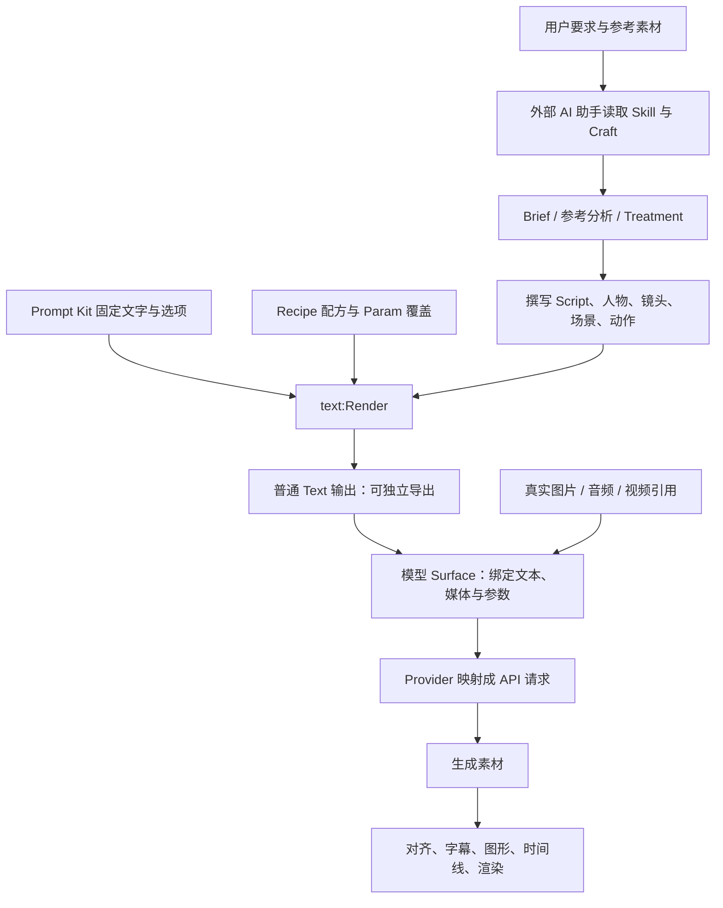

# Hypit 安装与 Prompt 生成机制拆解

日期：2026-09-18。源码版本：0.2.5，commit `5a367dd585ddb1d68e3efeaed5599f3e1ff04d5a`。

来源：[固定版本仓库](https://github.com/hypit-ai/hypit/tree/5a367dd585ddb1d68e3efeaed5599f3e1ff04d5a)。本文覆盖安装、官方 Skill 的提示词写作方法、8 套 Prompt Kit、文本编译、模型端口和 HypiHub 请求映射；不代表审计了全部仓库或验证了云端模型效果。

事实分类：代码与本地测试结果为 `verified_fact`；项目的审美建议为 `source_view`；对用户业务的迁移建议为 `candidate`。来源核验不使其自动成为用户的活动生产规则。

## 1. 已安装到什么程度

| 项目 | 位置或实测结果 |
| --- | --- |
| 完整源码及工作区依赖 | `F:\820\hypit`，135 个 workspace，378 个外部依赖安装完成 |
| 固定运行版本 | Node 24.14.1；按项目锁定的 pnpm 10.33.0 安装；Hypit 0.2.5 |
| 命令行 | 新终端可使用 `hypit --version`；启动器位于用户 npm 全局命令目录 |
| 官方 Codex Skill | `G:\Codex\UserData\.codex\skills\hypit`，安装自相同 commit |
| 独立演示工程 | `F:\820\hypit-lab` |
| Studio | 已启动于 `http://localhost:4317/`，HTTP 200；尚未逐项测试浏览器交互 |
| 本地运行配置 | `F:\820\hypit-lab\hypit.runtime.json`，仅本地媒体处理和渲染 |
| FFmpeg / FFprobe | 使用 `F:\Knowledge-Tools\ffmpeg` 下的现有程序 |
| 渲染浏览器 | 官方指定 Chrome Headless Shell 152.0.7928.2，位于 `F:\820\hypit-browser-cache` |
| 机器级工具包 | Hypit 默认 Host 目录 `%LOCALAPPDATA%\Hypit\packages`；不属于知识库 |
| 云端生成 | 未连接生成账号；没有调用付费图像、视频、声音模型；本地 WhisperX 未配置 |

已完成 TypeScript 检查、29 项与文本模板/生成端口/请求映射相关的上游测试。没有运行或声称通过整个项目测试套件。

实际构建证据：

- Prompt 构建：`bld_20260918T080100400Z_0864ECFA37`，两个文本输出，外部请求 0。
- 视频构建：`bld_20260918T080222593Z_39E6DFABD1`，官方聊天动画示例，3 个本地请求。
- 成片：[hypit-demo.mp4](F:/820/hypit-lab/outputs/hypit-demo.mp4)，8 秒，540×960，30 fps，H.264 + AAC。完整解码通过，已查看第 6 秒画面；没有对整段视频做人工逐帧观看或听音验收。
- 成片 SHA-256：`381033c3159befe7568cc97711a6881f2c254dd946b6e9c60119fa79ef94e5fe`。
- 源码 `git status --short` 为空；分析脚本、素材和运行状态均在独立工程，未修改上游跟踪文件。

## 2. 最关键的结论：这里有两种“提示词”

**第一种是写给 Codex / Claude 等外部助手的工作指令。** `skills/hypit/SKILL.md` 和按需读取的参考文档教助手怎样看视频、分析结构、选择人物、编台词、写镜头与动作。这一层承担创作判断。

**第二种是送给图像、视频、声音模型的具体请求文本。** AI 助手把当前作品的内容写入 `.svml`，选择 `.svs` 模板与配方，Hypit 用确定性的程序拼接、校验，再送给模型 Provider。

已追踪的默认链路没有一个独立的“自动润色 Prompt 的 LLM 调用”。`@hypit/text` 本身不调用模型，也不理解“爆款”或“好看”；它只是通用文本程序。不同助手会写出不同的素材描述；相同模板、相同绑定和相同版本则会得到相同的组装文本。



## 3. Prompt 写作的上游：AI 助手究竟学到了什么

证据入口：[官方 Skill](F:/820/hypit/skills/hypit/SKILL.md:73)、[Brief 与 Treatment](F:/820/hypit/skills/hypit/references/creation/brief.md)。

`BRIEF.md` 保存用户目标、事实、素材、要替换的内容、预算和限制；`TREATMENT.md` 保存助手的创意回答，包括故事推进、Hook、反转、人物、场景及每个画面系统的作用。这些文件是工作约定，不是程序自动收集并拼到每条 API Prompt 的字段。

对参考视频，Skill 要求看整体、抽取相关画面、结合转录与时间观察剪切、揭示和动作响应什么内容，然后重建这种关系。例如“某词说出口时显示排名”，新版本应跟随新台词中的对应语义，不能只沿用旧视频第几秒。执行这些分析的是外部助手与转录/媒体工具，不是 Prompt Kit 自己看懂了视频。

这套方法最有价值的部分是职责分离：

| 内容 | 应放的位置 |
| --- | --- |
| 让谁看、为什么看、主张和叙事目的 | Brief / Treatment |
| 人物外观、环境、空间关系 | 图像 Prompt 和参考图 |
| 逐字台词和发音 | Script |
| 说话态度、重点反应、动作 | 视频 action 文本 |
| 字幕、排名板、贴图、揭示动画 | 后期组件和语义时间线 |
| 比例、清晰度、时长、参考资源 | 模型 Surface 的显式参数和资源连接 |

因此，“让人物为左侧排名板留空间”要翻译成镜头中的人物位置；排名板的具体文字和动画由组件完成。笼统地要求生成模型“展示这个概念”，可能让模型生成不需要的物品或文字。

## 4. 图片 Prompt：四段式，只有第一段写死

实际模板：[phone-ugc-v1.svs](F:/820/hypit/packages/gpt-image-kits/kits/phone-ugc-v1.svs:8)。

最终图片文本是：

```text
固定 Capture 段落

Person：当前人物或多人的描述

Shot：镜头、姿势、朝向、动作、与物品的关系

Setting：地点、整体色彩、少量关键空间结构
```

Capture 段落规定：像真实 iPhone 视频中的一帧、自然细腻皮肤与自然光、背景清楚、没有景深虚化、不油腻不过度处理、整体连贯无伪影。这个版本逐字保留该段，不提供一个“随便改 Capture”的参数；要变成插画或其他摄影形式，应选择或自建另一模板。

`person` 可省略，`shot` 必填，`setting` 可省略。参考图已经建立身份或场景时，允许省掉重复描述。程序按 `order` 排序，用空行拼接，不会给省略的可选段落留空白占位。

**人物、镜头和场景内容来自助手写作，不是模板从商品名自动推出来的。** 模板没有年龄识别、人群推断或选景算法。

[Image direction](F:/820/hypit/skills/hypit/references/playbooks/craft/image-direction.md:67) 提供的写作倾向包括：

- 用少量有决定性的文化/审美词组织造型，避免把每个偶然细节都变成约束。
- 对其虚构真人社交视频风格，强调吸引力、肩宽和头肩比例；这些是作者的审美经验，不是技术必填字段。
- 写清人物在画面中的位置、与镜头距离、姿态、视线、物品关系。
- 先决定整体色彩和能体现空间的门、桌子、栏杆等结构，再补必要纹理。
- 不把“真实”机械等同于暗光、粗糙皮肤、噪点或疲惫。
- 参考图负责已有事实，文字说明哪些事实要保留、哪些关系要改变。

已导出的实例：

- [本次印尼人物示例的完整图片 Prompt](F:/820/hypit-lab/outputs/image-prompt.txt)。这是文本组装演示，未生成该人物图片。
- [官方足球排名案例的完整图片 Prompt](F:/820/hypit-lab/outputs/official-football-image-prompt.txt)。从官方源码原有三个段落提取，调用上游 `renderText` 得到，保留其原始审美设定；未调用模型。

## 5. 口播视频 Prompt：十块内容组成

实际模板：[speaker-v1.svs](F:/820/hypit/packages/seedance-kits/kits/speaker-v1.svs:13)。

| 顺序 | 内容 | 来源 |
| --- | --- | --- |
| 10 | 竖屏手机口播；图 1 负责人物与场景，音频 1 负责声线 | 固定 |
| 20 | 按顺序逐字说台词，口型同步，不增删改写 | 固定 |
| 30 | 构图稳定程度 | `composition-stability` |
| 40 | 镜头运动 | `camera-motion` |
| 50 | 连续拍摄或短暂停顿跳剪节奏 | `edit-rhythm` |
| 60 | 说话状态和整体表演方式 | `performance` |
| 70 | 肢体表达程度 | `gesture` |
| 80 | 脸、手、光影稳定；不生成字幕或悬浮文字 | 固定 |
| 90 | `SCRIPT TO DELIVER` 下的逐字台词 | 必填 `dialogue` |
| 100 | 当前段落的表演与动作意图 | 可选 `action` |

五个可选轴和默认值：

| 参数 | 默认 | 其他可选值 |
| --- | --- | --- |
| composition-stability | soft-locked | flexible-ugc、strict-locked |
| camera-motion | none | subtle-punch-in-return |
| edit-rhythm | continuous-take | pause-trim-jump-cuts |
| performance | natural-explainer | high-energy-ugc、calm-authority、reactive-playful |
| gesture | natural | restrained、compact、expressive |

这里有一个实用差异：**模板省略参数时默认连续镜头，但 Skill 对普通社交口播建议显式选择 pause-trim-jump-cuts。** 推荐写法和代码默认值不一样，不能只看其中一处。

这些轴有 3×2×2×4×4＝192 种语法组合，但不等于 192 个有效视频，更不代表不同组合一定提升播放量。组合是否自洽仍由创作者判断和成片验证。

`action` 最重要的写作规则是“让意义驱动动作”。例如一段台词在质疑某事，先写“像向朋友表达带点调侃的怀疑”，再指定关键短语处眉毛抬起或轻微前倾。这样声线、表情和动作有同一目的，而不是每句话硬安排一个手势。来源：[Video direction](F:/820/hypit/skills/hypit/references/playbooks/craft/video-direction.md:12)。

动作必须属于实际场景。人物说到一个物品，不等于该物品需要凭空出现；动作描述中的比喻也可能被模型按字面画出来。“不生成字幕”的约束不能补救一个语义含糊的展示要求。

## 6. Script 怎样成为生成模型真正读到的台词

常见连接是：

```svml
<text:Set name="dialogue" text={story.segment.hook.dialogue}/>
```

Script 会导出不同视图：`dialogue` 保留角色名和实际发音文本，`speech` 去掉角色标签，字幕视图使用显示文本。`||` 字幕分组和语义标记不是照抄到模型台词里的装饰符。

例如官方足球案例把 `<D | Dee>` 写成“屏幕显示 D，实际念 Dee”，同理 S / Ess。这样可独立控制字幕拼写与发音，降低缩写被读错的风险。来源：[Script manifest](F:/820/hypit/packages/script/src/manifest.ts:38)、[序列化实现](F:/820/hypit/packages/script/src/narrative.ts:120)。

本次实际输出中对应的一段为：

```text
SCRIPT TO DELIVER:
HOST: Aku mau tunjukkan satu hal sederhana. Perhatikan bagian ini.
```

这段印尼文只是安装验证用的原创台词，不是任何 SKU 的已审核销售文案。

## 7. 8 套官方 Kit 不是同一模板换标题

| Kit | 主要关系 | 动态内容和参数 |
| --- | --- | --- |
| phone-ugc-v1 | 手机实拍感图片 | person / shot / setting |
| speaker-v1 | 单人口播，图 1 + 声音 1 | dialogue / action + 五轴 |
| broll-v1 | 无口播的视觉事件 | story + 材质、故事形态、剪辑、运镜、运动强度 |
| podcast-v1 | 两个固定机位、A/B 两人各自声线 | dialogue / action + 构图、剪辑、语速节奏、表演、听众反应、手势 |
| call-v1 | 两张主画面/小窗位置互换的视频通话界面 | 同样有双人控制，但增加两个窗口均为活动画面的约束 |
| street-interview-v1 | 采访者、受访者、双人共景三张固定参考 | 角色、持麦归属、只在三个机位间切换，以及互动表演 |
| motion-reference-v1 | 图 1 的人物迁移视频 1 的身体动作 | 可选 direction；明确排除复制参考运镜 |
| camera-reference-v1 | 图 1 的人物迁移视频 1 的摄影和运镜 | 可选 direction；明确排除复制参考身体动作 |

双人模板强调当前说话者动嘴，听众保持无声但有反应；街访模板固定采访者持麦和递麦关系，防止人物/物品角色漂移。动作迁移与运镜迁移分别明确“迁移什么、排除什么”，这是比泛泛的“参考这个视频”更有信息量的写法。

全部模板的固定措辞、选项及默认值已由上游解析器导出到 [prompt-kit-inventory.json](F:/820/hypit-lab/outputs/prompt-kit-inventory.json)。版本升级后可运行 [trace-prompts.ps1](F:/820/hypit-lab/trace-prompts.ps1) 重新生成并比较。

## 8. 程序内部如何把这些内容拼起来

### 8.1 .svs 转成有限文本表达式

[textTemplateFromSvsRecipes](F:/820/hypit/packages/text/src/svs.ts:115) 读取 `text-template.<id>` 及其 block/choice：

- `fixed` → literal，原样文字；
- `slot` → 当前绑定，必要时添加字面标题；可选槽位用 present 判断；
- `axis` → 参数值与 choice ID 精确匹配；
- `variant` → 所有声明条件同时满足的分支；
- 按非负、不可重复的 `order` 排序，段落间 `\n\n` 连接。

底层通用表达式还支持顺序连接、列表遍历、替换、大小写/空白变换、子模板调用等；这不表示每个 `.svs` Kit 都暴露了这些操作。模板会检查调用循环，避免递归无限展开。

### 8.2 确定参数和图中的文本依赖

[decodeTextRenderSurface](F:/820/hypit/packages/text/src/surface.ts:123) 处理 `<text:Render>`：

1. 读取可选 Recipe，但只投影模板真正消费的属性；例如不相关的模型名/分辨率不会变成 Prompt 控制参数。
2. 读取 `<text:Param>`，覆盖同名 Recipe 值；显式 Param 重复会报错。
3. 把 `<text:Set>` 和 `<text:Append>` 变成有序的文本依赖。
4. [createTextRenderFragment](F:/820/hypit/packages/text/src/fragment.ts) 先逐个绑定，再运行 render。
5. [renderText](F:/820/hypit/packages/text/src/program.ts:407) 最后合并模板默认值与输入绑定，执行纯文本表达式，输出普通 `Text { value }`。

标量优先级为：**模板 defaults < Recipe < 显式 Param**。

重要边界：`Set` 不是通用的覆盖操作。[bindText](F:/820/hypit/packages/text/src/program.ts:230) 遇到已经设置的同名绑定会报错；`Append` 会形成列表，需要模板用列表语义消费，不能假定往普通单值槽位里 Append 就会自动接成长字符串。参考文档中简略的“replace”措辞，应以此版本代码为准。

### 8.3 校验的范围

缺必填槽位、未知输入字段、非法选项、多个同时命中的 choice、没有命中且没有 otherwise 的 choice、递归调用等都会失败。`variant` 也不自动意味着“不匹配就省略”：当前转换器生成 choice，没有 otherwise 时零命中会报错。

这些检查保障文本程序结构正确，**不检查人物是否适合受众、动作是否自然、商品是否真实、商业说法是否有证据**。把参数拼对只是第一层验证。

## 9. 最终 Prompt 怎样传到模型 API

`text:Render` 输出可以单独作为 Run Target，或通过 `prompt={...}` 连接 `gpt:Image` / `seedance:ReferenceVideo` 等 Surface。

[Seedance Surface](F:/820/hypit/packages/seedance/src/surface.ts:298) 把文本引用、媒体引用、时长和分辨率变成显式图输入；[bindGenerationText](F:/820/hypit/packages/generation/src/request.ts:375) 将 `text.value` 放进模型端口；最终 request 校验端口类型、数量、长度和组合规则。

[HypiHub 映射](F:/820/hypit/packages/provider-hypihub/src/mapping.ts:15) 再通过 [compileWireRequest](F:/820/hypit/packages/generation/src/mapping.ts:113) 转成服务字段：

```text
ports.prompt[0]      → input.prompt（文字原样）
duration            → seconds
aspectRatio         → aspect_ratio
referenceImage      → reference_image_urls
referenceAudio      → reference_audios
generateAudio       → generate_audio
```

这个映射没有语义润色步骤。服务端或底层模型是否另有内部处理，开源客户端不能证明。

“@image1 是人物”“@audio1 是声线”只是模板文字，实际请求必须另有匹配顺序的图片/音频资源。写出名字并不会自动上传文件或从电脑里找到它。Prompt Kit 本身也不负责模型选择、账号连接或计费。

在本次版本中 GPT Image 2 的 prompt 上限为 20,000 字符；Seedance 非 2.5 为 20,000，2.5 为 30,000；这些是此 commit 的模型端口规则，不保证所有代理服务都接受完全相同的限制。应通过安装版本的 vocabulary 和选定 Provider 再核实。

另外，普通 `@hypit/gpt-image@1` 的 Image 不会暗中追加降噪；显式导入 `@hypit/gpt-image/clean@1` 才增加可见的后处理节点。不要把后处理效果误归功于 Prompt。

## 10. 这次本地实验验证了什么

演示文件：[prompts.svml](F:/820/hypit-lab/prompts.svml)、[prompts.svs](F:/820/hypit-lab/prompts.svs)、[prompts.svrun](F:/820/hypit-lab/prompts.svrun)。

Recipe 中故意配置 `gesture: expressive`，调用处写：

```svml
<text:Param name="gesture" value="restrained"/>
```

实际导出：[video-prompt.txt](F:/820/hypit-lab/outputs/video-prompt.txt)，包含：

```text
GESTURE: restrained body language; let face, eyes, and voice carry the meaning.
```

验证了 Param 覆盖 Recipe；`strict-locked`、`pause-trim-jump-cuts` 则来自 Recipe。台词由 Script 的 dialogue 视图产生。图片 Prompt 的固定首段来自官方 Kit，其余三段来自演示 Source。

本次运行只要求这两个文本 Target，规划为 0 个外部请求，成功导出文本；因此提示词可以先本地审阅，再决定是否接到付费生成节点。这是实际跑通的能力。

要复现：

```powershell
cd F:\820\hypit-lab
hypit check prompts.svrun
hypit plan prompts.svrun
hypit build prompts.svrun --follow
# 使用上一步新返回的 Build ID：
hypit get <Build-ID> --output video-prompt --to outputs/review-prompt
```

Text 导出目的地是一个包含 `value.json` 的目录；文本位于 JSON 的 `value.value`，不是裸 txt。报告里提供的 txt 是从这个真实结果抽取的便利查看版。视频输出则直接导出为 MP4。

安装验证中曾把 Source 路径误写为 `@hypit/seedance-kits/speaker-v1`，已修正：**导入路径叫 `speaker`，导出模板 ID 才叫 `speaker-v1`**。复现时区分文件名、包导出路径与模板 ID。

## 11. 对你现有 TikTok 工作流的价值与边界

适合保留为候选方法的三项：

1. **分开固定约束与当前任务内容。** 把真实感、机位、禁用叠字等稳定方向放进版本化模板；SKU、人群、场景、动作由当前事实决定。
2. **先导出最终 Prompt 再提交模型。** 同时核对参考素材顺序、实际文件、台词和生成参数，避免只审查零散片段。
3. **按语义事件组织后期。** 字幕和揭示动作跟随词义与真实词级时间，换台词后有机会复用结构；仍需转录/对齐和成片检查。

不自动采用的内容：官方对特定美貌、年龄、文化风格、模型、分辨率和服务的偏好；生成模型重画真实包装；把普通口播任务默认改成 Seedance；把一次技术安装当作批量内容生产获批。你的现行人物适配、真实商品锁层、最终音频和样片审核规则继续约束业务任务。

本次“安装 Hypit 并分析 Prompt”授权了本地安装和研究，没有要求恢复所有云端生成路线。官方 Skill 的 Seedance 示例作为技术材料保留，不能据此覆盖内容系统中已有的工具选择规则。

还有两个效果层面的限制：固定文案写“逐字说”不保证模型零错字；写“保持包装”不保证零形变。官方展示的批量变体能力与播放量宣传也不能证明你的 SKU 会有相同结果。本次没有这类业务效果证据。

## 12. Skill 路由、复用与后续停止条件

- `knowledge-distillation`：保存来源卡、明确范围的源码全文快照、技术报告、缺口与日志。
- `tiktok-content-system`：加入 Hypit 技术研究参考路由；Prompt 导出和本地安装结论已验证，创意效果与业务迁移仍为候选，不替代已有生产路线。
- 官方 `hypit`：作为已安装的专项工具 Skill，供明确的 Hypit 任务读取；下一轮应可发现，若当前会话仍没有刷新则新建会话。
- 输入：明确的视频 Brief、适合的模板、真实参考素材，以及必要时已授权的生成账户。
- 检查：版本、Template/Recipe/Param、实际文本、素材顺序与身份、模型参数、请求计划、产出检查。
- 停止对应生成分支：缺真实商品、引用不明、账号/额度未接通、出现意外远端请求、模板与目标冲突，或需要超出现有范围的付费生成。
- 反馈：记录所用 commit、完整 prompt、配方、参考哈希、实际模型/服务、结果版本及用户对效果的判断；不能只记录“这句话有效”。

再次开启 Studio：运行 `F:\820\hypit-lab\start-studio.ps1`，或在演示目录执行 `hypit studio --run chat.svrun --port 4317`。已经有该端口的 Studio 时直接打开页面。
